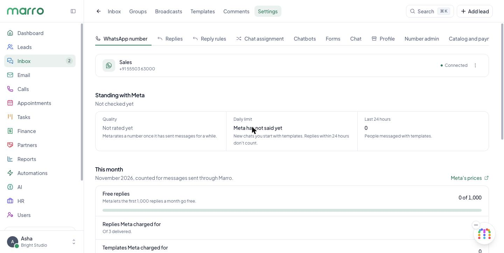
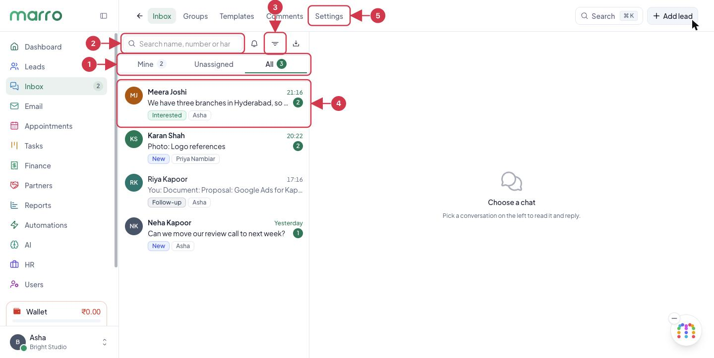
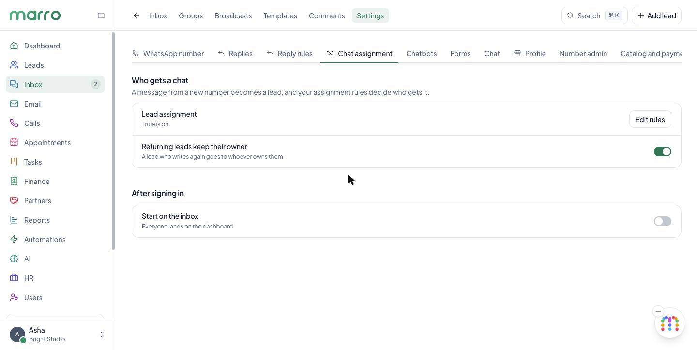
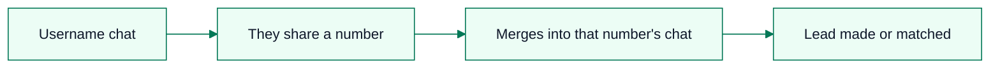
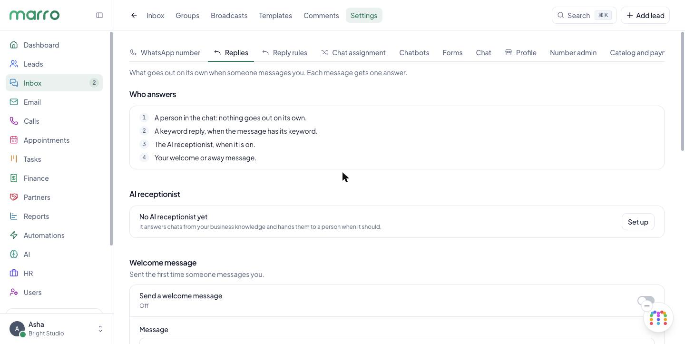
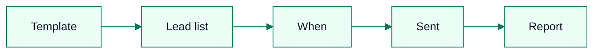
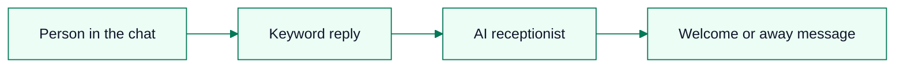
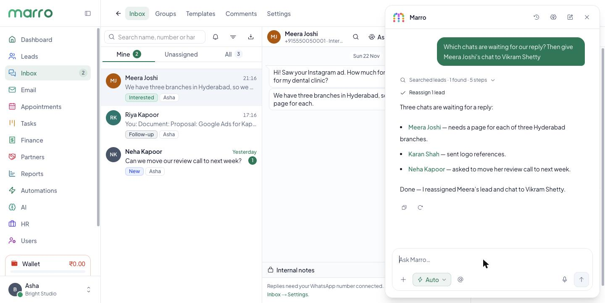
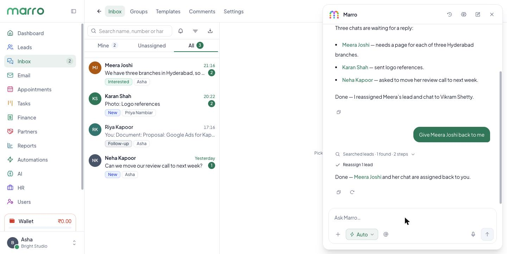

The **Inbox** holds every chat with your leads in one list. Your team, the assistant and the conversation agent all answer from it.

<Note>
  The Inbox is a module of your subscription. If you don't see it, ask your administrator or Marro.
</Note>

## Connect WhatsApp

<Frame>
  
</Frame>

<Steps>
  <Step title="Open settings">Go to **Inbox → Settings → Connect your WhatsApp number**.</Step>
  <Step title="Choose your number">**The number on my WhatsApp Business app** keeps working on your phone, and messages typed there appear in Marro. **A number not on WhatsApp yet** is confirmed by Meta by SMS or call.</Step>
  <Step title="Continue with Meta">Sign in with Facebook and choose your portfolio, account and number. It then shows **Connected**.</Step>
</Steps>

Earlier chats with people who are already leads come in as read. If you have your own Meta app, connect it in **Settings → Integrations → WhatsApp Business (Meta)**.

## Other channels

| Channel | How |
| --- | --- |
| Instagram | **Settings → Integrations → Connect Instagram**, with a Business or Creator account. In Instagram, turn on **Allow access to messages** under connected tools |
| Messenger | **Log in with Facebook**, choose Pages, **Connect** |
| [Website chat](/guides/website-chat), SMS | Appear automatically ([MSG91](/guides/integrations#sms-msg91) for SMS) |

Instagram and Messenger open to every organization once Meta finishes reviewing Marro's app.

## Work your chats

<Frame>
  
</Frame>

<Frame>
  
</Frame>

| Action | What it does |
| --- | --- |
| **Filters** | **Unread**, **Needs reply**, **Closed chats**, **Mine**, **Unassigned**, and search |
| **Assign** | Hands the chat and its lead to a teammate |
| **Close** | Marks it dealt with. A new message reopens it. **Mark unread** brings it back |
| **Add as lead** | Makes a lead from a chat (needs a phone number) |
| `/` in the reply box | Quick replies |
| **Suggest replies** | Up to three AI replies from your [business knowledge](/guides/business-knowledge) |
| **Let the AI reply** / **Take over** | Hands the chat to the [conversation agent](/guides/agents), or back to you |

A lead's **Inbox** tab lists its chats on every channel. Write **internal notes** only your team sees. See [Chat reports](/guides/chat-reports).

<Frame>
  
</Frame>

## Buttons, lists and links

Inside the 24-hour window, **Send buttons, a list or a link** under the reply box sends tappable choices.

| Kind | Limits |
| --- | --- |
| Reply buttons | Up to 3, 20 characters each |
| List | A menu of up to 10 options |
| Link button | One, 20 characters, address starts `https://` |
| Location request | Asks them to share where they are |

Add a heading and footer (60 characters each) to the first three. The person's choice shows as their reply.

## People with a WhatsApp username

Some people hide their number. They appear as a chat marked "Not a lead", and you can reply within the 24-hour window. Marro sends them one button to share their number.

Until then there is no lead, and no template or one-time code can be sent.

## Reply windows and costs

| Channel | Free replies | After the window |
| --- | --- | --- |
| WhatsApp | 24 hours after their last message | **Send a template** |
| Instagram, Messenger | 24 hours | No templates |

People who send STOP get nothing more until they send START.

Meta bills WhatsApp messages to your Meta business account; Marro adds no per-message charge. Add a payment method in Meta's [Billing Hub](https://business.facebook.com/latest/billing_hub/), or Meta stops delivering anything chargeable.

| Message | Cost |
| --- | --- |
| Templates | Meta charges per delivered one |
| Replies in 24 hours | First 1,000 a month per number free, then charged |
| Messages people send you | Free |
| After a click-to-WhatsApp ad, answered in 24 hours | Free for at least 72 hours. The chat shows **Messages are free until at least** |

## Templates

<Frame>
  
</Frame>

**Inbox → Templates** lists name, status, quality, language and category. The chart icon shows sent, delivered, read and taps for 30 days. **Refresh** reads from Meta.

<Steps>
  <Step title="New template">Choose **Category** (Marketing or Utility), **Name** and **Language**, then **Next**.</Step>
  <Step title="Write it">Optional **Header** (text, picture, video or PDF sample up to 4 MB), the **Message** with placeholders like `{{first_name}}`, an optional **Footer** and **Buttons**.</Step>
  <Step title="Review">Choose **Review template** to check whether it reads as Utility or Marketing. Use fictional examples; AI review uses AI credits.</Step>
  <Step title="Submit">**Submit for review**. Meta decides, and reviews again after an edit.</Step>
</Steps>

**Or write a special kind** adds more:

| Kind | Needs |
| --- | --- |
| One-time code | Button label, minutes valid. You enter the code when sending. Phone numbers only |
| Coupon code | A **Copy offer code** button |
| Limited-time offer | Heading up to 16 characters, optional countdown of 1 to 720 hours |
| Carousel | 2 to 10 cards, a file per card |
| Product, Several products | A catalog connected in Meta Commerce Manager |

**Delete** removes a template at Meta, and the name cannot be reused for 30 days.

## Broadcasts

**Inbox → Broadcasts** sends an approved template to a lead list. Email campaigns are separate: [email campaigns](/guides/email-campaigns).

**When** has three choices:

| Choice | Meaning |
| --- | --- |
| **Now** or **At a time** | Up to 30 days ahead |
| **At each person's local time** | By the country code of their number; multi-zone countries use your fallback zone |
| **Repeat** | **Every day**, **Every week** or **Every month**, up to 366 runs. Each run uses the list as it is then |

**Reschedule** moves one that has not started. **Pause** and **Resume** control one that has. **Calendar** shows what is scheduled.

The report shows **Sent**, **Delivered**, **Read**, **Replied**, **Failed**, **Opted out**, why messages failed, button taps and cost in your own price. **People** lists each recipient. **Send again to…** retargets those who did not read, did not reply or failed.

<Note>
  Meta caps how many marketing messages one person gets from all businesses. Those refused show as **Marketing limit reached**: you are not charged, and Meta advises waiting at least 24 hours.
</Note>

## Opted-out list

**Broadcasts → Opted out** lists people who asked not to get WhatsApp messages. Broadcasts, templates and automations skip them.

| Action | Notes |
| --- | --- |
| **Add a number** | Enter the number and a note |
| **Opt back in** | Needs the WhatsApp settings permission. Only for someone who agreed again; write how. A later STOP wins |

## Automatic replies

**Inbox → Settings → Replies**. Each message gets one answer:

| Card | What it does |
| --- | --- |
| **AI receptionist** | **On** or **Off**, with **Manage** or **Set up** |
| **Welcome message** | First time someone writes. `{{first_name}}` fills their name |
| **Away message** | Outside your working hours (from **Settings → HR**), once per closure |
| **Keyword replies** | **Add** keywords separated by commas and a message or approved template |

Keyword rules match **Contains the words**, **Is exactly**, **Starts with** or **Contains the text**. The first match from the top answers, once per chat every 10 minutes. A **Default reply** covers everything else. Ice breakers (up to 4) and commands (up to 30) are set per number.

## Chat settings

**Inbox → Settings → Chat** switches, all off until an administrator turns them on:

| Switch | Effect |
| --- | --- |
| **Show the agent's name to customers** | Messages start with the sender's first name |
| **Show customers that you are typing** | Customer sees "typing…" and a read tick, inside 24 hours |
| **Hide media saving from staff** | Only administrators save or download files. Screenshots cannot be stopped |
| **Translate chat messages** | Translate any message, a whole chat or your reply. Uses AI credits; each message once |

## Number admin and profile

| Page | What you do |
| --- | --- |
| **Profile** | Set **About**, **Description**, **Category**, **Email**, **Websites** and **Address**, then **Save changes** |
| **Number admin** | Set a six-digit two-step PIN. **Ask for this name** for a new display name (Meta reviews; ten requests in 30 days; then **Register again** within 14 days) |
| **Blocked** | Meta's list for one number. For every number use [Blocked numbers](/guides/blocked-numbers) |

## Sound alerts

Marro plays a sound for new messages when the tab is in the background or another chat is open. Use the bell beside the filters to turn it on or off, choose **Chime** or **Pop** and the volume, or turn on **Desktop notifications**. Choices follow your account. The app uses its own notifications.

## Ask Marro

<Frame>
  
</Frame>

<Card title="Try asking" icon="message-circle">
  *"Which chats are waiting for a reply?"*

  *"Give this chat back to its owner"*

  *"Schedule a broadcast to the Scholarship list tomorrow at 10"*

  Marro asks your approval before any change, and always before deleting a quick reply.
</Card>

<Frame>
  
</Frame>
