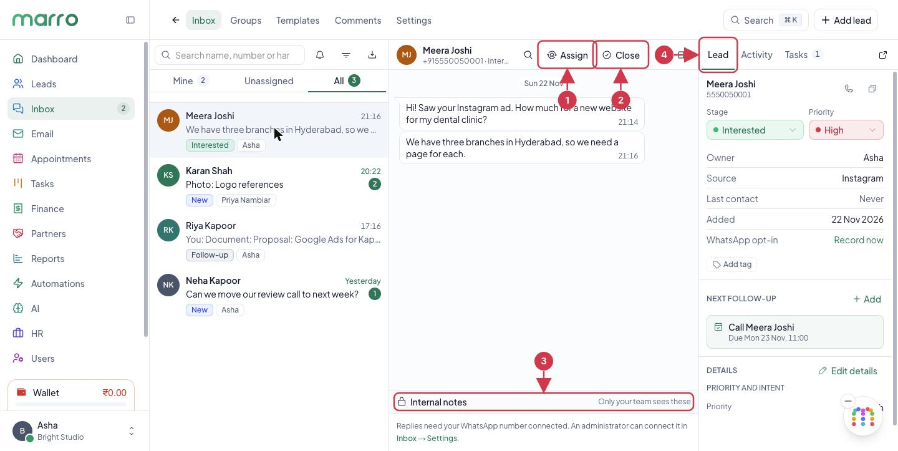

import { Flow } from "/snippets/flow.jsx";

The **Inbox** holds every chat with your leads in one list. Your team, the assistant and the conversation agent all answer from it.

<Note>
  The Inbox is a module of your subscription. If you don't see it, ask your administrator or Marro.
</Note>

## Set up your Inbox

Choosing **Inbox** in the main sidebar slides it to the Inbox's own menu: **Inbox**, **Comments**, **Broadcasts**, **Templates**, **Groups** and **Settings** with its pages. **Back to app** returns to the main menu; on a phone the menu opens from the **Menu** button.

<CardGroup cols={2}>
  <Card title="WhatsApp number" icon="phone" href="/guides/whatsapp-number">Connect your number, see its standing with Meta, staff alerts</Card>
  <Card title="WhatsApp templates" icon="file-text" href="/guides/whatsapp-templates">Write and send templates for Meta's review</Card>
  <Card title="Chat assignment" icon="users" href="/guides/chat-assignment">Who gets a new chat, and returning leads</Card>
  <Card title="Replies and reply rules" icon="reply" href="/guides/whatsapp-replies">AI receptionist, welcome, away and keyword replies</Card>
  <Card title="WhatsApp contacts" icon="tag" href="/guides/whatsapp-contacts">Tags, attributes, segments, imports and downloads</Card>
  <Card title="WhatsApp groups" icon="users-round" href="/guides/whatsapp-groups">Groups and their members</Card>
  <Card title="Chatbots and flows" icon="bot" href="/guides/whatsapp-chatbots">Automated conversations and forms</Card>
  <Card title="Catalog" icon="shopping-bag" href="/guides/whatsapp-catalog">Products customers can browse</Card>
</CardGroup>

## Other channels

| Channel | How |
| --- | --- |
| Instagram | **Settings → Integrations → Connect Instagram**, with a Business or Creator account. In Instagram, turn on **Allow access to messages** under connected tools |
| Messenger | **Log in with Facebook**, choose Pages, **Connect** |
| [Website chat](/guides/website-chat), SMS | Appear automatically ([MSG91](/guides/integrations#sms-msg91) for SMS) |

## Use several WhatsApp numbers

An organization can connect more than one WhatsApp number. In **Inbox → Settings**, choose **Add a number** and go through the same Meta window. Your other numbers keep working, and every chat from every number arrives in the same Inbox.

- **One chat for each number and person.** Someone who writes to two of your numbers has two chats, linked to the same lead and the same owner. Each chat shows the number it is on, and you can filter the Inbox by number.
- **A reply goes from the number the customer wrote to.** The box above the reply shows **From** that number, and you can't change it inside a chat. The 24-hour window belongs to that number too: if they wrote to Admissions yesterday, you can reply freely there, but not from Sales.
- **Templates** belong to a number's WhatsApp Business account, so a template sent in a chat is the one approved on that chat's number. Starting a chat from a lead who has none asks which number to send from.
- **STOP applies to every number.** Someone who sends STOP to one number gets no more messages from any of them until they send START.
- **Default number.** Messages that are in no chat, such as reminders and portal codes, go from the default number. The first number you connect is the default; change it from the number's menu with **Make default**. Adding a number doesn't change it.
- **Broadcasts** are sent from one number you choose first, and stay on it, even if scheduled or paused.
- **Name a number** (**Rename**) so your team can tell them apart. Customers don't see the name.
- **Disconnecting a number** leaves its chats in the Inbox to read, but nobody can reply on them, and nothing arrives on it. Connect the same number again and its chats pick up where they were.
- **Staff alerts** come from one number at a time, and the assistant on WhatsApp uses the default number.

Each WhatsApp Business account has its own payment method in Meta. A number on another account needs one too, and connecting it doesn't prove it can send.

## Work your chats

<Frame>
  
</Frame>

<Frame>
  
</Frame>

| Action | What it does |
| --- | --- |
| **Filters** | **Unread**, **Needs reply**, **Closed chats**, **Mine**, **Unassigned**, and search |
| **Assign** | Hands the chat and its lead to a teammate |
| **Close** | Marks it dealt with. A new message reopens it. **Mark unread** brings it back |
| **Add as lead** | Makes a lead from a chat (needs a phone number) |
| `/` in the reply box, or the lightning button | Quick replies: search by name or any word in the reply, choose with the arrows and Enter. `{{first_name}}` and `{{name}}` fill in the customer's name. **Manage** adds, edits and removes them, with a preview |
| Paperclip | Attaches a file, or drag one in or paste a screenshot. WhatsApp takes photos, videos, audio and documents. Instagram and Messenger take photos (up to 8 MB), videos and voice notes (up to 25 MB); send anything else as a link |
| Smiley button | Emoji in categories, with the ones you used last on top. |
| **Suggest replies** | Up to three AI replies from your [business knowledge](/guides/business-knowledge) |
| **Let the AI reply** / **Take over** | Hands the chat to the [conversation agent](/guides/agents), or back to you |

A lead's **Inbox** tab lists its chats on every channel. Write **internal notes** only your team sees. See [Chat reports](/guides/chat-reports).

## Buttons, lists and links

Inside the 24-hour window, **Send buttons, a list or a link** under the reply box sends tappable choices.

| Kind | Limits |
| --- | --- |
| Reply buttons | Up to 3, 20 characters each |
| List | A menu of up to 10 options |
| Link button | One, 20 characters, address starts `https://` |
| Location request | Asks them to share where they are |

Add a heading and footer (60 characters each) to the first three. The person's choice shows as their reply.

## People with a WhatsApp username

Some people hide their number. They appear as a chat marked "Not a lead", and you can reply within the 24-hour window. Marro sends them one button to share their number.

<Flow steps={["Username chat", "They share a number", "Merges into that number's chat", "Lead made or matched"]} />

Until then there is no lead, and no template or one-time code can be sent.

## Reply windows and costs

| Channel | Free replies | After the window |
| --- | --- | --- |
| WhatsApp | 24 hours after their last message | **Send a template** |
| Instagram, Messenger | 24 hours | No templates |

People who send STOP get nothing more until they send START.

Meta bills WhatsApp messages to your Meta business account; Marro adds no per-message charge. Add a payment method in Meta's [Billing Hub](https://business.facebook.com/latest/billing_hub/), or Meta stops delivering anything chargeable.

| Message | Cost |
| --- | --- |
| Templates | Meta charges per delivered one |
| Replies in 24 hours | First 1,000 a month per number free, then charged |
| Messages people send you | Free |
| After a click-to-WhatsApp ad, answered in 24 hours | Free for at least 72 hours. The chat shows **Messages are free until at least** |

## Broadcasts

**Inbox → Broadcasts** sends an approved [template](/guides/whatsapp-templates) to a lead list. Email campaigns are separate: [email campaigns](/guides/email-campaigns).

**When** has three choices:

| Choice | Meaning |
| --- | --- |
| **Now** or **At a time** | Up to 30 days ahead |
| **At each person's local time** | By the country code of their number; multi-zone countries use your fallback zone |
| **Repeat** | **Every day**, **Every week** or **Every month**, up to 366 runs. Each run uses the list as it is then |

**Reschedule** moves one that has not started. **Pause** and **Resume** control one that has. **Calendar** shows what is scheduled, by **Day**, **Week** or **Month**, or over a date range you pick (presets such as This week or Last 30 days, or a custom range of up to 92 days).

The report shows **Sent**, **Delivered**, **Read**, **Replied**, **Failed**, **Opted out**, why messages failed, button taps and cost in your own price. **People** lists each recipient. **Send again to…** retargets those who did not read, did not reply or failed.

<Note>
  Meta caps how many marketing messages one person gets from all businesses. Those refused show as **Marketing limit reached**: you are not charged, and Meta advises waiting at least 24 hours.
</Note>

## Opted-out list

**Broadcasts → Opted out** lists people who asked not to get WhatsApp messages. Broadcasts, templates and automations skip them.

| Action | Notes |
| --- | --- |
| **Add a number** | Enter the number and a note |
| **Opt back in** | Needs the WhatsApp settings permission. Only for someone who agreed again; write how. A later STOP wins |

## Chat settings

**Inbox → Settings → Chat** switches, all off until an administrator turns them on:

| Switch | Effect |
| --- | --- |
| **Show the agent's name to customers** | Messages start with the sender's first name |
| **Show customers that you are typing** | Customer sees "typing…" and a read tick, inside 24 hours |
| **Hide media saving from staff** | Only administrators save or download files. Screenshots cannot be stopped |
| **Translate chat messages** | Translate any message, a whole chat or your reply. Uses AI credits; each message once |

## Number admin and profile

| Page | What you do |
| --- | --- |
| **Profile** | Set **About**, **Description**, **Category**, **Email**, **Websites** and **Address**, then **Save changes** |
| **Number admin** | Set a six-digit two-step PIN. **Ask for this name** for a new display name (Meta reviews; ten requests in 30 days; then **Register again** within 14 days) |
| **Blocked** | Meta's list for one number. For every number use [Blocked numbers](/guides/blocked-numbers) |

## Sound alerts

Marro plays a sound for new messages when the tab is in the background or another chat is open. Choices follow your account; the app uses its own notifications.

<Steps>
  <Step title="Open your account">
    Open the user menu at the bottom of the left list and choose **Your account**.
  </Step>
  <Step title="Choose your sound">
    Under **Inbox sound**, switch **Sound for new messages** on or off, pick **Chime** or **Pop**, set the volume and press **Play sample** to hear it.
  </Step>
  <Step title="Add desktop alerts">
    Switch on **Desktop notifications** and allow them when your browser asks.
  </Step>
</Steps>

## Ask Marro

<Frame>
  
</Frame>

<Card title="Try asking" icon="message-circle">
  *"Which chats are waiting for a reply?"*

  *"Give this chat back to its owner"*

  *"Schedule a broadcast to the Scholarship list tomorrow at 10"*

  Marro asks your approval before any change, and always before deleting a quick reply.
</Card>

<Frame>
  
</Frame>
