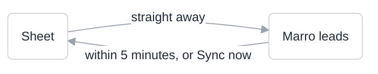

Each organization connects its own accounts. Open **Settings → Integrations** and pick a service; its page has a step-by-step guide. You need permission to manage settings.

| Service | What you get | Guide |
| --- | --- | --- |
| WhatsApp Business (Meta) | Your number in the Inbox: replies, templates, automations, broadcasts | [WhatsApp number](/guides/whatsapp-number) |
| Instagram, Messenger | DMs and Page messages in the Inbox | [Inbox](/guides/inbox#other-channels) |
| Website chat | A chat window on your site | [Website chat](/guides/website-chat) |
| Facebook & Instagram lead ads | Ad leads within seconds | [Below](#facebook-and-instagram-lead-ads) |
| Google Ads lead forms | Form leads within seconds | [Below](#google-ads-lead-forms) |
| Google Sheets | Leads and a sheet kept in step | [Below](#google-sheets) |
| Razorpay | Payment links and recorded payments | [Payments](/guides/payments) |
| MSG91 | DLT SMS and two-way SMS | [Below](#sms-msg91) |
| MCube | Call logging | [Below](#phone-calls-mcube) |
| Google Calendar, Outlook Calendar | Appointments in each person's calendar | [Appointments](/guides/appointments) |
| Zapier, Make, Pabbly Connect, n8n | Marro's events sent to your workflows | [Below](#zapier-make-pabbly-connect-n8n-and-your-own-webhook) |
| API keys | Your own apps read and write leads | [Getting started](/getting-started) |

<Note>
  Instagram messages, Messenger and lead ads open to every organization once Meta finishes reviewing Marro's app. When connecting Instagram, stay signed in to the same Marro account and organization.
</Note>

## Facebook and Instagram lead ads

<Steps>
  <Step title="Log in with Facebook">
    In **Facebook & Instagram lead ads**, press **Log in with Facebook** with the account that runs your Page.
  </Step>
  <Step title="Choose your Pages">
    Pick the Pages your ads run from.
  </Step>
  <Step title="Check your forms">
    Questions are matched to lead fields. Change a match if needed, then press **Done**.
  </Step>
</Steps>

New leads get the source "Facebook ads" or "Instagram ads", go through your assignment rules and start your automations. **Fetch recent leads** brings in the last 90 days.

## Google Ads lead forms

Leads from Search, YouTube, Demand Gen and Performance Max forms arrive within seconds. There is no Google sign-in: Google sends each lead to a web address and key Marro makes for you. Add one connection per account, brand or agency.

<Steps>
  <Step title="Add a connection">
    In **Google Ads lead forms**, press **Add connection** and name it.
  </Step>
  <Step title="Copy the address and key">
    **Connection setup** shows a **Webhook URL** and a **Key**. Keep the key private.
  </Step>
  <Step title="Paste into Google Ads">
    In **Assets**, edit your lead form, choose **Webhook** and paste both.
  </Step>
  <Step title="Send test data">
    Press **Send test data** in Google Ads. The lead shows under **Recent leads**. A test with a phone number becomes "Google test lead"; delete it afterwards.
  </Step>
  <Step title="Check the mapping">
    Under **Forms and field mapping**, questions are already matched. You can also name each campaign there.
  </Step>
</Steps>

New leads get the source "Google ads". A lead needs a phone number. The same phone number (or email) is filled in, not duplicated. If a lead cannot be added, **Recent leads** says why and Marro retries. Disconnecting stops new leads at once: also remove the webhook in Google Ads.

## Google Sheets

Keep a sheet and your leads in step. Marro sees only the sheet you choose, never the rest of your Drive. Each connection is one Google account and one sheet.

<Steps>
  <Step title="Connect a sheet">
    Press **Connect a sheet** and sign in with the owning Google account.
  </Step>
  <Step title="Choose the sheet">
    Pick one, or press **Create a new sheet**. Marro adds a **Marro ID** column: do not delete or edit it.
  </Step>
  <Step title="Check the columns">
    Under **Column mapping**, change a match or set a column to **Not shared**.
  </Step>
  <Step title="Choose the direction">
    Under **Sync settings**, pick **Both ways**, **Sheet to CRM only** or **CRM to sheet only**, and all leads or one saved list. Press **Save and start syncing**.
  </Step>
</Steps>

- A new row with a phone number becomes a lead, assigned by your usual rules. Only empty fields are filled.
- If both sides changed, Marro keeps its value and notes it on the lead.
- Deleting a row never deletes a lead. **Recent activity** shows each sync.
- A list a sheet adds leads to cannot be deleted until the sheet is disconnected.
- Disconnecting stops syncing and withdraws access. The sheet and leads stay.

## SMS (MSG91)

You need an MSG91 account with your sender ID and templates registered on DLT.

<Steps>
  <Step title="Enter your details">
    In **MSG91 (SMS)**, enter **Auth key**, **Sender ID** and **DLT entity ID**.
  </Step>
  <Step title="Add templates">
    Add each template with its MSG91 and DLT IDs, and choose the lead detail that fills each blank.
  </Step>
  <Step title="Test and track">
    Send a test SMS to your phone, then turn on delivery reports in MSG91 with the callback URL and header shown.
  </Step>
</Steps>

Your team sends SMS from a lead's page or automations. Leads who reply STOP get no more.

## Phone calls (MCube)

On the MCube page, copy the **Call events URL** and set it in MCube as the push URL for incoming call events (On Call and On Hangup).

| Call | What Marro does |
| --- | --- |
| Answered | Logs it on the lead (found by phone number, or a new lead with source **Phone call**) under the executive who took it, with talk time and recording |
| Missed | Shows **Missed call**, alerts the owner, and can start automations |
| Any | Appears in **Calls** as **Bridge call · MCube** |

Each executive's phone number in Marro must match the one MCube rings. Exotel and Tata Smartflo calls appear the same way. If a call you start cannot be confirmed it shows **Not confirmed**: check your phone before calling again.

## Zapier, Make, Pabbly Connect, n8n and your own webhook

<Steps>
  <Step title="Paste the webhook URL">
    Create a webhook trigger in your tool and paste its URL into the service's page. For anything else, choose **Custom webhook** with an `https` address.
  </Step>
  <Step title="Choose the events">
    Anything that can start an automation: leads, calls, messages, forms, quotes, invoices, payments, appointments, opportunities and [custom objects](/guides/custom-objects). Search the list.
  </Step>
  <Step title="Send test event">
    Posts a made-up lead so your workflow learns the field names.
  </Step>
</Steps>

Check each event's signature with the **Signing secret** on the page. A failed delivery is retried after 1 minute, 5 minutes, 30 minutes, 2 hours and 8 hours, then dropped. Full details are in [Webhooks](/guides/webhooks).

## Ask Marro

<Card title="Try asking" icon="message-circle">
  *"How many Google Ads leads did we get this week?"*

  *"Sync the Google Sheet now"*

  Marro reads your connections and recent leads, and runs a sync after you approve. It never shows keys.
</Card>

## Being prepared

<CardGroup cols={2}>
  <Card title="Comment replies" icon="message-square" href="/guides/social-comments">Not released yet</Card>
  <Card title="Lead ad attribution" icon="chart-no-axes-combined" href="/guides/lead-ad-attribution">Not released yet</Card>
</CardGroup>
