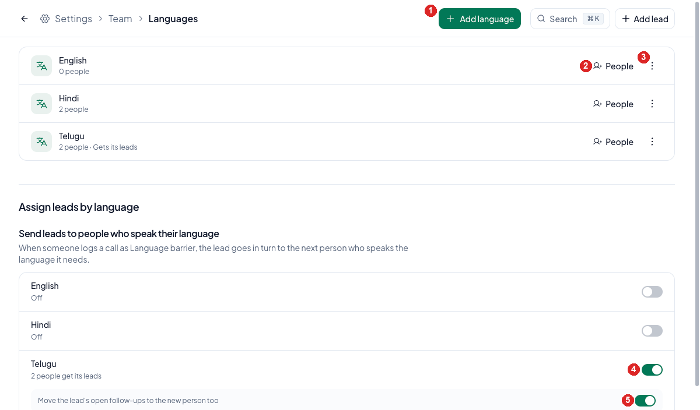
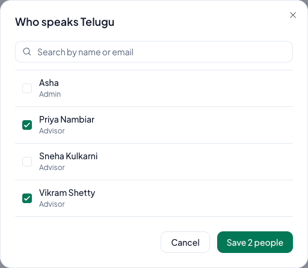
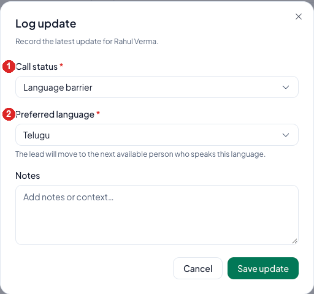

When a lead needs a language the caller doesn't speak, Marro can hand the lead to someone who does. Set it up in **Settings → Team → Languages**.

<Frame>
  
</Frame>

1. **Add language**, such as Telugu.
2. **People**: tick who speaks it.
3. The menu: **Rename**, or **Deactivate** a language you no longer use.
4. Switch a language on to hand its leads to the people who speak it, in turn.
5. **Move the lead's open follow-ups to the new person too**. Off, the follow-ups stay with whoever booked them.

<Frame>
  
</Frame>

## Hand a lead over

On the lead, choose **Update**, then:

<Frame>
  
</Frame>

1. **Call status**: **Language barrier**.
2. **Preferred language**: only languages switched on, with someone who speaks them, are offered.

**Save update** gives the lead to the next person who speaks it. The lead's history records who it went to.

<Note>
New leads are not assigned by language. The handover happens when someone logs a **Language barrier**. To route new leads, use [Lead assignment](/guides/lead-assignment).
</Note>

<Warning>
While a language is switched on, at least one active person must speak it. Marro won't let you untick the last one.
</Warning>
