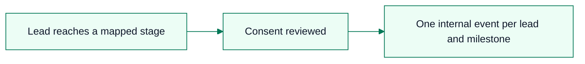

<Note>
Built and awaiting release validation. Sending anything to an ad platform is **off**: no sender exists yet.
</Note>

A lead shows **Ad source** when Meta supplied evidence with a message referral or lead-ad submission. Marro keeps only what Meta sent, and never guesses.

## What you see

| Point | Detail |
| --- | --- |
| Not proof | WhatsApp alone doesn't prove a Facebook ad: a referral can describe an organic post. Missing fields stay unknown |
| First and latest source | The earliest and latest **observed evidence**, by Meta's event time. Not necessarily the person's first marketing contact |
| Before they are a lead | The referral is held safely and linked when the same conversation becomes a lead. No matching by name |
| Not copied | Message text, ad headlines, URLs, pictures, answers, patient details, documents and notes |

Lead-ad submissions keep supplying campaign, ad set and ad names.

## Internal feedback

An organization admin opens **Settings → Ad conversion feedback**.

<Steps>
  <Step title="Map the stages">
    **Qualified** uses an open stage and **Won** uses a won stage. They must differ.
  </Step>
  <Step title="Record consent">
    Opt-in needs reviewed organization consent and a consent-review reference. Each lead also needs a reviewed consent record. Withdrawing is supported and keeps the audit trail.
  </Step>
  <Step title="Save">
    If another admin saved first, refresh and review again.
  </Step>
</Steps>

- Consent must come from reviewed evidence, never from a form being filled in or someone contacting you.
- Archiving or deleting a mapped stage stops new feedback for it.
- Old leads are not backfilled. Retries and re-entering a stage never create a second event.

## Eligible businesses

| Eligible | Blocked, with no override |
| --- | --- |
| Agency, services, automotive, travel | General or unknown profiles, clinic and healthcare, beauty, fitness, finance, insurance, mortgage, legal, education |

## Nothing is sent yet

<Card title="Provider sends remain off" icon="ban">
  Events stay **unsent**. Qualified and Won are internal milestones, not Meta event names, and carry no contact details, revenue or currency. Before anything could be sent, the advertiser must finish setup, current API permissions must be verified, identifier use must be reviewed and consent obtained. No medical information may ever be sent. Existing `ads_read` or `ads_management` access does not mean these are done.
</Card>

To send results for click-to-WhatsApp ads, see [Click-to-WhatsApp ads](/guides/click-to-whatsapp-ads).
