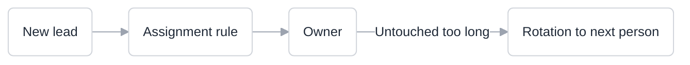

Rules decide who gets each new lead. Open **Settings → Leads → Lead assignment**.

## Assignment rules

<Frame>
  
</Frame>

In **Lead assignment**, choose **Add rule**.

<Steps>
  <Step title="Name the rule">Give it a name.</Step>
  <Step title="Add a condition">Source, state, words and more. With none, it applies to every lead.</Step>
  <Step title="Give it to">Choose the people and teams. People come first, then team members. People on leave are skipped.</Step>
  <Step title="Share them">**In turns**, or **In turns among those checked in**.</Step>
  <Step title="Create rule">Press **Create rule**.</Step>
</Steps>

The first matching rule wins.

<Card title="Try asking" icon="message-circle">
  *"Create a lead assignment rule called Ad leads: leads from Google Ads or Facebook Ads go to the Sales team in turns"*

  Marro creates the rule.
</Card>

## Then rotation and response time

<CardGroup cols={2}>
  <Card title="Lead rotation" icon="refresh-cw" href="/guides/lead-rotation">Pass a lead nobody has touched to the next person.</Card>
  <Card title="Response time" icon="timer" href="/guides/response-time">Set how fast new leads should get a first reply.</Card>
</CardGroup>
