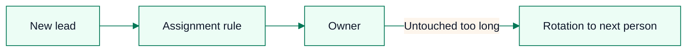
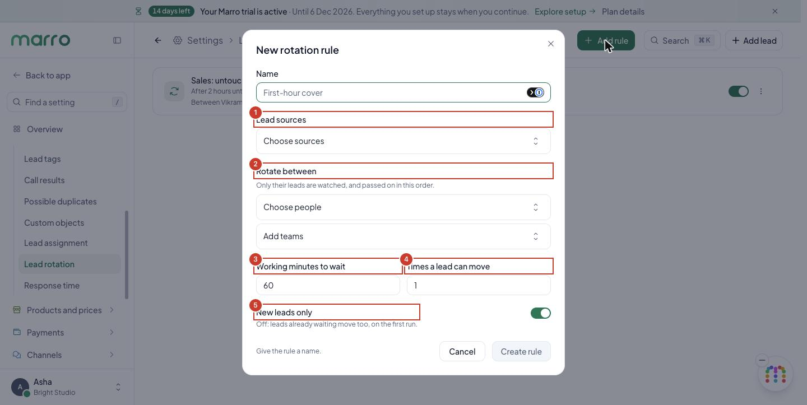
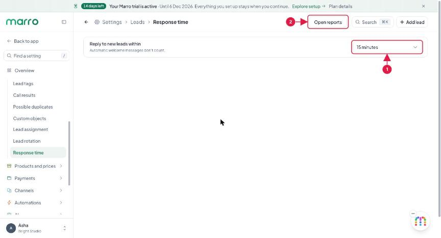

These pages are in **Settings → Leads**.

## Assignment rules

<Frame>
  
</Frame>

In **Lead assignment**, choose **Add rule**.

1. Name the rule.
2. **Add a condition**: source, state, words and more. With none, it applies to every lead.
3. Choose the people and teams. People come first, then team members. People on leave are skipped.
4. **Share them**: **In turns**, or **In turns among those checked in**.
5. **Create rule**.

The first matching rule wins.

<Card title="Try asking" icon="message-circle">
  *"Create a lead assignment rule called Ad leads: leads from Google Ads or Facebook Ads go to the Sales team in turns"*

  Marro creates the rule.
</Card>

## Rotation

A rotation rule passes a lead nobody has touched to the next person after a set time, a set number of times. Open **Lead rotation**.

<Frame>
  
</Frame>

<Card title="Try asking" icon="message-circle">
  *"Add a lead rotation rule: if a new lead is not touched within 2 hours, pass it to the next person in the Sales team"*

  Marro drafts the rule. It goes live only when you press **Publish rule**, even in Auto.
</Card>

Existing leads are left as they are.

## Response time

Open **Response time**.

<Frame>
  
</Frame>

1. Set how fast every new lead should get its first reply.
2. **Open reports** shows how your team is doing.

Automatic welcome messages do not count as a reply.
