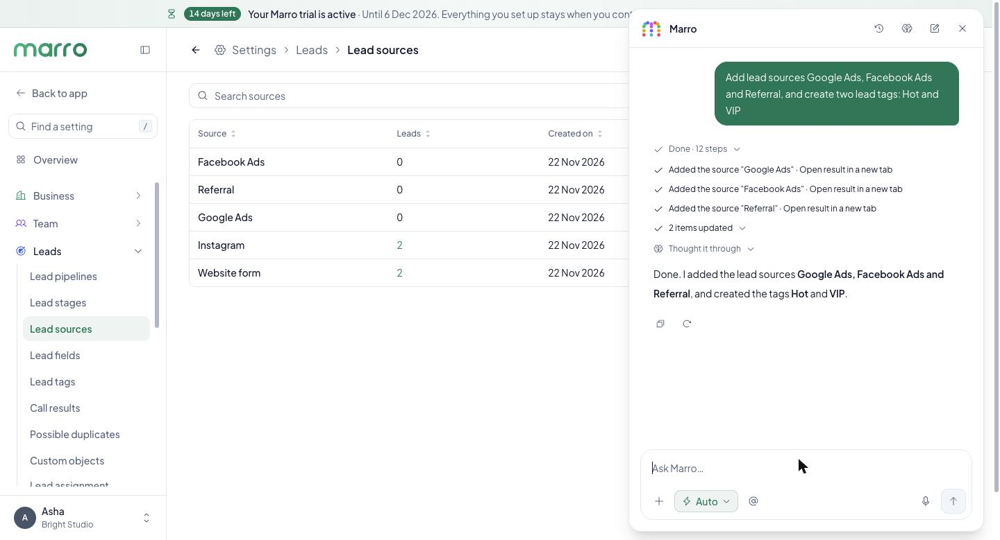
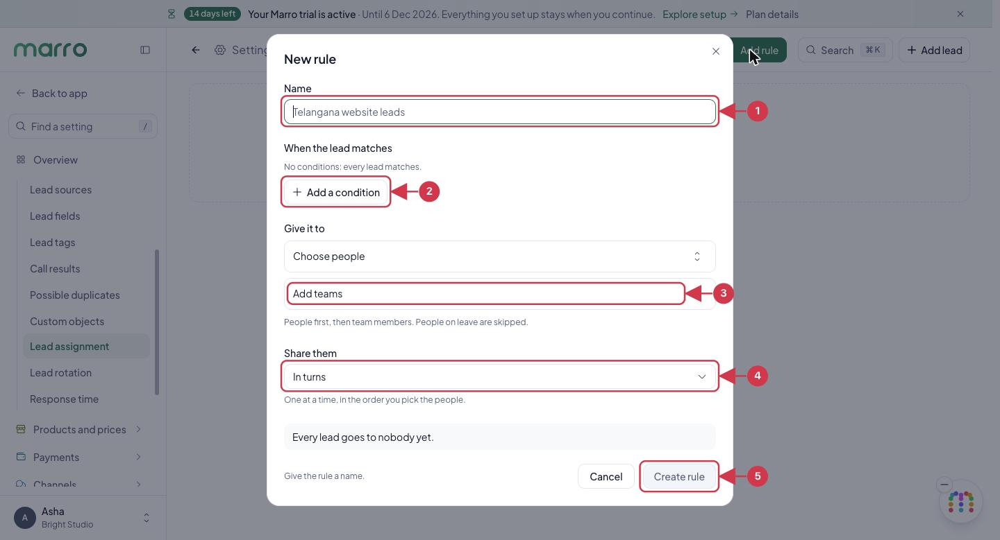
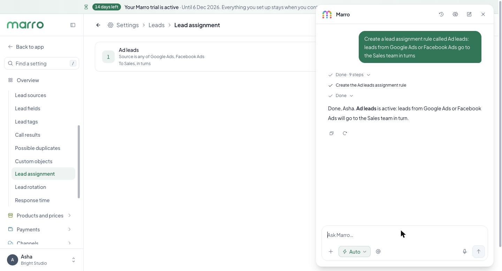
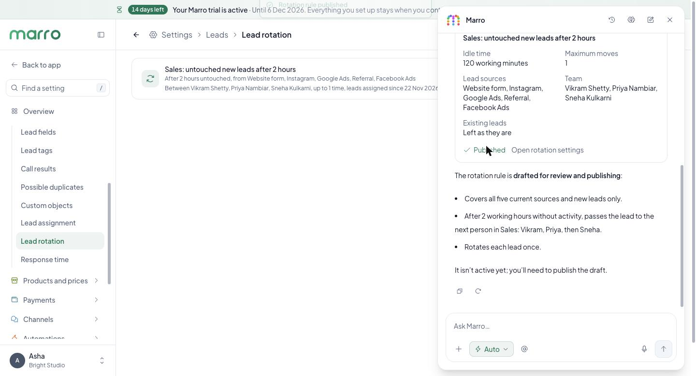

These pages are in **Settings → Leads**.

## Sources and tags

Open **Settings → Leads → Lead sources** and **Lead tags** to keep the lists your team picks from.

<Frame>
  
</Frame>

**Ask Marro:** *"Add lead sources Google Ads, Facebook Ads and Referral, and create two lead tags: Hot and VIP"*

<Frame>
  
</Frame>

<Frame>
  
</Frame>

## Assignment rules

Open **Settings → Leads → Lead assignment** and choose **Add rule**.

<Frame>
  
</Frame>

1. Give the rule a name.
2. **Add a condition**: source, state, words and more. With no conditions, the rule applies to every lead.
3. Choose the people and teams. People come first, then team members. People on leave are skipped.
4. **Share them**: **In turns**, or **In turns among those checked in**.
5. **Create rule**.

The first rule that matches wins. A new lead that a rule takes needs no owner chosen, even when **Assign to** is required.

**Ask Marro:** *"Create a lead assignment rule called Ad leads: leads from Google Ads or Facebook Ads go to the Sales team in turns"*

<Frame>
  
</Frame>

## Rotation

Open **Settings → Leads → Lead rotation**. A rotation rule passes a lead nobody has touched to the next person after a set time, a set number of times.

**Ask Marro:** *"Add a lead rotation rule: if a new lead is not touched within 2 hours, pass it to the next person in the Sales team"*

Marro drafts the rule and shows the idle time, the maximum moves, the sources and the team. It goes live only when you press **Publish rule**, even in Auto. Existing leads are left as they are.

<Frame>
  
</Frame>

<Frame>
  
</Frame>

## Response time

Open **Settings → Leads → Response time**.

<Frame>
  
</Frame>

1. Set how fast every new lead should get its first reply.
2. **Open reports** shows how your team is doing.

Automatic welcome messages do not count as a reply.
