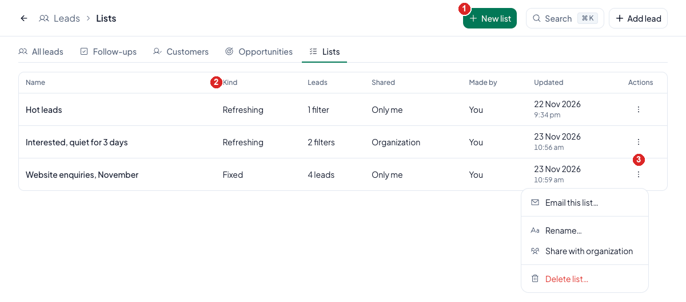
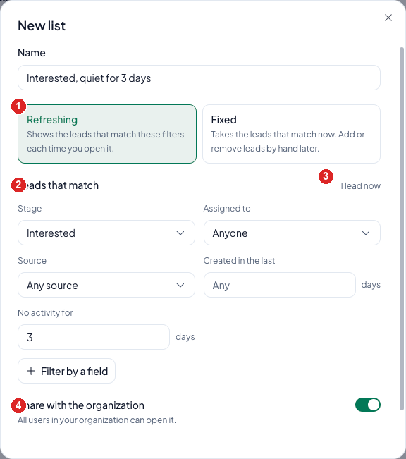
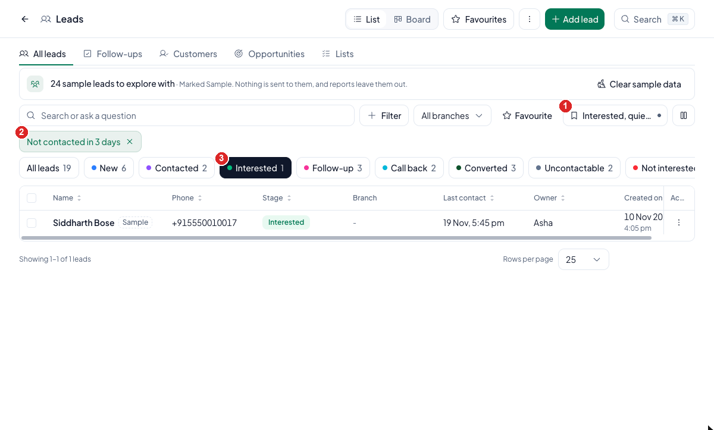
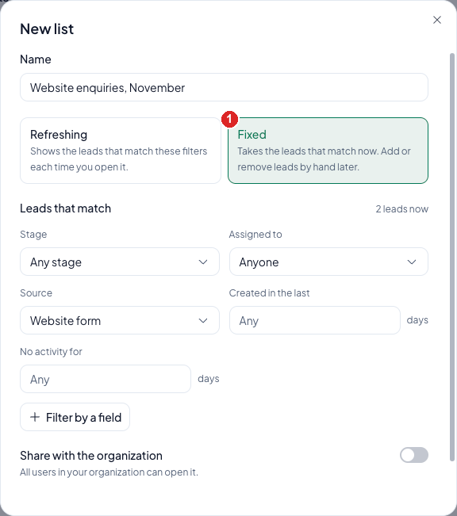
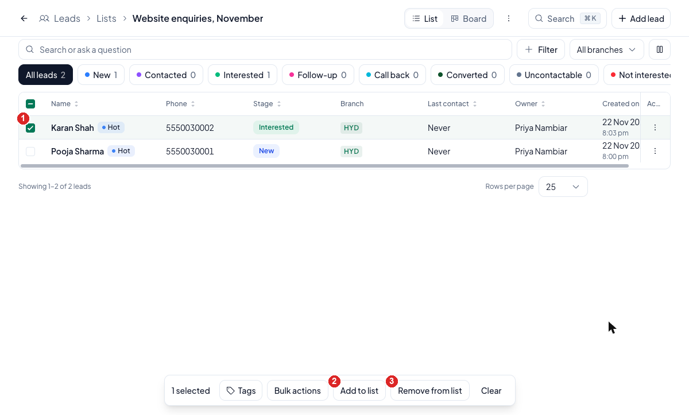
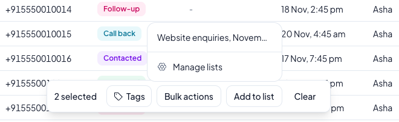

A **lead list** is a named group of leads you come back to: *Interested, quiet for 3 days* to call every morning, or *Website enquiries, November* for an offer. Make it once and use it to work through leads, or to send a WhatsApp broadcast or an email campaign to exactly those people. Open **Leads → Lists**.

From **Leads → Lists**, open **List options** on a fixed or refreshing list. Choose **Send WhatsApp template…**, **Call with AI…**, or **Send email campaign…** according to your permissions. These actions use the entire list you can access across all pages. A call campaign fixes its recipients when you confirm. An unsupported number or a repeated number is skipped.

<Frame>
  
</Frame>

1. **New list** makes one.
2. **Kind**: **Refreshing** or **Fixed** (below).
3. The ⋯ menu: **Email this list**, **Rename**, **Share with organization**, **Delete list**.

## Refreshing or fixed

| | Refreshing | Fixed |
| --- | --- | --- |
| Who is in it | Whoever matches its filters **right now** | The leads that matched when you made it, plus any you add |
| Changes by itself | Yes: a lead joins or leaves as it changes stage, owner or activity | No: only when you add or remove leads |
| Good for | Daily work queues: *quiet for 3 days*, *hot leads* | A campaign audience, an event, a hand-picked group |
| The Leads column shows | How many filters it has | How many leads it holds |

<Note>
A refreshing list shows each person only the leads they are allowed to see. Two people opening the same shared list can see different leads.
</Note>

## Make a refreshing list

<Frame>
  
</Frame>

1. Name it and choose **Refreshing**.
2. Choose the filters: **Stage**, **Assigned to**, **Source**, **Created in the last** days, **No activity for** days, or **Filter by a field**.
3. The count shows how many leads match **now**, as you change the filters.
4. **Share with the organization** lets every user open it. Off, it is only yours.

Opening it shows the leads page with those filters on:

<Frame>
  
</Frame>

1. The list's name, in the views button.
2. Its filters, as chips you can remove for a quick look.
3. Its stage. The list keeps its filters; your changes are not saved into it.

## Make a fixed list

<Frame>
  
</Frame>

Choose **Fixed** (1) and pick the filters for the leads to start with. They are copied in once, when you save.

## Add or remove leads by hand

<Frame>
  
</Frame>

1. Tick the leads.
2. **Add to list** puts them in another fixed list.
3. **Remove from list** takes them out of this one. The leads themselves are not changed.

From **All leads**, **Add to list** shows your fixed lists:

<Frame>
  
</Frame>

<Note>
Only fixed lists take leads by hand. A refreshing list decides for itself who is in it; change its filters instead.
</Note>

## Where lists are used

| Use | How |
| --- | --- |
| **WhatsApp broadcasts** | Choose a list as the audience |
| **Email campaigns** | **Email this list** from its ⋯ menu (when you can send email campaigns) |
| **Automations** | The step **Add the lead to a list** |
| **Google Sheets** | A connected sheet can put the leads it brings in into a list |

<Warning>
**Delete list** removes the list only. The leads in it are not deleted. A list a Google Sheet adds leads to can't be deleted until the sheet stops using it.
</Warning>

## Ask Marro

<Card title="Try asking" icon="message-circle">
  *"Make a list of interested leads with no activity for 3 days, and share it with the team"*

  *"Add Rahul Verma and Riya Kapoor to Website enquiries, November"*
</Card>
