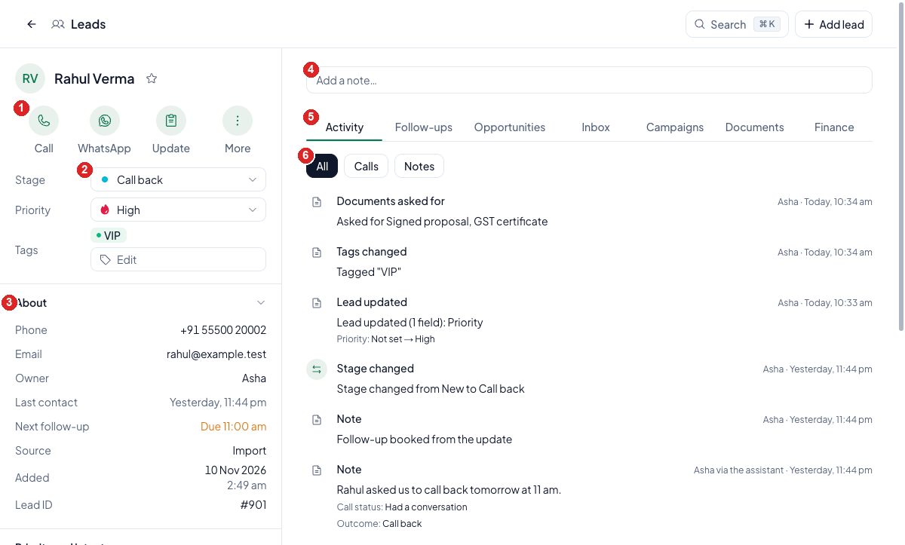
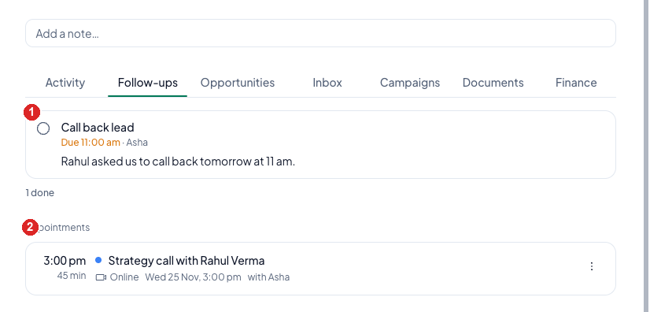
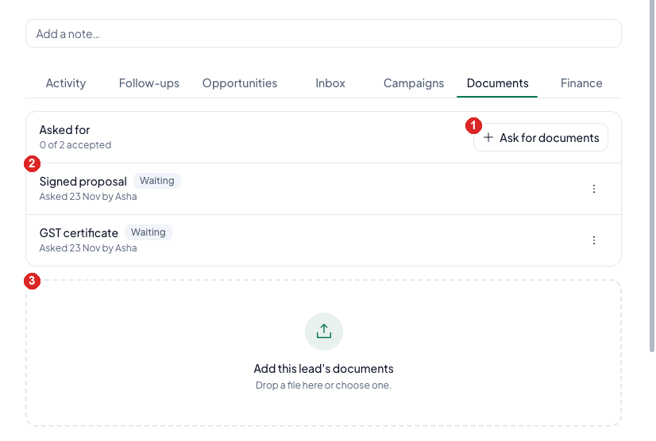
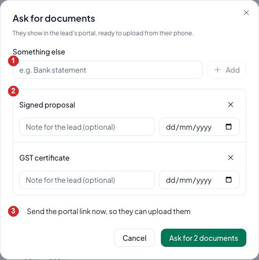
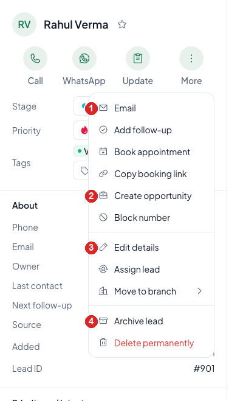
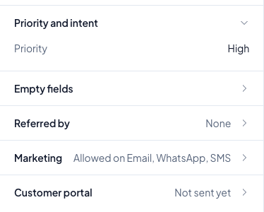

Open any lead from **Leads** to see who they are on the left and everything that happened on the right.

<Frame>
  
</Frame>

1. **Call**, **WhatsApp**, **Update** (record how a call went, see [Log update](/guides/log-update)) and **More**.
2. **Stage**, **Priority** and **Tags**: change them right here.
3. **About**: phone, email, owner, last contact, next follow-up, source, when it was added.
4. **Add a note** for your team.
5. The tabs, below.
6. In **Activity**, narrow the history to calls, notes, messages or emails.

## The tabs

| Tab | What it holds |
| --- | --- |
| **Activity** | Every change, call, message and note, newest first, with who and when on the right |
| **Follow-ups** | Open follow-ups first, finished ones folded away, then appointments |
| **Opportunities** | The deals made from this lead. See [Opportunities](/guides/opportunities) |
| **Inbox** | Their chats, one line per channel, to open in the Inbox |
| **Campaigns** | The broadcasts, email sequences and email campaigns they were in |
| **Documents** | Documents you asked for and files you added |
| **Finance** | Payments, quotes and invoices, with what is due |

A tab shows only when its module is on.

<Frame>
  
</Frame>

1. Tick the circle when a follow-up is done.
2. **Appointments** with this lead; the ⋯ menu moves, completes or cancels one.

## Ask for documents

<Frame>
  
</Frame>

1. **Ask for documents**.
2. Each request shows **Waiting** until the lead uploads it, then you accept it.
3. Drop your own files for this lead here.

<Frame>
  
</Frame>

1. Name each document and press **Add**.
2. Add a note or a due date if you like.
3. **Send the portal link now** messages the lead so they can upload from their phone. Leave it off to send it later.

## More

<Frame>
  
</Frame>

1. **Email** the lead from your connected mailbox.
2. **Add follow-up**, **Book appointment**, **Copy booking link** or **Create opportunity**.
3. **Edit details**, **Assign lead** to someone else, or **Move to branch**.
4. **Archive lead** takes it out of the list and keeps everything. **Delete permanently** removes it for good, after you confirm.

**Block number** drops this number's WhatsApp messages and calls quietly, on all your numbers. See [Blocked numbers](/guides/blocked-numbers).

**Lead ID** under **About** is the lead's number in your organization: your first lead is **#1**. Say it to a colleague, or type `#26` in **Search** to open that lead.

## Further down the left

<Frame>
  
</Frame>

| Section | What it shows |
| --- | --- |
| Your own sections | The fields you added, such as **Priority and intent** |
| **Empty fields** | Fields not filled in yet; fill them from **Edit details** |
| **Referred by** | The partner who brought this lead in |
| **Marketing** | Which channels they agreed to hear from |
| **Customer portal** | Whether their portal link was sent |

## Ask Marro

On a lead's page, Marro knows which lead you mean.

<Card title="Try asking" icon="message-circle">
  *"Summarise this lead and tell me what to do next"*

  *"Ask him for his GST certificate and the signed proposal"*

  *"Book a strategy call with him on Wednesday at 3 pm"*
</Card>
