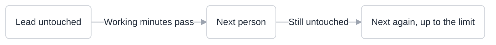
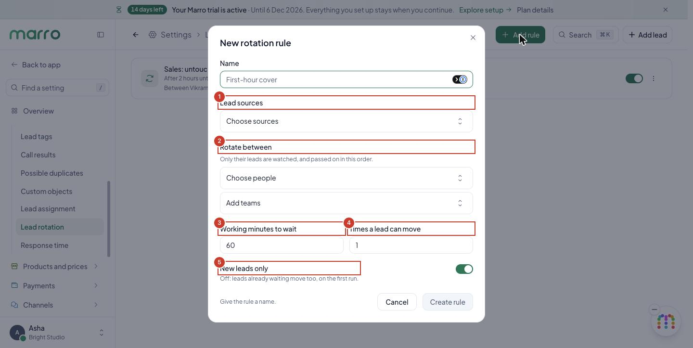

A rotation rule passes a lead nobody has touched to the next person, after a set time, a set number of times. Open **Settings → Leads → Lead rotation**.

## The rule

<Frame>
  
</Frame>

| Field | What it does |
| --- | --- |
| **Lead sources** (1) | Which sources the rule watches |
| **Rotate between** (2) | The people. Only their leads are watched, and passed on in this order |
| **Working minutes to wait** (3) | How long a lead may sit untouched |
| **Times a lead can move** (4) | The most passes one lead gets |
| **New leads only** (5) | Off: leads already waiting move too, on the first run |

## Set one up

<Steps>
  <Step title="Add a rule">Open **Lead rotation** and add a rule.</Step>
  <Step title="Fill in the form">Choose sources and people, then set the wait and the limit.</Step>
  <Step title="Publish">Press **Publish rule**. Existing leads are left as they are unless **New leads only** is off.</Step>
</Steps>

New leads get their first owner from [Lead assignment](/guides/lead-assignment).

## Ask Marro

<Card title="Try asking" icon="message-circle">
  *"Add a lead rotation rule: if a new lead is not touched within 2 hours, pass it to the next person in the Sales team"*

  Marro drafts the rule. It goes live only when you press **Publish rule**, even in Auto.
</Card>
