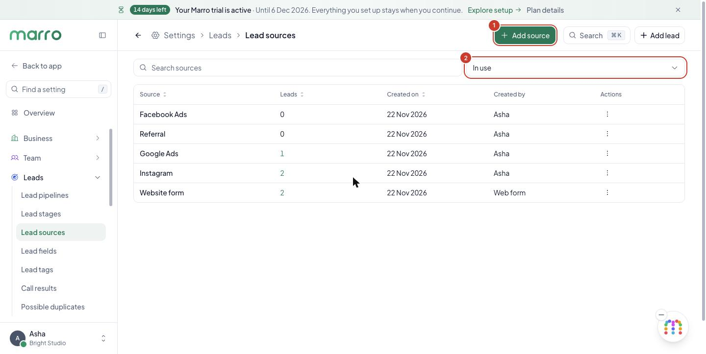
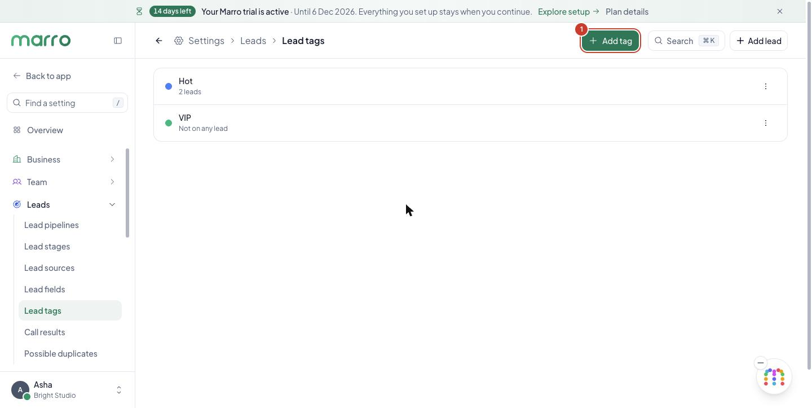

Both live in **Settings → Leads**. Sources say where a lead came from; tags are labels your team adds.

## Lead sources

<Frame>
  
</Frame>

1. **Add source** (1) and give it a name, such as *Instagram*.
2. The list (2) shows sources **In use**, **Archived** or **All**, each with how many leads it has. Click the count to see those leads.

| You want to | Do this |
| --- | --- |
| Stop offering a source on new leads | **Archive** it. Old leads keep it. |
| Bring it back | **Restore** |
| Remove it for good | **Delete** (only if no lead has it) |

## Lead tags

<Frame>
  
</Frame>

1. **Add tag** (1): a name and a colour (Blue, Green, Amber, Red, Violet, Pink, Cyan or Grey).
2. Each tag shows how many leads have it. **Edit** renames or recolours it; **Delete** takes it off those leads.

Tags can also be added straight from a lead or the leads list.

## Ask Marro

<Card title="Try asking" icon="message-circle">
  *"Add lead sources Google Ads, Facebook Ads and Referral, and create two lead tags: Hot and VIP"*

  Marro adds all five in one go.
</Card>
