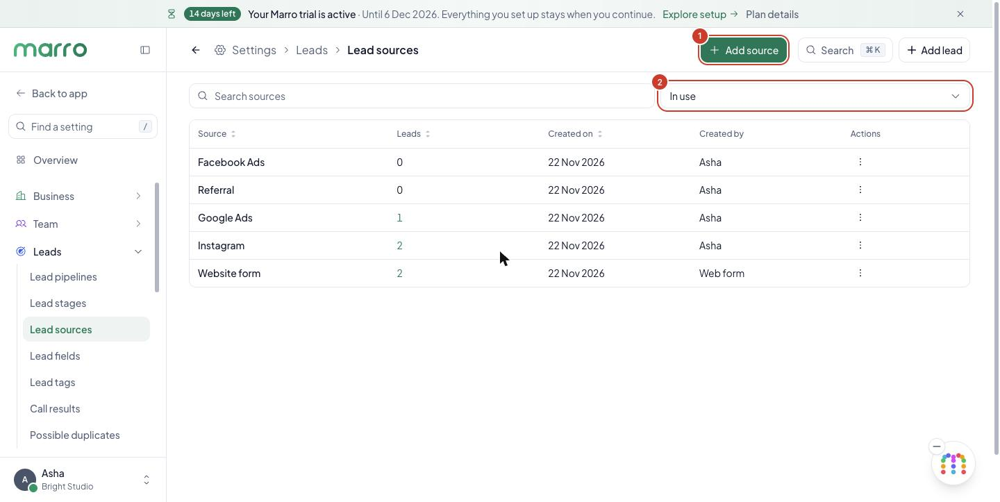

Sources say where a lead came from, such as Instagram or Referral. Open **Settings → Leads → Lead sources**.

<Frame>
  
</Frame>

1. **Add source** gives you a new one.
2. The list shows sources **In use**, **Archived** or **All**, each with how many leads it has. Click the count to see those leads.

## Add a source

<Steps>
  <Step title="Add source">Choose **Add source**.</Step>
  <Step title="Name it">For example *Instagram*, then save.</Step>
</Steps>

## Archive, restore or delete

| You want to | Do this |
| --- | --- |
| Stop offering a source on new leads | **Archive** it. Old leads keep it. |
| Bring it back | **Restore** |
| Remove it for good | **Delete** (only if no lead has it) |

## Ask Marro

<Card title="Try asking" icon="message-circle">
  *"Add lead sources Google Ads, Facebook Ads and Referral"*

  Marro adds them after you approve. Tags are on [Lead tags](/guides/lead-tags).
</Card>
