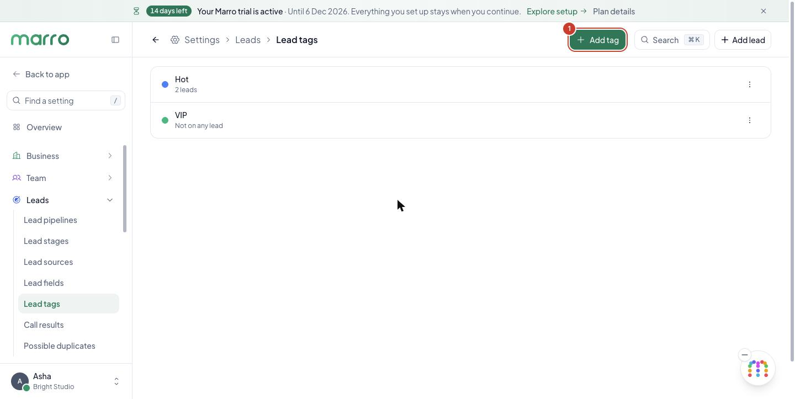

Tags are labels your team adds to leads. Open **Settings → Leads → Lead tags**.

<Frame>
  
</Frame>

1. **Add tag** creates a tag with a name and a colour.

Each tag shows how many leads have it.

## Add a tag

<Steps>
  <Step title="Add tag">Choose **Add tag** and name it, for example *Hot*.</Step>
  <Step title="Pick a colour">Blue, Green, Amber, Red, Violet, Pink, Cyan or Grey.</Step>
</Steps>

Tags can also be added straight from a lead or the leads list.

## Edit or delete

| You want to | Do this |
| --- | --- |
| Rename or recolour | **Edit** |
| Remove it | **Delete**. It is taken off those leads. |

## Ask Marro

<Card title="Try asking" icon="message-circle">
  *"Create two lead tags: Hot and VIP"*

  Marro adds them after you approve.
</Card>
