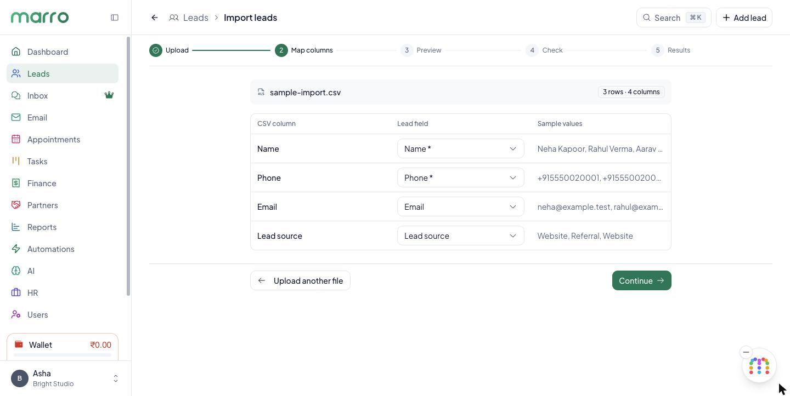
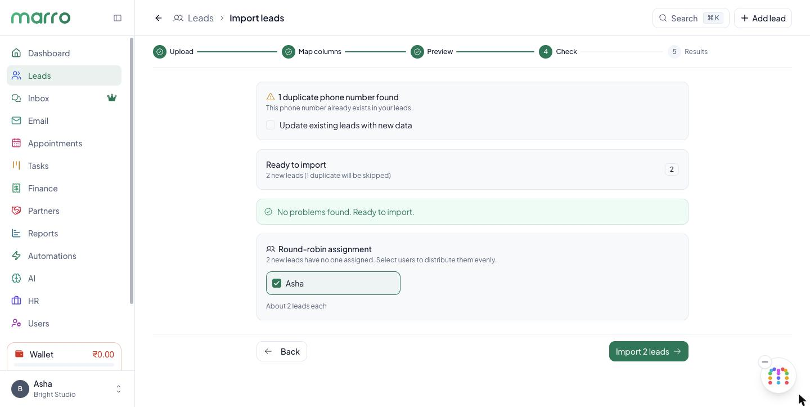
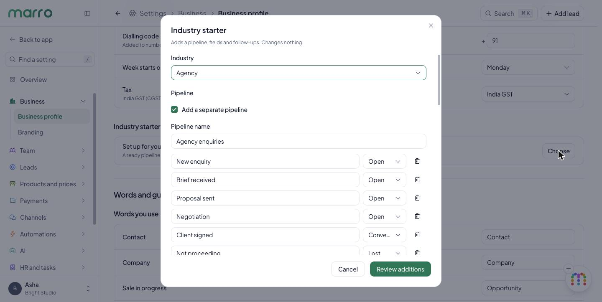

Open **Leads** in the sidebar. Every lead your role can see is here, with tabs for **Follow-ups**, **Customers**, **Opportunities** and **Lists**.

## Try it with sample leads

A new workspace can start with made-up leads. On **Welcome**, choose **Explore with sample leads**. They are marked **Sample**, nothing is sent to them, and reports leave them out. **Clear sample data**, above the list, removes them in one click.

## List and board

**List** shows each lead's name, phone, stage, last contact, owner and when it was created. The stage pills above the list filter it and show how many leads are in each stage. Search, **Filter** and saved **Views** narrow it further.

<Frame>
  
</Frame>

**Board** shows one column per stage. Each card has the lead's owner, source and when they are next due. Drag a card to another column to move the lead to that stage.

<Frame>
  
</Frame>

## Add a lead

Choose **Add lead**. Name, phone and **Assign to** are required; **Personal**, **Address** and **Priority and intent** open when you need them. **Create and add another** keeps the form open for the next lead.

If the phone number already belongs to a lead, Marro says so before you save: **This looks like a lead you already have**. Choose **Open** to add to that lead instead, or **Add anyway**.

<Frame>
  
</Frame>

## Import a spreadsheet

Open **Leads → Import** and upload a CSV file of up to 10,000 rows. Name and phone are required.

1. **Upload** the file.
2. **Map columns**. Columns named like a field are matched for you; change any match here.
3. **Preview** the first rows as they will be imported.
4. **Check**. Phone numbers that are already leads are skipped, or tick **Update existing leads with new data** to update them instead. Leads with no owner can be shared out in turns: tick the people under **Round-robin assignment**.
5. **Results** shows how many were imported, updated and skipped.

<Frame>
  
</Frame>

<Frame>
  
</Frame>

## Possible duplicates

**Leads → Possible duplicates** lists pairs of leads with the same phone number or email, or a similar name, most certain first. Compare them and merge them into one; merging never deletes anything.

## Stages, fields and who gets each lead

- **Settings → Leads → Lead stages**: rename, recolour and drag stages into order, mark which mean converted or lost, and choose where new leads start. See [Pipelines](/guides/pipelines).
- **Settings → Business → Industry starter**: opens on the industry you chose at sign-up and previews a pipeline, fields and follow-ups for it. Nothing is added until you confirm.
- **Settings → Leads → Lead fields**: add, rename, require or hide fields. See [Custom fields](/guides/custom-fields).
- **Settings → Leads → Lead assignment**: rules that give new leads to people by state, source, words and more, in turns or only among people checked in. People on leave are skipped. With no rule, new leads go to the default assignee.

<Frame>
  
</Frame>

<Frame>
  
</Frame>
