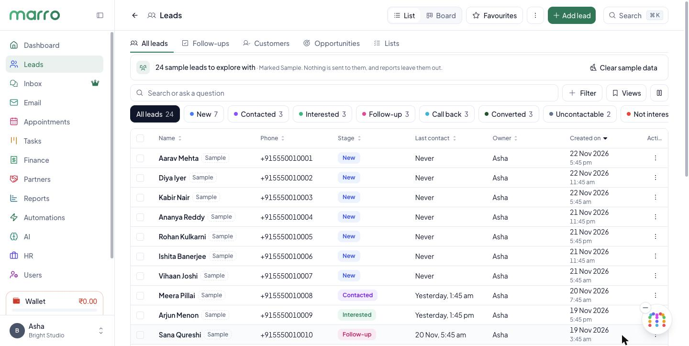
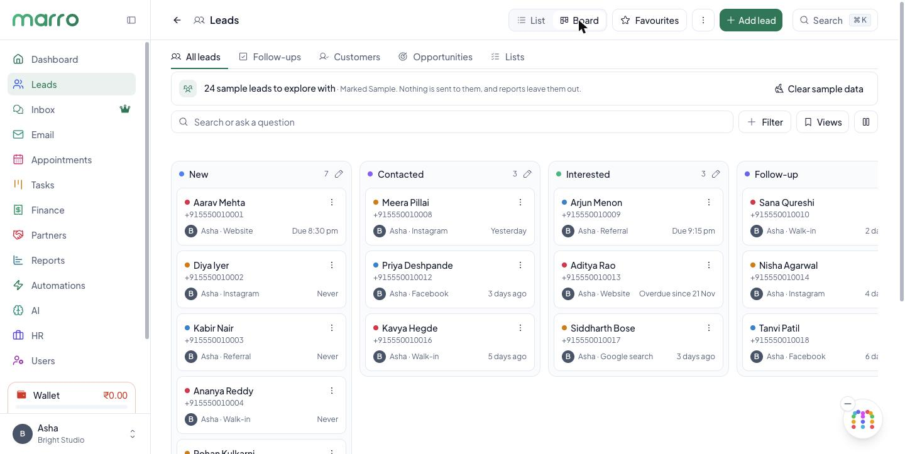
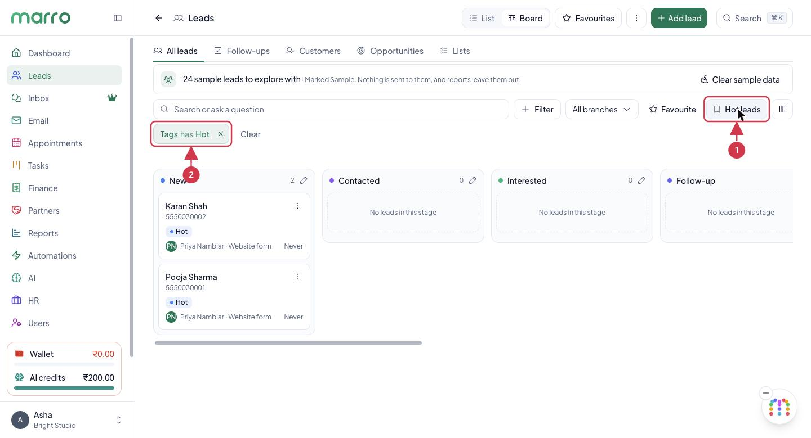
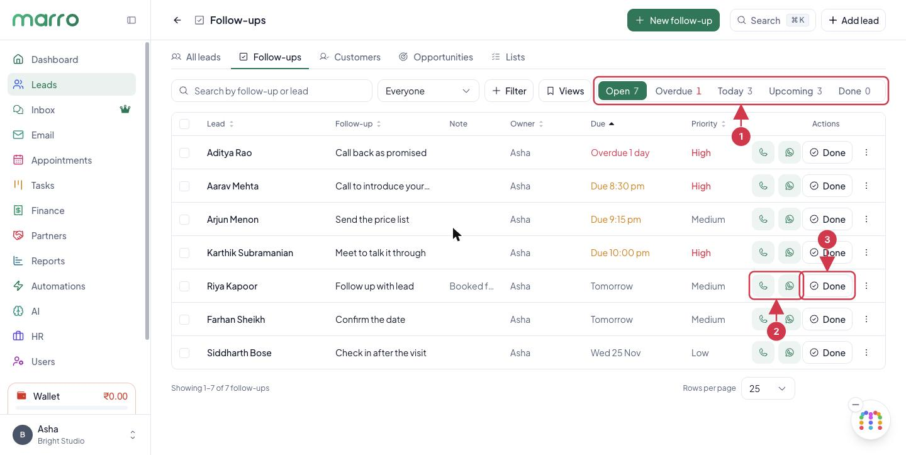

Open **Leads** in the sidebar. Every lead your role can see is here, with tabs for **Follow-ups**, **Customers**, **Opportunities** and **Lists**.

## Try it with sample leads

On **Welcome**, choose **Explore with sample leads**. They are marked **Sample**, nothing is sent to them, and reports leave them out. **Clear sample data**, above the list, removes them.

<Frame>
  
</Frame>

## List and board

**List** shows name, phone, stage, last contact, owner and created date. The stage pills above it filter the list. Search, **Filter** and saved **Views** narrow it further.

**Board** has one column per stage. Drag a card to another column to move the lead.

<Frame>
  
</Frame>

## Saved views

Save a filter as a **View** to come back to it. Its name shows on the **Views** button.

<Frame>
  
</Frame>

1. The saved view’s name on the **Views** button.
2. Its filter.

A view keeps your own columns and list or board choice unless it saved them.

## Change many leads at once

Tick the leads, then choose **Bulk actions** in the bar at the bottom.

<Frame>
  
</Frame>

| Action | Effect |
| --- | --- |
| **Change owner**, **Move to branch**, **Change stage** | Applies to every ticked lead |
| **Archive selected** | Archives them |
| **Delete selected permanently** | Asks first and cannot be undone |

## Add a lead

<Frame>
  
</Frame>

1. Choose **Add lead**. Name and phone are required.
2. **Assign to** starts with you. Pick someone else if the lead is theirs.
3. Open **Personal**, **Address** or **Priority and intent** if you need them.
4. Save, or **Create and add another**.

If the phone already belongs to a lead, Marro warns **This looks like a lead you already have**. Choose **Open**, or **Add anyway**.

## Work a lead

Open a lead to see details, stage and timeline. Add a note, change the stage, or choose **Update** to record a call. Every part of it is in [The lead page](/guides/lead-page).

<Frame>
  
</Frame>

**Leads → Follow-ups** lists open follow-ups with overdue, today and upcoming counts. Call or WhatsApp from the row, then mark it **Done**.

<Frame>
  
</Frame>

## Import a spreadsheet

Open **Leads → Import** and upload a CSV of up to 10,000 rows. Name and phone are required.

<Frame>
  
</Frame>

<Steps>
  <Step title="Upload">Choose your file.</Step>
  <Step title="Map columns">Columns named like a field are matched for you. Change any match.</Step>
  <Step title="Preview">See the first rows as they will be imported.</Step>
  <Step title="Check">Existing phone numbers are skipped, or tick **Update existing leads with new data**. Tick people under **Round-robin assignment** to share out leads with no owner.</Step>
  <Step title="Results">Shows how many were imported, updated and skipped.</Step>
</Steps>

## Possible duplicates

<CardGroup cols={2}>
  <Card title="Possible duplicates" icon="copy" href="/guides/duplicates">**Leads → Possible duplicates**: compare pairs that look the same and merge them. Nothing is deleted.</Card>
</CardGroup>

## Stages, fields and who gets each lead

<CardGroup cols={2}>
  <Card title="Lead stages" icon="list-ordered" href="/guides/stages">**Settings → Leads → Lead stages**: rename, recolour and order stages.</Card>
  <Card title="Lead fields" icon="square-pen" href="/guides/custom-fields">**Settings → Leads → Lead fields**: add, require or hide fields.</Card>
  <Card title="Lead assignment" icon="users" href="/guides/lead-assignment">**Settings → Leads → Lead assignment**: rules that give new leads to people.</Card>
  <Card title="Industry starter" icon="building">**Settings → Business → Industry starter**: preview a pipeline and fields. Nothing is added until you confirm.</Card>
</CardGroup>

## Ask Marro

<Frame>
  
</Frame>

<Card title="Try asking" icon="message-circle">
  *"Add a lead: Kiran Rao, phone 98765 43210, came from Instagram."*

  *"Give Karan Shah and Pooja Sharma to Priya Nambiar and tag both Hot"*

  *"Save a leads view called Hot leads that shows only leads tagged Hot"*

  *"Merge Meera J into Meera Joshi"*

  Marro shows what it will change and asks before saving.
</Card>
