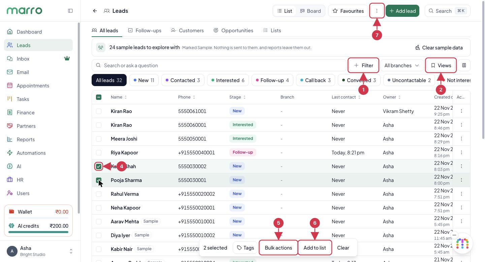
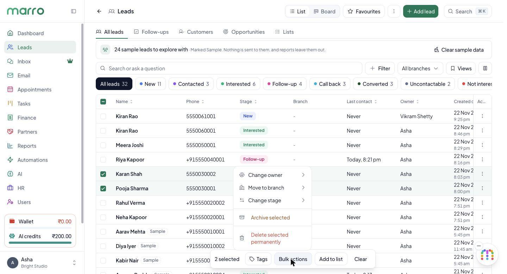
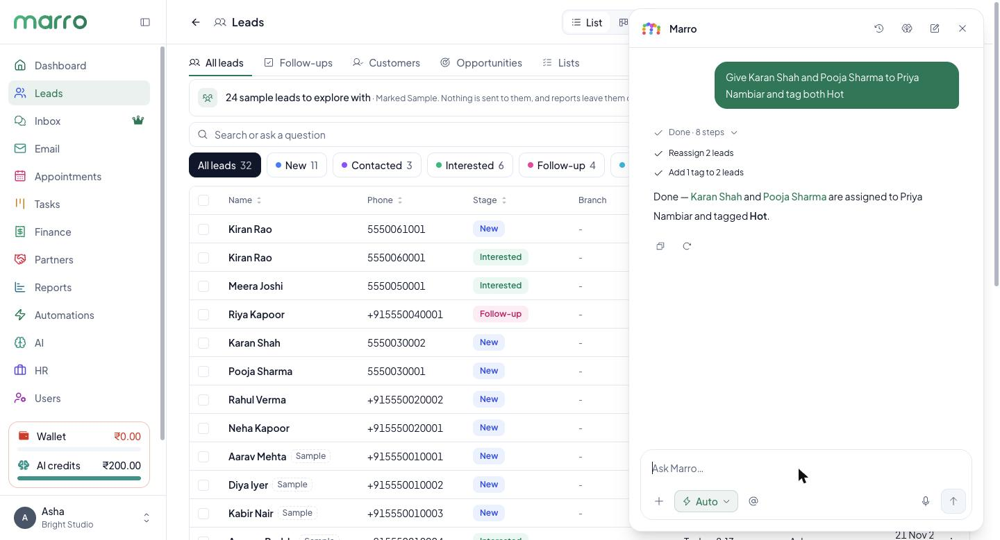
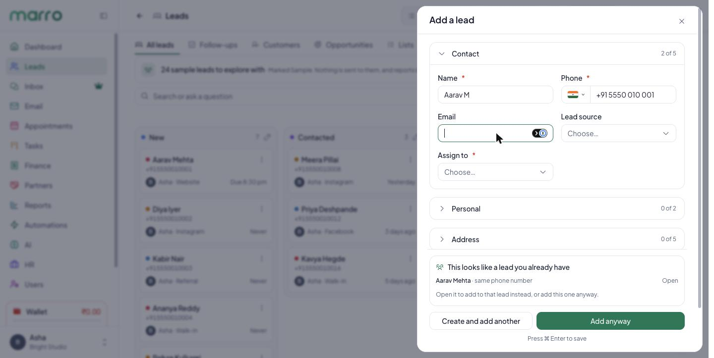
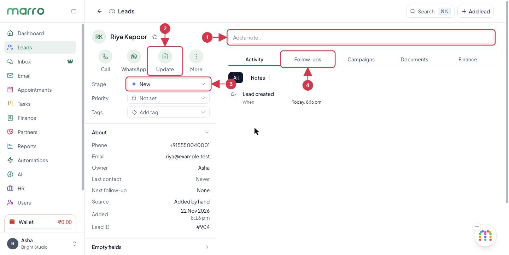
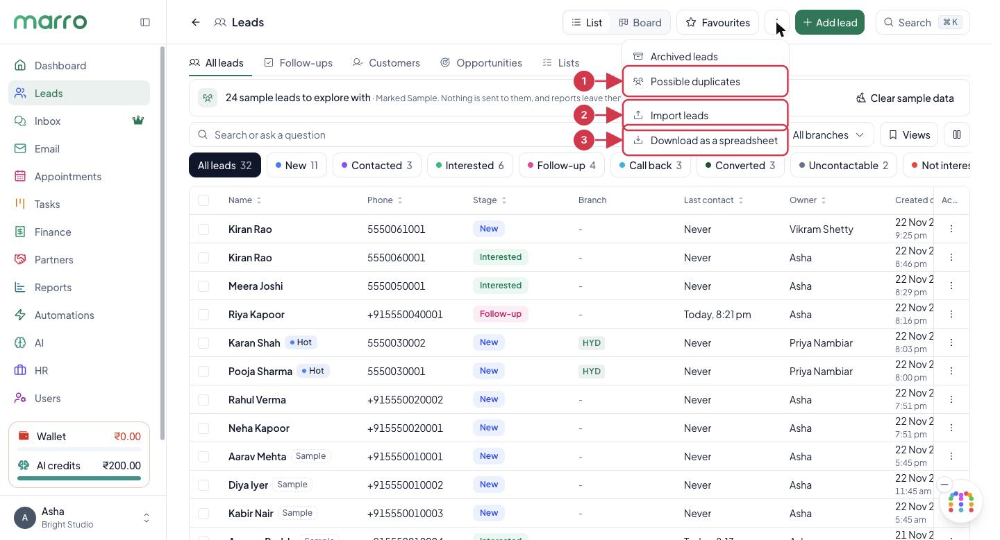
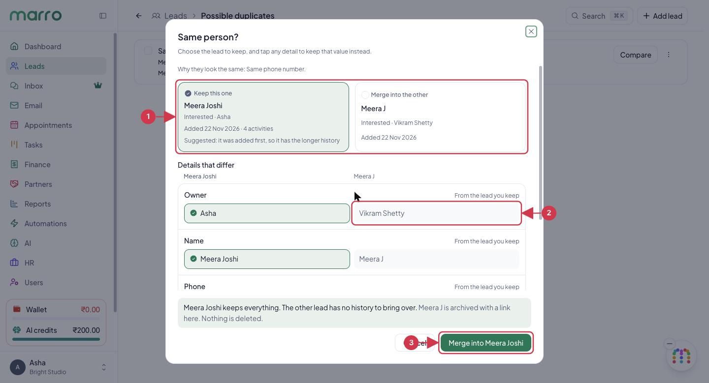
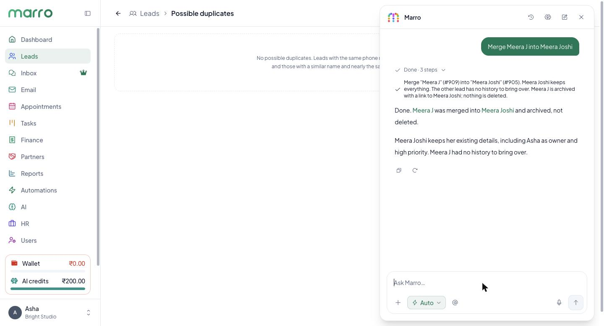
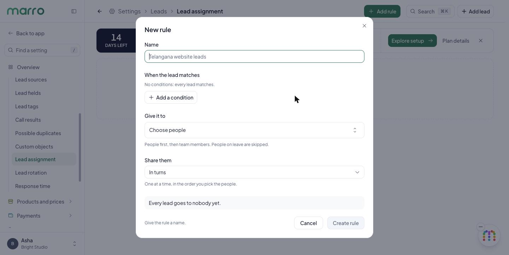

Open **Leads** in the sidebar. Every lead your role can see is here, with tabs for **Follow-ups**, **Customers**, **Opportunities** and **Lists**.

## Try it with sample leads

A new workspace can start with made-up leads. On **Welcome**, choose **Explore with sample leads**. They are marked **Sample**, nothing is sent to them, and reports leave them out. **Clear sample data**, above the list, removes them in one click.

## List and board

**List** shows each lead's name, phone, stage, last contact, owner and when it was created. The stage pills above the list filter it and show how many leads are in each stage. Search, **Filter** and saved **Views** narrow it further.

<Frame>
  
</Frame>

- **1:** **Filter**.
- **2:** **Views**.
- **4:** tick a row's box to select that lead.
- **5:** **Bulk actions**.
- **6:** **Add to list**.
- **7:** the page menu.

The selection bar appears at the bottom of the screen. The stage chips under the search narrow the list by stage.

<Frame>
  
</Frame>

**Board** shows one column per stage. Each card has the lead's owner, source and when they are next due. Drag a card to another column to move the lead to that stage.

<Frame>
  
</Frame>

## Saved views

Save a filter as a **View** to come back to it. The view's name shows on the **Views** button, with its filter applied.

<Frame>
  
</Frame>

- **1:** the saved view's name on the **Views** button.
- **2:** its filter.

**Ask Marro:** *"Save a leads view called Hot leads that shows only leads tagged Hot"*

A view keeps your own columns and your list or board choice unless it saved them.

## Change many leads at once

Tick the leads you want, then choose **Bulk actions**.

<Frame>
  
</Frame>

- **Change owner**
- **Move to branch**
- **Change stage**
- **Archive selected**
- **Delete selected permanently**: asks first, and cannot be undone.

**Ask Marro:** *"Give Karan Shah and Pooja Sharma to Priya Nambiar and tag both Hot"*

<Frame>
  
</Frame>

## Add a lead

Choose **Add lead**. Name and phone are required, and **Assign to** starts with you; pick someone else if the lead is theirs. **Personal**, **Address** and **Priority and intent** open when you need them. You can also ask the [assistant](/guides/assistant): *"Add a lead: Kiran Rao, phone 98765 43210, came from Instagram."* **Create and add another** keeps the form open for the next lead.

If the phone number already belongs to a lead, Marro says so before you save: **This looks like a lead you already have**. Choose **Open** to add to that lead instead, or **Add anyway**.

<Frame>
  
</Frame>

## Work a lead

Open a lead to see its details, stage and timeline in one place. Add a note, change the stage, or choose **Update** to record a call: see [Configure Log update](/guides/log-update).

<Frame>
  
</Frame>

**Leads → Follow-ups** lists every open follow-up with counts for overdue, today and upcoming. Call or WhatsApp from the row, and mark it **Done**.

<Frame>
  
</Frame>

## Import a spreadsheet

Open **Leads → Import** and upload a CSV file of up to 10,000 rows. Name and phone are required.

<Frame>
  
</Frame>

1. **Possible duplicates**.
2. **Import leads**.
3. **Download as a spreadsheet**.

1. **Upload** the file.
2. **Map columns**. Columns named like a field are matched for you; change any match here.
3. **Preview** the first rows as they will be imported.
4. **Check**. Phone numbers that are already leads are skipped, or tick **Update existing leads with new data** to update them instead. Leads with no owner can be shared out in turns: tick the people under **Round-robin assignment**.
5. **Results** shows how many were imported, updated and skipped.

<Frame>
  
</Frame>

<Frame>
  
</Frame>

## Possible duplicates

**Leads → Possible duplicates** lists pairs of leads with the same phone number or email, or a similar name, most certain first. Compare them and merge them into one; merging never deletes anything.

<Frame>
  
</Frame>

Open the page menu and choose **Possible duplicates**. Leads with the same phone or email show here, and so do leads with a similar name and nearly the same number or email.

1. **Compare** opens a pair.
2. Tick several pairs to merge each one with the suggestions.

<Frame>
  
</Frame>

1. The lead to keep. Marro suggests the one with the longer history.
2. Tap a value from the other lead to keep it instead.
3. **Merge**.

The other lead is archived with a link to the kept lead. Nothing is deleted.

**Ask Marro:** *"Merge Meera J into Meera Joshi"*

<Frame>
  
</Frame>

## Stages, fields and who gets each lead

- **Settings → Leads → Lead stages**: rename, recolour and drag stages into order, mark which mean converted or lost, and choose where new leads start. See [Pipelines](/guides/pipelines).
- **Settings → Business → Industry starter**: opens on the industry you chose at sign-up and previews a pipeline, fields and follow-ups for it. Nothing is added until you confirm.
- **Settings → Leads → Lead fields**: add, rename, require or hide fields. See [Custom fields](/guides/custom-fields).
- **Settings → Leads → Lead assignment**: rules that give new leads to people by state, source, words and more, in turns or only among people checked in. People on leave are skipped. With no rule, new leads go to the default assignee. See [Lead assignment and rotation](/guides/lead-assignment).

<Frame>
  
</Frame>

<Frame>
  
</Frame>
