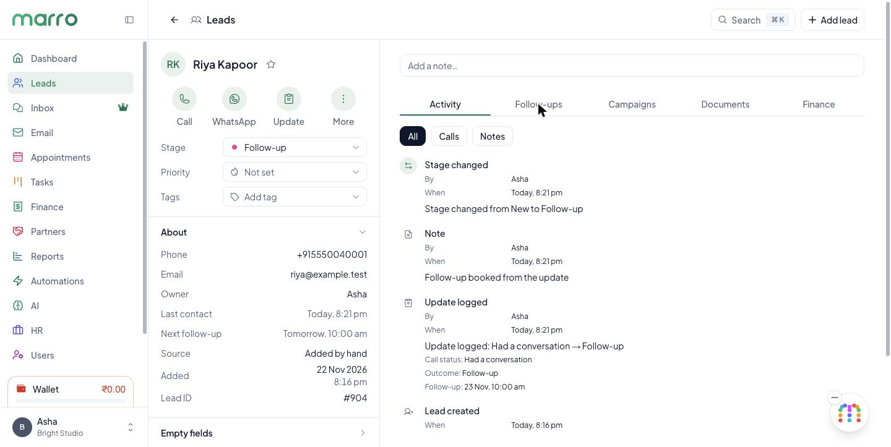

Open **Settings → Leads → Call results** as your organisation's administrator. The same saved form is used by the web app, supported mobile builds and the staff assistant.

## Log an update on a lead

On a lead's page, choose **Update**. Pick how the call went, then the outcome. Fields the outcome asks for start with the lead's current values, so a priority already set is kept unless you change it. An outcome with a follow-up asks when: in an hour, tomorrow at 10 am, in 2 days, next week, or another time. Saving moves the lead to the outcome's stage, books the follow-up and records it all on the timeline.

<Frame>
  
</Frame>

<Frame>
  
</Frame>

<Frame>
  
</Frame>

## Choose what the team sees

The **Form** tab sets the title, description, labels, help text, button wording, section order, one or two columns and dialog width. Use `{leadName}` in the description to show the lead's name. Phones use a single column.

The **Notes** tab controls whether notes appear, whether they are required, the label, placeholder, length limit and box height. An outcome can also require notes. Notes must remain shown while any available outcome requires them.

## Lead types

Add the choices your organisation needs, with your own names and help text. Each choice belongs to the individual or business CRM role. That role is fixed once the choice is saved, so existing leads cannot silently change role. Add another choice to use a different role.

**Classification only** saves the chosen type and notes without asking for a group or outcome. Turn **Ask for the lead type** off to keep each lead's current type.

## Groups and outcomes

Add, rename, reorder or hide groups. A group can let people choose an outcome or automatically use its first shown outcome. Any group can route by language; it asks for a preferred language and uses the organisation's assignment rules.

For each outcome, choose its group, stage, follow-up task title and priority, required notes, and the fields to ask for. Fields can be required for that outcome. Reorder outcomes to change their display order and which one an automatic group uses.

<Frame>
  
</Frame>

<Frame>
  
</Frame>

Saved choices are hidden rather than erased, so earlier activity keeps its meaning. The familiar conversation, unreachable, wrong-number and language groups are starting choices; administrators can configure them through the same controls as any other group.

## Save and use the form

Choose **Save**. If another administrator saved first, reload the current settings before trying again. Forms already open with an older revision must reload before submitting.

The mobile app asks you to update if its build cannot display the saved definition. Record-link questions use a searchable picker and only show records the person may access. The assistant can read the form and log updates with the same validation; changing its settings requires administrator access and approval.

If an offline update reaches a form that has since changed, the mobile app keeps it as a review draft. Choose **Review** from its notice, or reopen Log update on that lead. Applicable saved answers are restored; check the current choices before saving. It is not silently submitted under the new rules.
