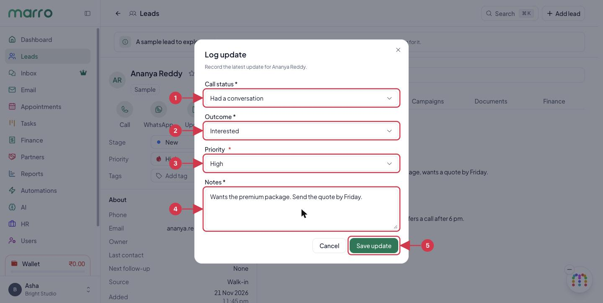
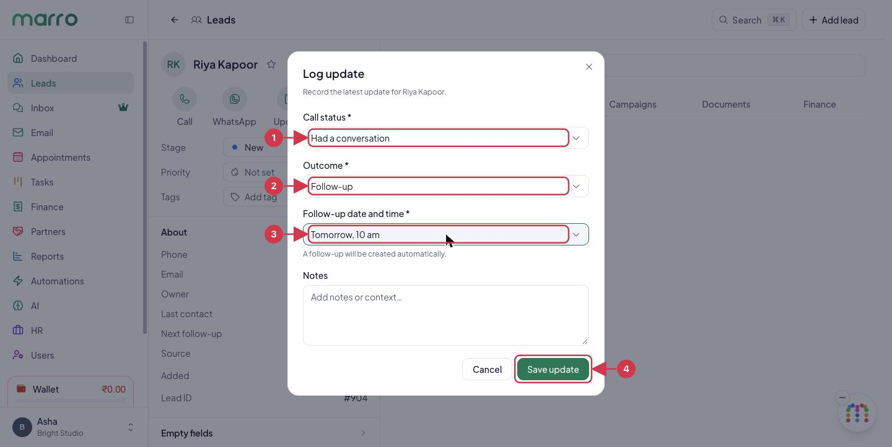
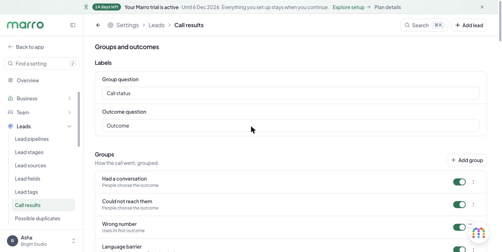
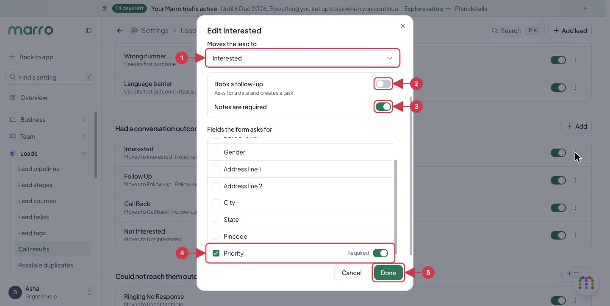
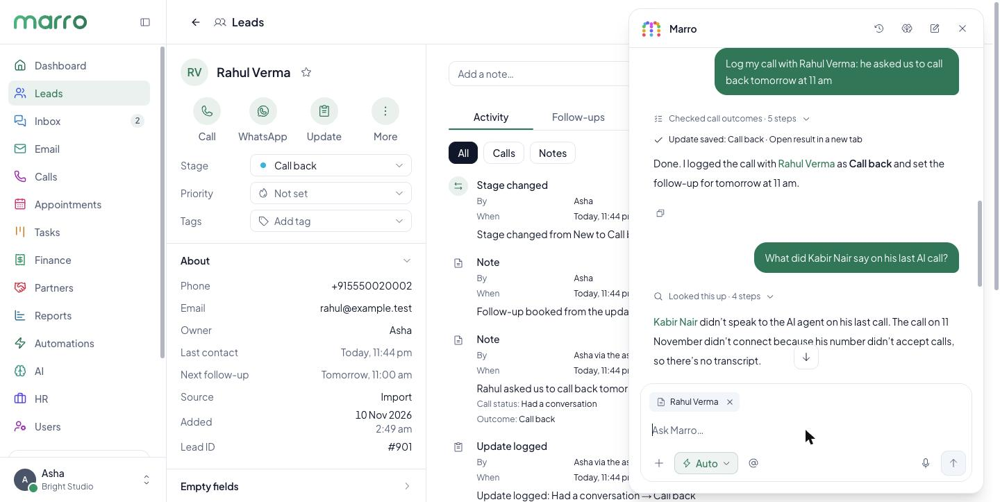

Log update is what your team fills in after a call. An administrator sets it up in **Settings → Leads → Call results**. The web app, mobile app and assistant all use the same form.

## Log an update

1. On a lead's page, choose **Update**.
2. Pick how the call went, then the outcome.
3. Fill in what the outcome asks for. Fields start with the lead's current values.
4. If the outcome has a follow-up, choose when: in an hour, tomorrow at 10 am, in 2 days, next week, or another time.

Saving moves the lead to the outcome's stage, books the follow-up and records it on the timeline.

<Frame>
  
</Frame>

<Frame>
  
</Frame>

<Frame>
  
</Frame>

## Choose what the team sees

| Tab | You set |
| --- | --- |
| **Form** | Title, description, labels, help text, button wording, section order, one or two columns, dialog width |
| **Notes** | Whether notes show and are required, label, placeholder, length, box height |

Use `{leadName}` in the description to show the lead's name. Phones use one column. Notes must stay shown while any outcome requires them.

## Lead types

Add your own choices with names and help text.

| Option | Effect |
| --- | --- |
| Individual or business role | Fixed once saved. For a different role, add another choice |
| **Classification only** | Saves the type and notes, no group or outcome |
| **Ask for the lead type** off | Keeps each lead's current type |

## Groups and outcomes

<Frame>
  
</Frame>

- **Groups**: add, rename, reorder or hide. A group lets people choose an outcome, or uses its first shown outcome automatically. A group can also route by language, using your assignment rules.
- **Outcomes**: set the group, stage, follow-up task title and priority, required notes, and the fields to ask for (each can be required).

<Frame>
  
</Frame>

Saved choices are hidden, not erased, so earlier activity keeps its meaning. Choose **Save**. If another administrator saved first, reload and try again.

## On the mobile app

| Situation | What happens |
| --- | --- |
| Offline update, form changed since | Kept as a review draft. Choose **Review** and check before saving |
| App too old to show the form | It asks you to update |

## Ask Marro

<Card title="Try asking" icon="message-circle">
  *"Log a call with Neha: interested, follow up tomorrow at 10"*

  Marro uses the same checks. Changing the settings needs administrator access and approval.
</Card>

<Frame>
  
</Frame>
