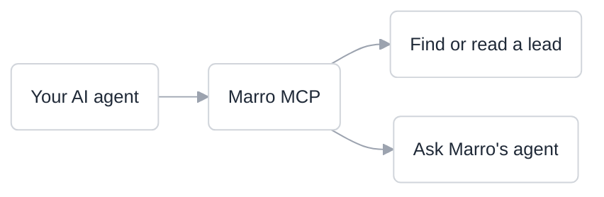

Marro offers its lead tools to other AI agents over **MCP** (Model Context Protocol). Connect an agent you already use, and it can find leads, read them and ask Marro's agent to act on one.

## Connect

<Steps>
  <Step title="Create a key">
    In **Settings → Integrations → API keys**, create a key with the **AI agent tools (MCP)** scope. Your plan needs AI, and you need access to settings.
  </Step>
  <Step title="Add the server">
    In your agent, add an MCP server at `https://app.marro.si/api/mcp` with the header `Authorization: Bearer <your key>`.
  </Step>
</Steps>

## Tools

| Tool | What it does |
| --- | --- |
| `find_leads` | Finds leads by phone, email or part of the name (up to 10). |
| `get_lead` | A lead's details, latest timeline, open follow-ups and what Marro's agents know. |
| `agent_capabilities` | What Marro's agent may do: on its own, asking first, or off. |
| `ask_agent` | Hands a lead to Marro's agent with an instruction in plain words. Set `dryRun` to see what it would do without changing anything. |

## Limits

| Rule | Detail |
| --- | --- |
| Permissions | `ask_agent` follows your [agent permissions](/guides/agents). **Ask me first** waits as a suggestion on the lead. |
| Hours and credits | Working hours and daily limits apply; it uses your [AI credits](/guides/ai-usage). |
| Rate | 600 tool calls an hour per key. |
| Disconnect | Revoke the key and the agent stops at once. |
