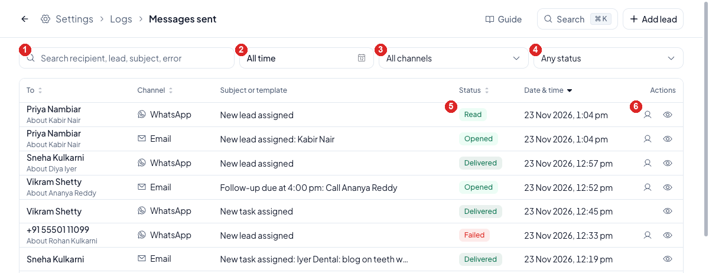
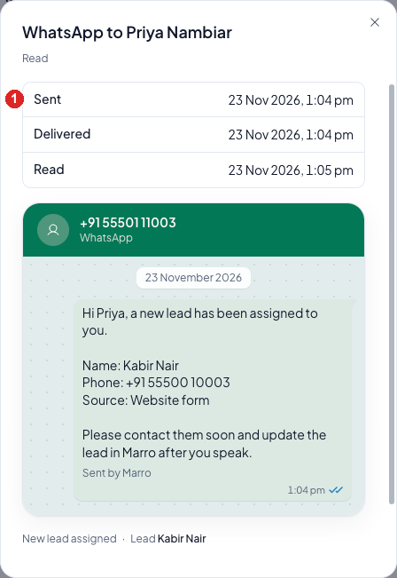
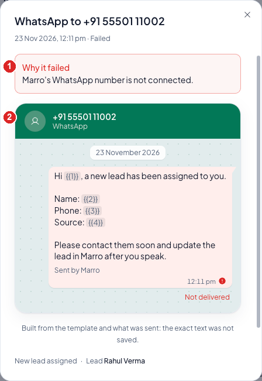

**Messages sent** lists every alert and message Marro sent for your organization: new-lead alerts to your team, follow-up reminders, portal links and more. Open **Settings → Logs → Messages sent**.

<Frame>
  
</Frame>

1. Search a person, lead, subject or error.
2. A period.
3. **Email**, **WhatsApp** or **SMS**.
4. **Status**: find what **Failed**, or was not read.
5. How far it got: **Sent**, **Delivered**, **Read** (an email says **Opened**) or **Failed**.
6. **Open the lead** the message was about, and **View** the message with its times.

Each message is its own row: an alert sent by WhatsApp and by email shows twice. A team member shows by name; under it, **About** names the lead the message was about.

## When it was delivered and read

Click a row, or **View**.

<Frame>
  
</Frame>

1. When it was **Sent**, **Delivered** and **Read** (or **Opened**, for an email). A step not reached yet is not listed.

## Why a message failed

<Frame>
  
</Frame>

1. When it failed.
2. **Why it failed**, in plain words.
3. The message as it would have read.

<Note>
Fix the cause so later messages go through. Here, the team member's number in **Users** is not on WhatsApp.
</Note>

Which alerts are sent, and by which channel, is set in [Notifications](/guides/notifications).
