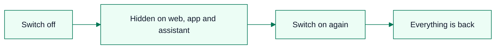

Marro is made of modules. **Settings → Modules** shows them in ten areas, each with a switch, one line on what it does, and how many are on.

| Area | Modules |
| --- | --- |
| **Leads** | Leads and pipeline · Customers and opportunities · Forms and lead pages · Import and export · Partners |
| **Conversations** | Inbox · Broadcasts · Email sequences (with email campaigns) |
| **Calling** | Cloud calls · Call flows and ring groups · AI calls |
| **Finance** | Catalogue and payment links · Quotes · Invoices and payments · Customer portal |
| **Work** | Tasks and boards · Appointments |
| **Automation and AI** | Automations · Assistant · Agents · Knowledge |
| **Insight** | Standard reports · Custom reports and dashboards · Forecast and scheduled reports |
| **Build your own** | Custom objects · API and webhooks |
| **Team (HR)** | Attendance · Leave · Timesheets · Expenses · Payroll · Performance |
| **Control** | Branches · Company sign-on · Activity log |

Roles and teams, two-step sign-in, data export and team task boards are in every plan and are not modules.

## What each plan includes

| Plan | Modules |
| --- | --- |
| **Starter** | Leads and pipeline, Customers and opportunities, Forms and lead pages, Import and export, Inbox, Tasks, Appointments, Cloud calls, Catalogue and payment links, Standard reports, Automations (5 on at once), Assistant |
| **Growth** | Starter, plus Agents, AI calls, Knowledge, Call flows and ring groups, Quotes, Invoices and payments, Customer portal, Broadcasts, Email sequences, Custom reports and dashboards, Custom objects (3), Partners (10 logins), API and webhooks, 25 automations, HR Attendance and Leave |
| **Complete** | Every module, with unlimited automations and partner logins and up to 20 custom objects |

A module your plan doesn't include is greyed, with a crown and the plan that has it ("Available on Growth"), and a link to **Subscription**. It is left out of the menu.

## Switch a module off

Only your organization's administrator can use the switches.

Nothing is deleted. A switch can only narrow your plan, never add a module it doesn't include.

Some modules need another one. Marro tells you which before you confirm.

| If this is off | These go with it |
| --- | --- |
| Inbox | Broadcasts |
| Quotes | Invoices |
| Cloud calls | Call flows |
| Leads and pipeline | Almost everything |

A dependent module shows "Off while … is off".

## Limits

Some things are counted, not switched: automations on at once, custom objects and partner logins. **Settings → Subscription** shows your use of each.

At a limit, only adding one more is refused, with the plan that lifts it. Nothing you have is hidden or removed. Partner logins never count as paid users.

## AI modules

<CardGroup cols={2}>
  <Card title="Plan includes it, switched off" icon="toggle-left">Its pages offer to turn it on.</Card>
  <Card title="Plan doesn't include it" icon="lock">Its pages show what it does and which plan has it.</Card>
</CardGroup>

The Assistant, Agents, Knowledge and AI calls are separate modules. What you wrote in Business knowledge is kept while Knowledge is off.
