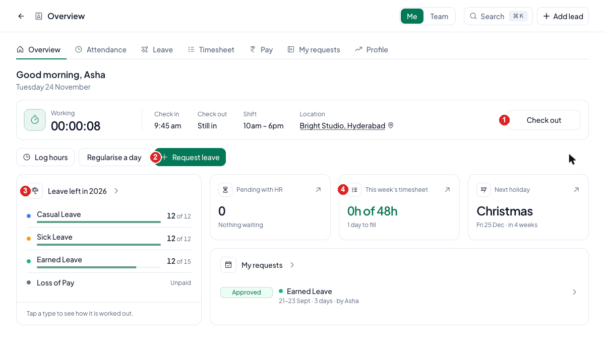
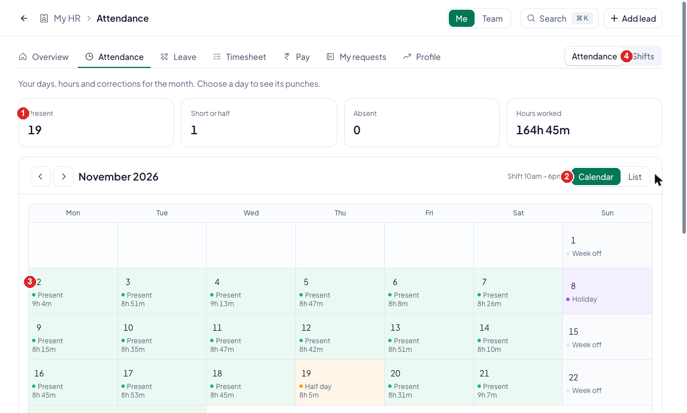
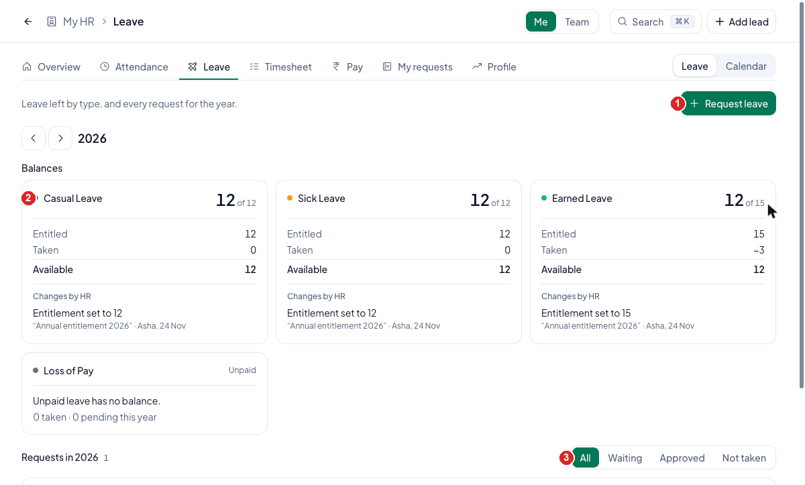

Open **HR**. Staff see **My HR**. Someone who also manages the team switches between **Me** and **Team** at the top. What shows depends on your organization's HR modules and your role.

## Overview

<Frame>
  
</Frame>

1. **Check in** and **Check out**. Your shift and location are beside them.
2. **Request leave**. **Log hours** and **Regularise a day** sit next to it.
3. **Leave left** this year, by type. Select a type to see how it is worked out.
4. This week's timesheet, what is waiting with HR, and the next holiday.

## Attendance

<Frame>
  
</Frame>

1. The month at a glance.
2. **Calendar** or **List**.
3. Select a day to see its check-ins and outs. If one is wrong or missing, ask for a correction (**Regularise a day**).
4. **Shifts**: the shifts you are on.

| A day is | When |
| --- | --- |
| **Present** | You worked a full day |
| **Half day** | Fewer hours, or you came in after the late time |
| **Short hours** | Under the half-day hours, once you have checked out |
| **Absent** | A working day with no check-in and no leave |

## Leave

<Frame>
  
</Frame>

1. **Request leave**: the type, the dates, half days, and a reason.
2. Each type shows entitled, taken and available, and any changes HR made.
3. Your requests, filtered by **Waiting**, **Approved** or **Not taken**.

You can cancel a request before it starts. Once approved leave has started, you ask to cut it short instead.

## Timesheet, pay and requests

| Tab | What you do |
| --- | --- |
| **Timesheet** | Log hours against each working day, then **Submit week for approval** |
| **Pay → Payslips** | Every approved payslip, to open |
| **Pay → Expenses** | **New claim** with the amount, date and receipt, and follow it until it is paid |
| **My requests** | Every leave, correction and timesheet request, with who decided it |
| **Profile** | Your goals, reviews and documents HR added |

Ask Marro or the staff assistant on WhatsApp to show your expense claims or withdraw one you submitted. Name the expense and date, then review and approve the withdrawal in chat. You can withdraw your own claim while it is awaiting review.

## Ask Marro

<Card title="Try asking" icon="message-circle">
  *"How much casual leave do I have left?"*

  *"Request leave on 5 and 6 December, family function"*

  Marro reads your HR records and asks before sending any request.
</Card>
