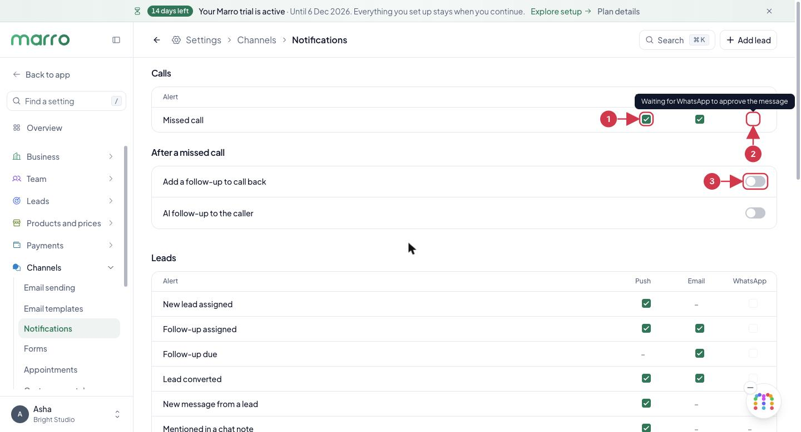
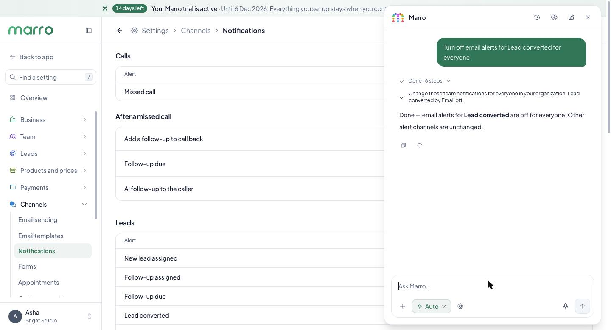

An organization administrator opens **Settings → Notifications**. Anything switched off there stops for everyone in the organization.

<Frame>
  
</Frame>

## Alerts by module

Each area is a table: one row per alert, one column per channel (**In app**, **Push**, **Email**, **WhatsApp**). Tick a box to send that alert that way. A dash means it is never sent that way. A greyed box shows why when you point at it, for example while WhatsApp approves the message.

| Area | Alerts |
| --- | --- |
| Calls | Missed call |
| Leads | New lead assigned, Follow-up assigned, Follow-up due, Lead converted, New message from a lead, Portal activity |
| Tasks | Task assigned, Task moved, Task completed, Mentioned in a comment |
| HR | Approval needed, Request decided, Check-in reminder |
| Appointments | Appointment booked or moved, Appointment starting |
| Automations | Automation failed |

When an automation fails, an email goes to the person who made it, at most once a day for each automation.

## Missed calls

The **Calls** section also decides what a missed call sets off:

| Setting | What it does |
| --- | --- |
| **Add a follow-up to call back** | One open follow-up per lead, however often they call. Choose when it is **Follow-up due**. |
| **AI follow-up to the caller** | Lets your AI agents act on a missed call. Off by default. Automations set to **Missed calls only** still run. |

## Ask Marro

<Frame>
  
</Frame>

<Card title="Try asking" icon="message-circle">
  *"After a missed call, add a follow-up to call back"*

  *"Turn off email alerts for Lead converted for everyone"*

  Marro changes the setting for the whole organization, and says so.
</Card>

## Messages sent

**Settings → Messages sent** lists every WhatsApp message, SMS and email Marro sent for you. Use the **Status** filter to find messages that failed or were not read.

| Status | Means |
| --- | --- |
| **Sent** | Handed to the provider |
| **Delivered** | Reached the phone or inbox |
| **Read** / **Opened** | The person looked at it (WhatsApp / email) |
| **Failed** | It did not arrive, with the reason when known |

SMS shows only Sent or Failed. An email shows **Opened** only if the person's mail app loads images, so treat it as a minimum.

## Not on this page

| Where | What |
| --- | --- |
| **Appointments** | Reminders leads get before an appointment |
| Always sent | Sign-in, invitation and password emails, and steps in your own automations |
