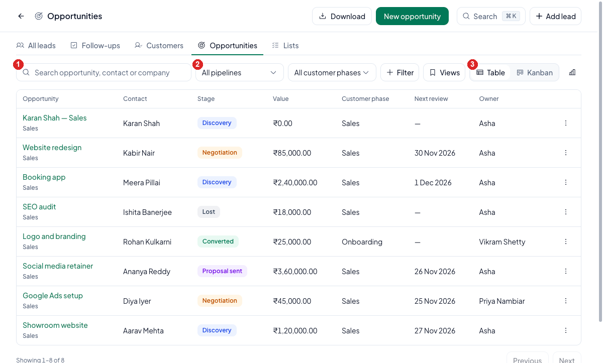
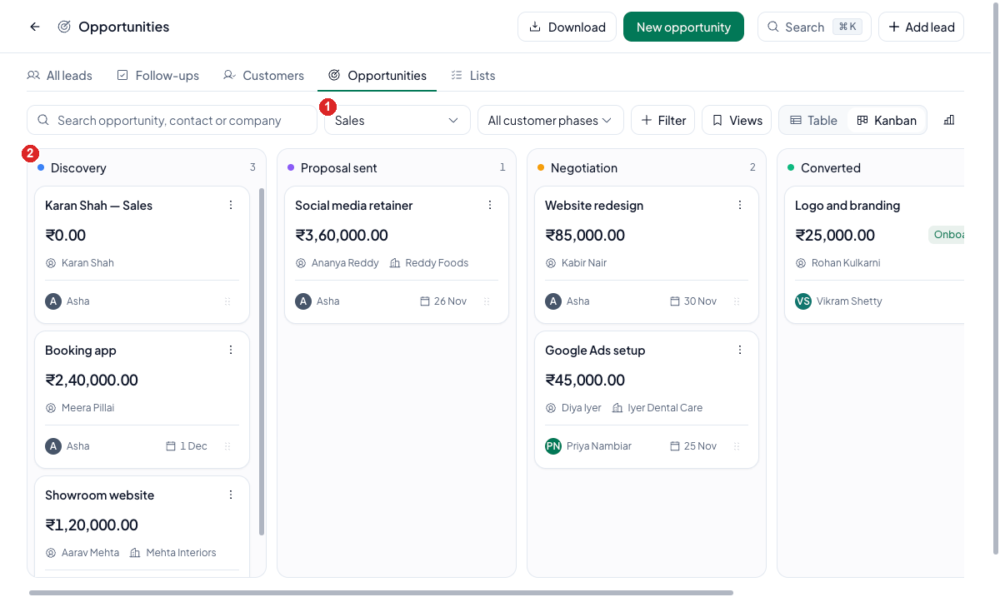
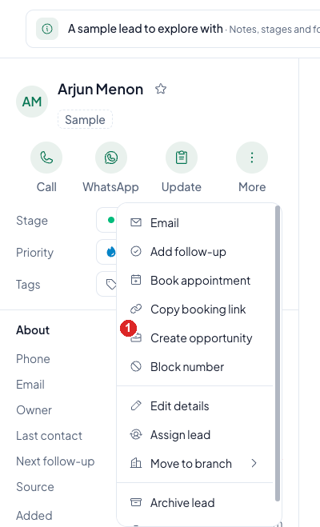
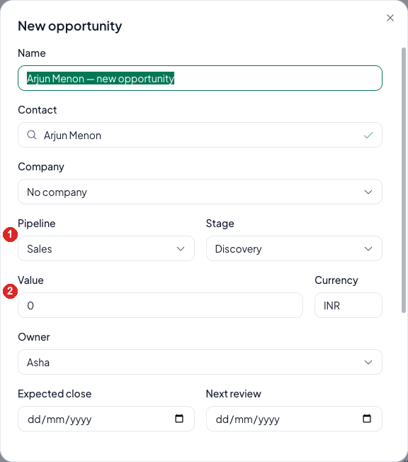
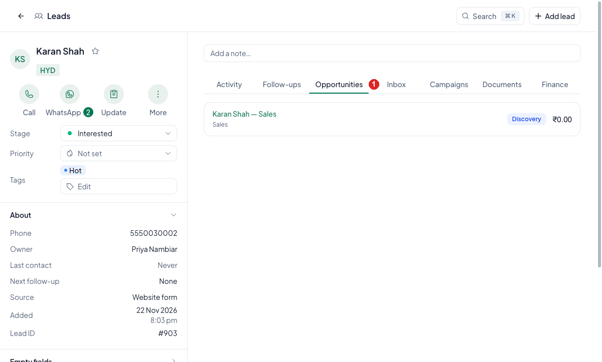
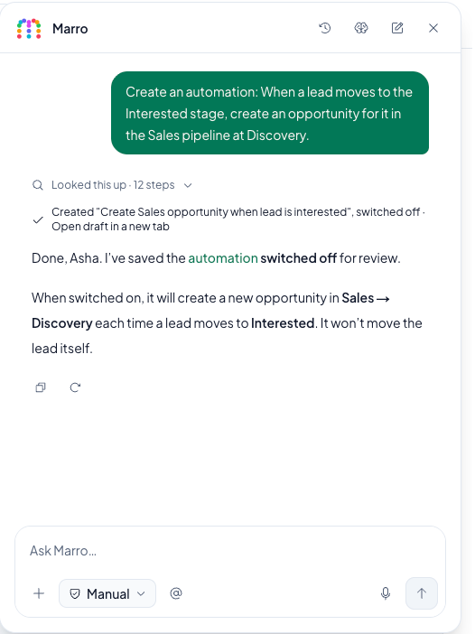
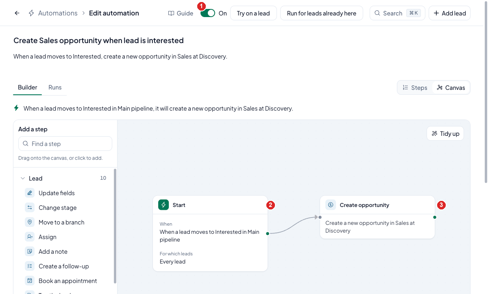
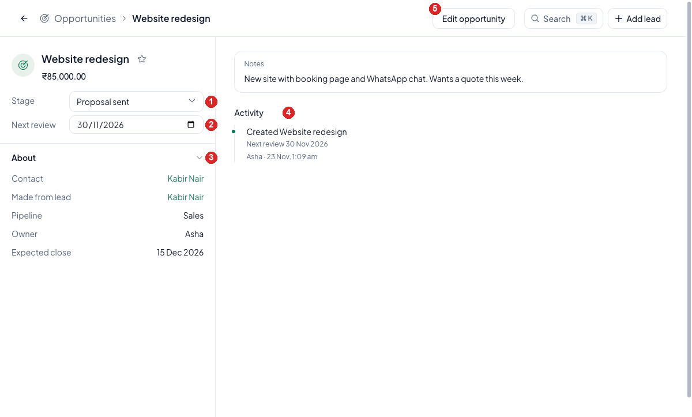

An **opportunity** is one deal with a customer: *Website redesign, ₹85,000, closing 15 Dec*. A lead can have several. Find them in **Leads → Opportunities**.

<Frame>
  
</Frame>

1. Search by opportunity, contact or company.
2. Pick the pipeline. To keep deals apart from leads, see [Pipelines](/guides/pipelines).
3. **Table** or **Kanban**. Each row's ⋯ menu opens or edits it.

<Frame>
  
</Frame>

On **Kanban**, drag a card to another stage.

## Make one from a lead

<Frame>
  
</Frame>

On the lead, choose **More → Create opportunity** (1).

<Frame>
  
</Frame>

1. **Pipeline** and **Stage** start at your opportunities default.
2. Add the **Value**, **Owner**, **Expected close** and **Next review**, then **Save opportunity**.

The lead's contact is reused or made for you. The lead itself is not changed. It shows the deal in its **Opportunities** tab:

<Frame>
  
</Frame>

## Make one automatically

Let Marro make the opportunity when a lead reaches a stage. In **Automations → New automation**, describe it and choose **Ask Marro**:

<Frame>
  
</Frame>

<Frame>
  
</Frame>

1. Switch it **On** and **Save and switch on**.
2. **Start**: *A lead's stage changes* to the stage you pick.
3. **Create opportunity**: the pipeline, starting stage and value. Choose one per lead, or a new one each time.

Add **Set the lead's stage from the opportunity** to keep the two in step. Sample leads never run automations.

## Work an opportunity

<Frame>
  
</Frame>

1. **Stage**: change it here; **Save** appears.
2. **Next review**: when to look at it again.
3. **About**: the contact, the lead it came from, pipeline, owner, expected close.
4. **Activity**: every change, newest first.
5. **Edit opportunity** changes the name, value, company and notes.

When it reaches a won stage such as *Converted*, pick its **Customer phase**: Onboarding, Delivery, Follow-up, Renewal or Complete.

## Ask Marro

<Card title="Try asking" icon="message-circle">
  *"Create an opportunity for Kabir Nair: Website redesign, ₹85,000, closing 15 December"*

  *"Which opportunities are in Negotiation, and what are they worth?"*

  *"Move Website redesign to Proposal sent"*
</Card>

## For developers

<Card title="Opportunities in the API" icon="code" href="/api-reference/customers/list-records">List, create and update opportunities like any customer record.</Card>
