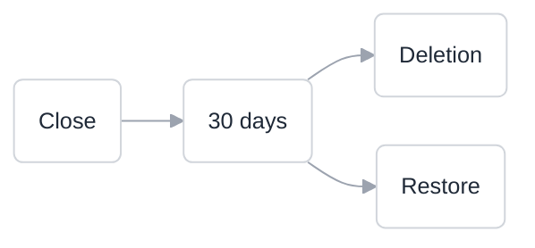

Any active **admin** can close the organization while signed in as themselves. Open **Settings → Close organization**, or **Account → Organization closure** in the app (it opens the same secure web page). Every step asks for your current password. If you sign in with Google or Microsoft, set a password from the sign-in page first.

## Close

<Steps>
  <Step title="Review the data">Enter your password and choose **Review data**. You see how many leads, contacts, messages, files and other records will be deleted. You can **Download data** right there.</Step>
  <Step title="Close">Tick the confirmation and choose **Close organization**.</Step>
</Steps>

Closing signs everyone out and stops messages, calls and automations. It does not cancel your subscription, and amounts owed to Marro are not waived. If a lot changes while you review, Marro asks you to review again.

## The 30 days

| When | What you can do |
| --- | --- |
| Until the deadline | **Download data** or **Restore organization** |
| 15 days and 1 day before | We email the admin who requested closure |
| After the deadline | No restore. You can still download until deletion starts |
| Any time | **Delete now** skips the rest. It can't be undone |

The closure page shows the exact deadline and days left. **Restoring** brings everyone back, but messages, calls and automations stay paused until you choose **Resume activity**. Reminders set before the closure stay cancelled.

## Download your data

<CardGroup cols={2}>
  <Card title="Included" icon="download">Every record table, the member list and your files, as NDJSON. Large organizations download in several parts: keep them all. The last ends with `"completed": true`.</Card>
  <Card title="Left out" icon="eye-slash">Internal AI pricing records, passwords, tokens and data shared with other organizations. Files over 64 MiB are listed as omitted; [support](https://app.marro.si/legal/support) can send them.</Card>
</CardGroup>

## Deletion

After the deadline, records and files are deleted in batches, aiming for seven days. The closure page shows progress for records, files and connected services.

| What | After deletion |
| --- | --- |
| Marro's own billing records (contracts, wallet entries, billable AI calls) | Kept for eight years, as accounting law requires. They hold no CRM content |
| Copies outside Marro (phones, your downloads, other services) and expiring backups | Not deleted by Marro |

## Reassign the recorded creator

<Steps>
  <Step title="Open Organization creator">The creator opens it on the closure page.</Step>
  <Step title="Choose another active admin">Confirm with the creator's password.</Step>
</Steps>

This doesn't change who can close: every active admin can. If the creator has left, ask [support](https://app.marro.si/legal/support).

## Ask Marro

<Card title="Try asking" icon="message-circle">
  *"Where is our organization closure?"*

  Marro tells an admin where it stands and opens the closure page. It never asks for your password and never closes, restores or deletes anything in chat.
</Card>
