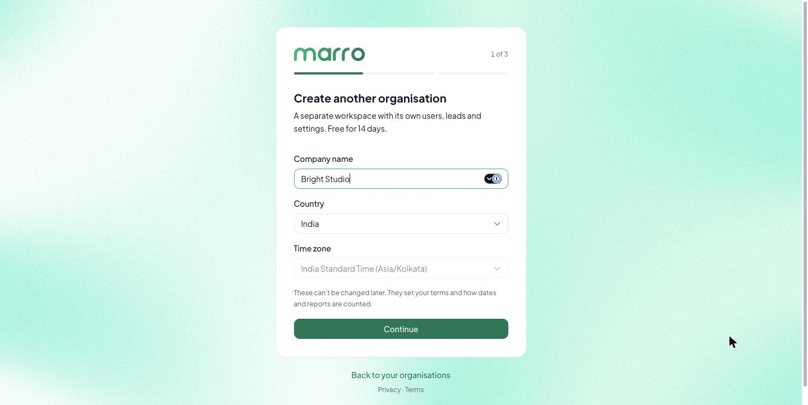
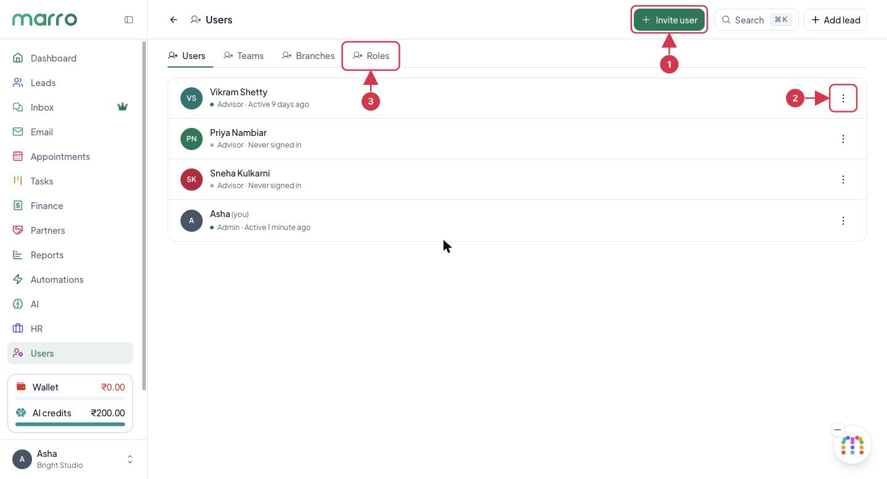

import { Flow } from "/snippets/flow.jsx";

Start with one enquiry source and one person responsible for it. Your first milestone: an enquiry comes in, someone owns it, and they know what to do next. Then connect the rest.

<Flow steps={["Create workspace", "Decide how you work enquiries", "Test one enquiry", "Connect modules"]} />

## 1. Create your workspace

<Frame>
  
</Frame>

1. [Create your workspace](/guides/sign-up) and confirm your email if you used a password. Choose the country and time zone: they set currency, dates and reporting.
2. Choose the closest industry, or **Others**, and answer the setup questions. You can skip and return later.
3. If you see **Add suggested fields for your business**, choose it only if they're useful. Industry stages, fields and follow-ups are in **Settings → Business → Industry starter**, previewed before you add them. Starter booking types and workflows must be enabled separately.
4. On **Welcome**, follow the setup suggestions. In **Settings**, open [Business profile](/guides/business-profile) and describe what you sell, who you serve and what happens after a sale.
5. Check [Modules](/guides/modules). A missing menu item can mean the module is off, not in your plan, or hidden from your role. A module being on doesn't connect a channel.

## 2. Decide how your team works enquiries

<Frame>
  
</Frame>

| Decision | Where | Tip |
| --- | --- | --- |
| Pipeline | [Lead stages](/guides/pipelines) | Mirror what happens, e.g. New → Contacted → Appointment booked → Converted. Keep one pipeline until teams differ |
| Fields | [Custom fields](/guides/custom-fields) | Only fields that change a decision. Collect the rest later |
| Ownership | **Users**, **Users → Teams**, **Lead assignment** | Invite the people who will work enquiries. Working alone? Assign enquiries to yourself. See [users](/guides/users), [roles](/guides/roles) and [teams](/guides/teams) |
| Locations | [Branches](/guides/branches) | Only if staff, enquiries or reports split by location |
| Security | [Two-step sign-in](/guides/two-step-sign-in), [Company sign-in](/guides/company-sign-in) | Company sign-in needs the module |

## 3. Put one enquiry through the whole process

<Steps>
  <Step title="Choose one way in">
    In **Settings**, search **Forms**, pick a template, review the questions, **Publish**, and open the public link from **Share**. Already have a website form? [Connect it](/guides/connect-a-website). Or try [lead ads or Google Sheets](/guides/integrations), or add a lead by hand. Importing a list? Try a small batch first.
  </Step>
  <Step title="Send a test enquiry as a customer">
    Use contact details you control. In **Leads**, check its source, pipeline, stage and owner. Submit again to see how duplicates behave. Repeat for each channel.
  </Step>
  <Step title="Give it a next step">
    On the lead, **More → Add follow-up**, or **More → Book appointment** once a time is agreed. Move the lead to the matching stage. Check the **Follow-ups** tab.
  </Step>
  <Step title="Try it as the person who does the work">
    Have an advisor sign in, find the enquiry, record the outcome and confirm they see only what their role allows. Check **Reports** for the expected source and stage.
  </Step>
</Steps>

## 4. Connect modules around your workflow

Add a module when it solves a problem for the team.

| When you need to… | Connect | Check before launch |
| --- | --- | --- |
| See and answer messages in one place | [Inbox](/guides/inbox), [website chat](/guides/website-chat) or WhatsApp, Instagram, Messenger; [Email](/guides/email) | Send a test message, reply, confirm it arrives |
| Answer or follow up calls | [Cloud calls](/guides/cloud-calls), ring groups or call flows, follow-up tasks | Test direct and forwarded calls, and what happens when nobody answers |
| Let customers book | [Appointments](/guides/appointments), staff availability, a booking link | Hours, types, time zone, who gets it, rescheduling |
| Make follow-up consistent | [Automations](/guides/automations), stages, tasks | Start with one internal task. Test a record that qualifies and one that doesn't |
| Give AI the facts | [Business knowledge](/guides/business-knowledge), [Ask Marro](/guides/assistant), [Agents](/guides/agents), [AI calls](/guides/ai-calling) | Add approved details; check answers where facts are missing; review permissions before automatic replies |
| Quote and get paid | **Products and prices**, [Quotes and invoices](/guides/quotes-and-invoices), [Payments](/guides/payments), Customer portal | A test quote and invoice; amount due and status; what the portal shows |
| Run campaigns | [Email campaigns](/guides/email-campaigns), [sequences](/guides/email-sequences), [contact preferences](/guides/contact-preferences), [campaign reports](/guides/campaigns) | Sender, audience, opt-outs, test delivery, consistent link tags |
| Track repeat or specialist work | [Customers and opportunities](/guides/pipelines), [case workflows](/guides/case-workflows), [custom objects](/guides/custom-objects), [API and webhooks](/guides/webhooks) | One contact per person, one opportunity per deal |
| Manage people | **HR and tasks**, [Custom reports](/guides/custom-reports), [Forecast](/guides/sales-forecasting) | Hours, policies, approvals; try one request as staff and approve as manager |

## 5. Adapt it to your industry

| Business | First workflow |
| --- | --- |
| Education consultancy | Course enquiry → advisor → counselling → application. Add intake fields and a document checklist |
| Clinic or salon | Appointment enquiry → right branch or person → book and confirm. Add missed-call follow-up |
| Real estate | Viewing request → area or property → site visit → negotiation. Use a property record for listings |
| Agency or professional services | Brief → owner → discovery → quote → invoice. One opportunity per engagement |
| Home services | Request → location → assessment → quote. Add branch or team assignment |

## Build a routine

| When | Do |
| --- | --- |
| Each morning | Check unassigned enquiries, overdue follow-ups, missed calls and today's appointments. Give each open enquiry an owner and next step |
| Each week | Review enquiries by source and stage. Check real records before changing a rule |
| When something changes | Update the source of truth first: prices in **Products and prices**, hours in **Appointments**, policies in **Business knowledge** |

## Before real enquiries arrive

| Check | Done when |
| --- | --- |
| Sources | Each creates or matches the right record and owner |
| People | Advisors find their work; managers see what needs attention |
| Follow-up | A test follow-up and booking show on the lead. Automations run only on intended records |
| Channels | Connected channels send and receive tests. Check charges in [Plans and billing](/guides/billing) |
| Reporting | One report shows new enquiries, overdue follow-ups and conversions |

<Card title="Try asking" icon="message-circle" href="/guides/assistant">
  *"Help me set up a lead form for my clinic."*

  Marro proposes the steps and asks before applying. Stuck? Contact [Help and support](/guides/support).
</Card>
