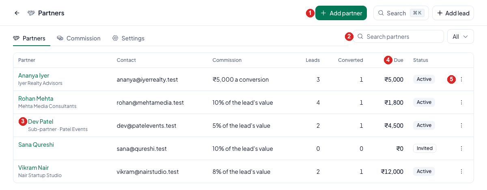
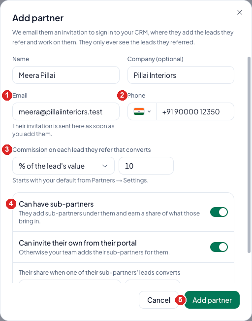
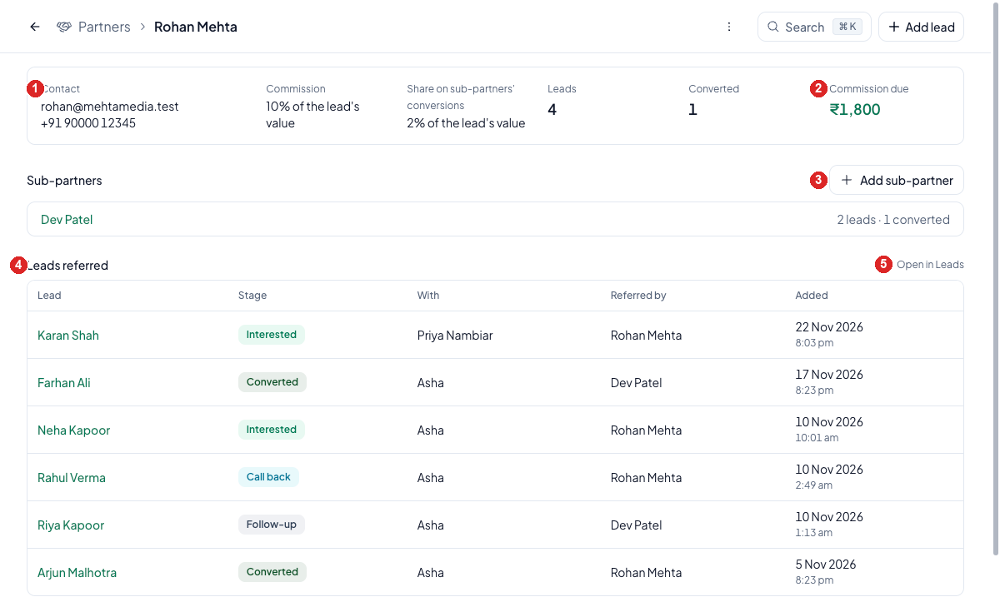
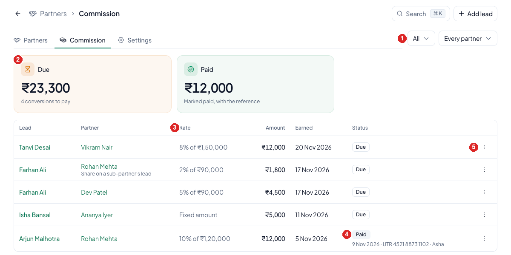
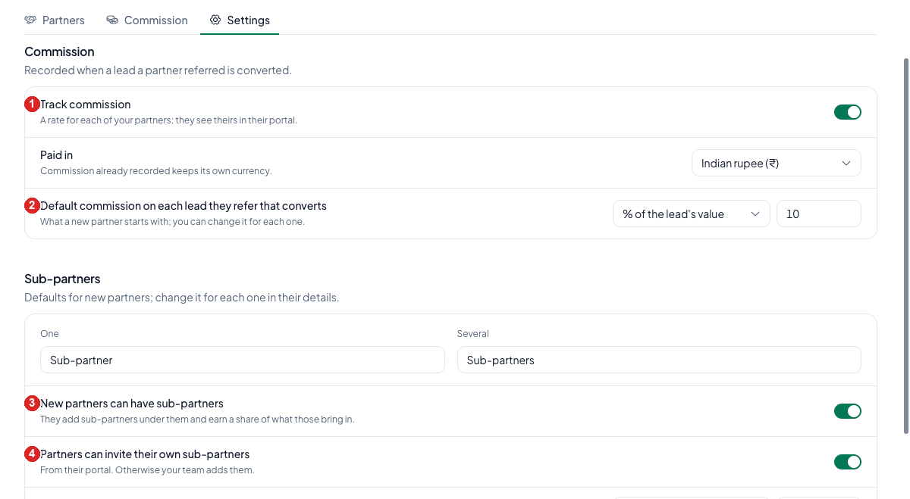

import { Flow } from "/snippets/flow.jsx";

Partners are agents, consultants or channel partners who send you leads. Each one signs in to Marro and sees only the leads they referred. Open **Partners**. It comes with the Growth plan, for roles with **See partners** (**Manage partners** to add them and pay commission).

<Flow steps={["Invite", "They add leads", "Lead converts", "Commission due", "Paid"]} />

You choose what they are called in **Partners → Settings**: Agents, Consultants, Associates. Every screen, email and their own sign-in uses your word.

## Your partners

<Frame>
  
</Frame>

1. **Add partner**.
2. Search by name, company, email or phone, and filter by status: *Active*, *Invited*, *Inactive*.
3. A **sub-partner** sits under the partner who brought them.
4. **Due**: commission earned and not yet paid.
5. **⋯**: edit, resend the invitation or a password reset link, copy that link, add a sub-partner, deactivate.

## Add one

<Frame>
  
</Frame>

1. **Email**: their invitation goes here as soon as you add them. They set a password and sign in.
2. **Phone**, with the country.
3. **Commission**: a fixed amount or a % of the lead's value. It starts with your default.
4. **Can have sub-partners**, and whether they invite their own. Their share of a sub-partner's conversion goes below.
5. **Add partner**.

A partner with nothing on record (no leads, commission or sub-partners) can be deleted. Anyone else is **deactivated**: they are signed out and their history stays.

## One partner

<Frame>
  
</Frame>

1. Contact and rates.
2. **Commission due**: opens their rows on **Commission**.
3. **Add sub-partner**.
4. **Leads referred**, by them and their sub-partners, with stage and who on your team has each.
5. **Open in Leads** shows the same leads in the full list, to filter or work on.

## Commission

<Frame>
  
</Frame>

1. Filter by status (*Due*, *Paid*, *Void*, *All*) and by partner.
2. **Due** and **Paid** totals.
3. **Rate**: the % and the value it was worked out on, or *Fixed amount*.
4. *Paid* shows the date, your reference (UTR, cheque number) and who marked it.
5. **⋯**: **Mark paid**, **Change amount**, **Void**.

A row is written when a referred lead reaches a converted stage, once per lead. A sub-partner's conversion also gives their partner their share. The amount is fixed when earned: changing a rate later changes only future ones. A % on a lead with no value shows **To set**.

## Settings

<Frame>
  
</Frame>

1. **Track commission**, and the currency it is paid in.
2. **Default commission**: what a new partner starts with.
3. **New partners can have sub-partners**, and the default share they get.
4. **Partners can invite their own sub-partners** from their sign-in. Otherwise your team adds them.

<Note>The Growth plan includes 10 partner logins. Partners do not count as users.</Note>

## Ask Marro

<Card title="Try asking" icon="message-circle">
  *"Which partner brought the most leads this month?"*

  *"Add Meera Pillai from Pillai Interiors as a partner, meera@pillaiinteriors.com"*

  *"Mark Ananya's commission on Isha Bansal paid, UTR 4521 8873"*

  Marro lists partners and commission, adds and invites partners, credits a lead to a partner and marks commission paid, each with your approval.
</Card>
