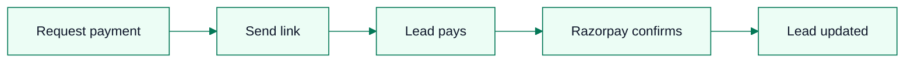

Marro sends payment links through your own Razorpay account. Once Razorpay confirms a payment, it shows on the lead and its timeline, can move the lead to a stage, starts automations and counts as revenue in Reports.

## Connect Razorpay

1. Open **Settings → Integrations → Razorpay**.
2. Enter your **Key ID** and **Key secret** from Razorpay's **Account & Settings → API Keys**.
3. In Razorpay, open **Account & Settings → Webhooks → Add New Webhook**.
4. Paste the webhook URL and secret shown in Marro.
5. Tick `payment_link.paid`, `payment_link.expired` and `payment_link.cancelled`, then save. Use the same mode (Test or Live) as your key.

## Set up what you sell

- **Settings → Products and payments → Products and prices**: each product or service with its price and, if you like, the parts it is paid in.
- **Settings → Products and payments → Payments**: under **When a lead pays**, choose **Move the lead to** a stage or **Keep it where it is**. A lead only moves forwards.

## Request a payment

1. Open the lead and go to the **Finance** tab. It shows **Value**, **Paid** and **Still due**.
2. Press **Request payment**.
3. Choose a product, one part of its price, or **Something else**. Change the amount for a discount or part payment, and set a pay-by day if you want.
4. Press **Create payment link**.
5. **Send on WhatsApp** (within the 24-hour reply window), or copy the link and share it another way.

Razorpay's own SMS and email are off, so the lead hears from your team.

## View payments

Open **Finance → Payments**. It starts on **Received**. You see only the invoices and leads your role can see.

| Filter | Use it for |
| --- | --- |
| **Status** | Received, or not yet paid |
| **Method** | How it was paid |
| **From**, **To** | The dates. Choose **Apply filters** |

## Automate

<Card title="A payment is received" icon="bolt" href="/guides/automations">
  Use this trigger in Automations to act on each payment.
</Card>

## For developers

[List payments](/api-reference/money/list-payments) and [record an invoice payment](/api-reference/money/record-invoice-payment).
