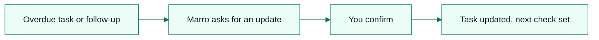

**Ask Marro** watches your overdue assigned tasks and lead follow-ups. It asks what happened, remembers your confirmed answer and checks again at the agreed time.

<Note>
Check-ins need AI access, enabled background agents and scheduled personal check-ins in your workspace. Tasks without a due date are not monitored.
</Note>

## Give a work update

Open **Ask Marro** and expand **Your work**, or use the **Your work** entry under your dashboard's question box. Or ask *"What needs my update?"* in Marro, the app or WhatsApp.

<Steps>
  <Step title="Pick an item">Select it, choose **Review with Marro**, or ask in your own words.</Step>
  <Step title="Say where it stands">**Still working**, **blocked** or **finished**, with a short note.</Step>
  <Step title="Agree the next deadline">For unfinished work. Times use your organization's time zone.</Step>
  <Step title="Confirm">Marro updates the task or follow-up and records the change.</Step>
</Steps>

- Confirmation is needed even in Auto mode. Silence is never treated as completion.
- For a finished board task, choose its completed or review stage. Review and publishing rules still apply.

## When it checks with you

| Rule | Detail |
| --- | --- |
| How often | At most one grouped invitation a day |
| When | Weekdays, 9 am to 6 pm in your time zone |
| Leave | Approved leave pauses routine invitations |
| Notifications | Mobile notifications show no customer or task details |

Proactive WhatsApp reminders are not included yet. You can still answer through your personal assistant on WhatsApp.

## Getting help

- A confirmed **blocked** update is visible to authorised team leads and admins.
- Work unanswered after two requests and 48 hours is raised with them.
- Managers see only work they have permission for. Private assistant memories are not shared.
- If an update is interrupted, Marro asks you to check the work record. It will not repeat the change itself.

## Pause your agent

Open **Check-in settings** beside **Your work** and choose **Pause check-ins**. It affects only your own monitoring. Choose **Resume check-ins** when ready.

## Ask Marro

<Card title="Try asking" icon="message-circle">
  *"What needs my update?"*

  *"Pause my check-ins"*

  Marro lists your work or pauses your check-ins.
</Card>
