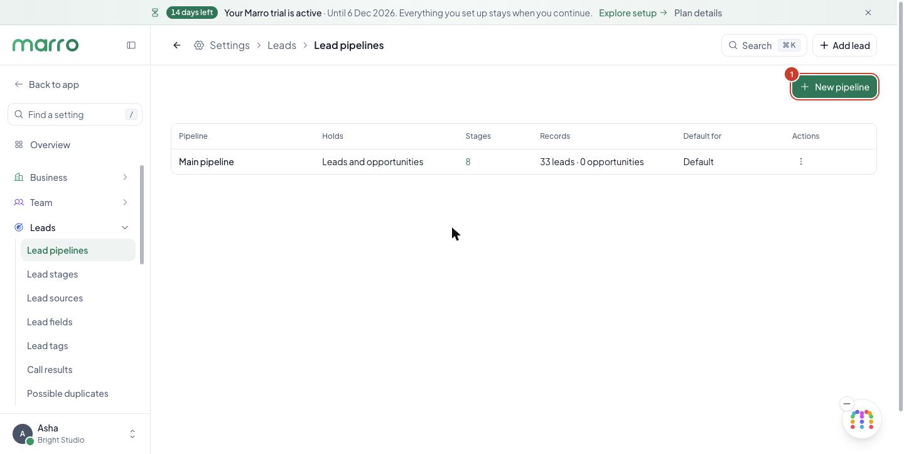
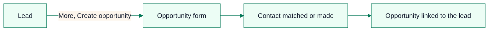

A pipeline is a track with its own stages. Each can hold leads, opportunities or both: for example an Enquiries pipeline for leads and an Admissions pipeline for applications.

<Frame>
  
</Frame>

1. **New pipeline** adds one.
2. The stage count opens the stages.
3. The row menu edits stages, renames, makes it the default, or sets what it holds.

## What a pipeline holds

Open **Settings → Lead stages**, pick the pipeline, then **Pipeline options**.

<Frame>
  
</Frame>

| Option | Effect |
| --- | --- |
| **Use for leads and opportunities** | The default for every pipeline. |
| **Use for leads only** | Left out of every opportunity list and picker. |
| **Use for opportunities only** | Left out of the leads page, lead forms, imports and lead automations. |

A pipeline can stop taking leads or opportunities only once none are in it. Marro never moves them for you.

## Two defaults

- New leads go into the **default for leads**, unless a form, import or automation names another.
- New opportunities go into the **default for opportunities**. The Opportunities board opens on it too.

Set each in **Pipeline options**. Changing one never changes the other.

## Stages

<Frame>
  
</Frame>

Stages show their order, name and type: *Open*, *Converted* or *Lost*. A tick marks where new leads start. Use the arrows to reorder and the **…** menu to edit, start new leads there, archive or delete.

When a lead moves into a converted stage from one that is not, Marro tells the owner and the organization's admins by email, WhatsApp and the app, once per conversion. The person who moved it is not told.

## Create an opportunity for a lead

- On a lead, choose **More → Create opportunity** (when Opportunities are on).
- Or use **Opportunities → New opportunity**. The contact field finds leads too, marked "Lead".

The lead is not changed, and can have as many opportunities as you need.

To keep them in step, use [automations](/guides/automations#keep-leads-and-opportunities-in-step).

## Ask Marro

<Card title="Try asking" icon="message-circle">
  *"What does the Admissions pipeline hold?"*

  *"Make Admissions opportunities only"*

  *"Create an opportunity for Neha Kapoor"*

  Marro can also set either default. You approve each change first.
</Card>
