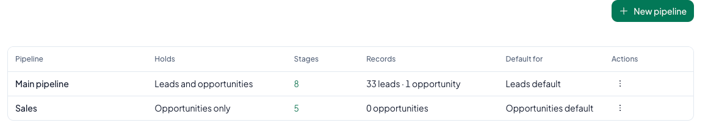
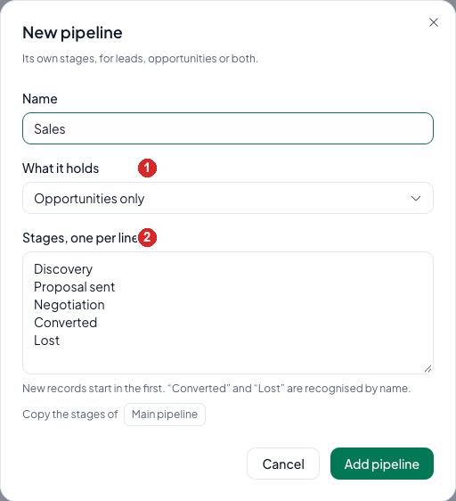
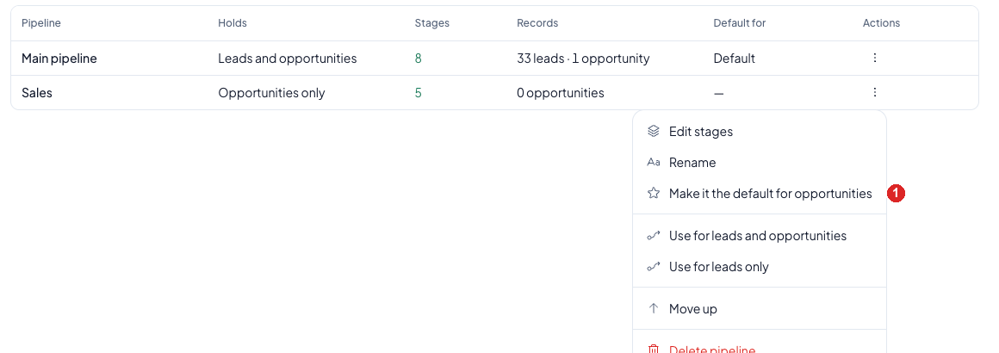

A pipeline is a track with its own stages. Each one holds leads, opportunities or both. For example: **Main pipeline** for enquiries, **Sales** for the deals that come out of them. Open **Settings → Leads → Lead pipelines**.

<Frame>
  
</Frame>

## Add a pipeline for opportunities

<Frame>
  
</Frame>

1. **Name** it, for example *Sales*.
2. **What it holds**: *Leads and opportunities*, *Leads only* or *Opportunities only*.
3. **Stages, one per line**. New records start in the first. Stages named *Converted* and *Lost* count as won and lost.

Or **Copy the stages of** another pipeline.

## Make it the default for opportunities

<Frame>
  
</Frame>

Open the pipeline's ⋯ menu and choose **Make it the default for opportunities** (1).

| New | Goes into |
| --- | --- |
| Leads | The **leads default**, unless a form, import or automation names another |
| Opportunities | The **opportunities default**. The Opportunities board opens on it too |

Changing one default never changes the other.

## What each choice hides

| What it holds | Where it is left out |
| --- | --- |
| **Leads only** | Every opportunity list and picker |
| **Opportunities only** | The leads page, lead forms, imports and lead automations |

A pipeline can stop taking leads or opportunities only once none are in it. Marro never moves them for you.

## Next

<CardGroup cols={2}>
  <Card title="Opportunities" icon="target" href="/guides/opportunities">Make them from a lead, by hand or automatically, and move them through the stages.</Card>
  <Card title="Lead stages" icon="list-ordered" href="/guides/stages">Name, colour, order and archive stages.</Card>
</CardGroup>

## Ask Marro

<Card title="Try asking" icon="message-circle">
  *"Add a Sales pipeline for opportunities only with Discovery, Proposal sent, Negotiation, Converted and Lost"*

  *"Make Sales the default for opportunities"*

  You approve each change first.
</Card>
