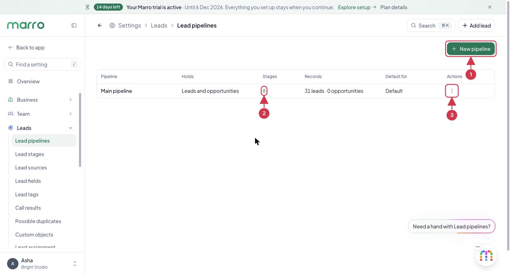
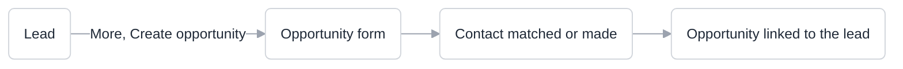

A pipeline is a track with its own stages. Each can hold leads, opportunities or both: for example an Enquiries pipeline for leads and an Admissions pipeline for applications.

<Frame>
  
</Frame>

1. **New pipeline** adds one.
2. The stage count opens the stages.
3. The row menu edits stages, renames, makes it the default, or sets what it holds.

## What a pipeline holds

Open **Settings → Leads → Lead stages**, pick the pipeline, then **Pipeline options**.

<Frame>
  
</Frame>

| Option | Effect |
| --- | --- |
| **Use for leads and opportunities** | The default for every pipeline. |
| **Use for leads only** | Left out of every opportunity list and picker. |
| **Use for opportunities only** | Left out of the leads page, lead forms, imports and lead automations. |

A pipeline can stop taking leads or opportunities only once none are in it. Marro never moves them for you.

## Two defaults

| New | Goes into |
| --- | --- |
| Leads | The **default for leads**, unless a form, import or automation names another |
| Opportunities | The **default for opportunities**. The Opportunities board opens on it too |

Set each in **Pipeline options**. Changing one never changes the other.

## Stages

Each pipeline has its own stages, set in **Settings → Leads → Lead stages**.

<CardGroup cols={2}>
  <Card title="Lead stages" icon="list-ordered" href="/guides/stages">Name, colour, order and archive stages; choose where new leads start.</Card>
  <Card title="Converted stages" icon="circle-check" href="/guides/stages#what-a-stage-means">When a lead moves into one, its owner and admins are told once.</Card>
</CardGroup>

## Create an opportunity for a lead

<Steps>
  <Step title="From a lead">Choose **More → Create opportunity** (when Opportunities are on).</Step>
  <Step title="Or from Opportunities">Use **Opportunities → New opportunity**. The contact field finds leads too, marked "Lead".</Step>
</Steps>

The lead is not changed, and can have as many opportunities as you need.

To keep them in step, use [automations](/guides/automations#keep-leads-and-opportunities-in-step).

## Ask Marro

<Card title="Try asking" icon="message-circle">
  *"What does the Admissions pipeline hold?"*

  *"Make Admissions opportunities only"*

  *"Create an opportunity for Neha Kapoor"*

  Marro can also set either default. You approve each change first.
</Card>
