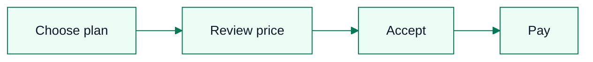

Marro sells from one published price list. The [pricing page](https://www.marro.si/pricing), checkout in **Settings → Subscription** and the assistant all read it, so the price you see is the price you are offered.

## Versions

Each plan and add-on has published terms: prices, included users, extra-user price, modules, limits and included AI. Any change is published as a new version, and a published version never changes.

| Who | Which version |
| --- | --- |
| New subscriptions | The one on sale when you accept the reviewed price |
| Your subscription | The one you bought, at every renewal, with the tax rate it was sold with |
| Moving to a newer version | Your choice: **Review new terms** (or **Review new add-on terms**) in **Settings → Subscription**, compare, approve |

Changing the number of users keeps every term you bought. Nobody is moved automatically.

AI beyond your plan and AI calls are paid from the prepaid [message wallet](/guides/billing#message-wallet). Meta bills WhatsApp messages to your own Meta account.

## The reviewed price

Marro shows the plan and version, period, users, add-ons, tax and total before any payment. The reviewed price lasts 15 minutes. If it expires or a new price list is published, review again. Nothing is charged at a price you did not see.

## When prices cannot be shown

<Note>
The pricing page says **Pricing temporarily unavailable** rather than show an older figure. Email hello@marro.si for current prices. The 14-day trial needs no price list or card.
</Note>

A new publication usually shows within minutes.

## For developers

<Card title="Published billing catalogue" icon="list" href="/api-reference/public-billing-catalogue/get-published-billing-catalogue">
  Public, no key needed. Only versions on sale, amounts in whole paise, `null` limit means unlimited.
</Card>

## For Marro platform administrators

In the platform console, under **Plans**:

<Steps>
  <Step title="Change a plan or add-on">
    It saves as a draft.
  </Step>
  <Step title="Review and publish">
    Choose **Review and publish…**, check the changes, tick **I have checked these prices and limits. New subscriptions will be sold on them.** and choose **Publish**.
  </Step>
  <Step title="Stop selling">
    Choose **Stop new sales…**. Existing subscriptions keep it.
  </Step>
</Steps>

Publishing never changes existing subscriptions.
