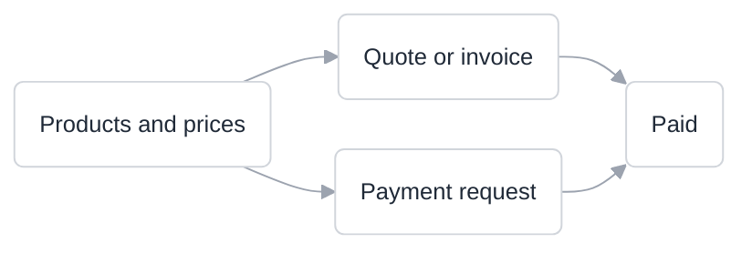

Your list of products or services, with prices, is kept in **Settings → Products and payments → Products and prices**. Quotes, invoices and payment requests pick from it.

## Add a product

<Steps>
  <Step title="Open the list">Choose **Add** in **Products and prices**.</Step>
  <Step title="Fill it in">**Name** and **Price** are needed. **GST rate** (0, 5, 12, 18 or 28%), **HSN or SAC**, **SKU or code**, **Unit** (hour, pc, month) and **Description** are optional.</Step>
  <Step title="Save">It appears in the list, ready to add to a quote, an invoice or a payment request.</Step>
</Steps>

You can edit a product, or hide it so it is not offered. Hidden products show as a count above the list. Use the search box to find one once the list is long.

## Paid in parts

Under **Paid in parts**, choose **Add a part** to split the price into named amounts, such as a *Deposit* and a *Balance*. A product can have up to 12 parts.

| Part | Amount |
| --- | --- |
| Deposit | The first amount |
| Balance | The rest |

When you [request a payment](/guides/payments#request-a-payment) from a lead, you choose the product or just one of its parts.

## Import many at once

<Steps>
  <Step title="Prepare a CSV">One row per product. **name** and **price** columns are needed; **sku**, **unit**, **gst**, **hsn** and **description** are optional.</Step>
  <Step title="Import CSV">Choose **Import CSV** and pick the file. Products with a name already in your list are skipped.</Step>
</Steps>

## Ask Marro

<Card title="Try asking" icon="message-circle">
  *"Add a product called Annual plan at 25,000"*

  *"Hide the Starter pack"*

  Marro shows the change and asks your approval before saving or hiding it.
</Card>
