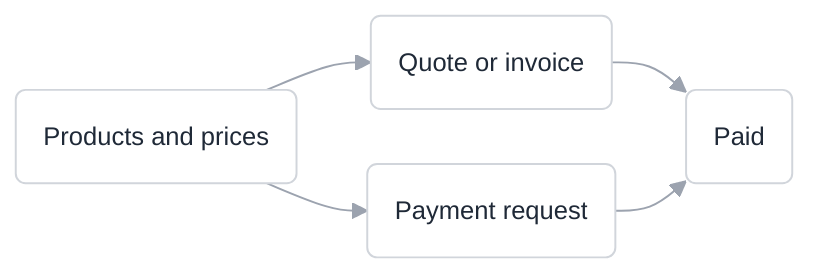
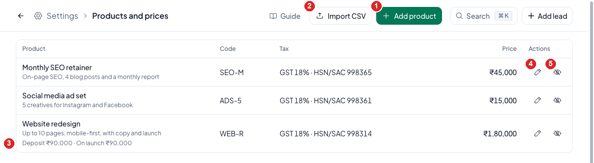
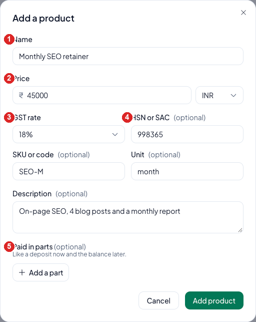

Your list of products or services, with prices, is kept in **Settings → Products and prices**. Quotes, invoices and payment requests pick from it.

<Frame>
  
</Frame>

1. **Add product**.
2. **Import CSV**: many at once (below).
3. A product paid in parts shows its parts under the name.
4. Edit it.
5. Hide it from new payment requests. **Show again** brings it back.

## Add a product

<Steps>
  <Step title="Open the list">Choose **Add product** in **Products and prices**.</Step>
  <Step title="Fill it in">**Name** and **Price** are needed. **GST rate** (0, 5, 12, 18 or 28%), **HSN or SAC**, **SKU or code**, **Unit** (hour, pc, month) and **Description** are optional.</Step>
  <Step title="Save">It appears in the list, ready to add to a quote, an invoice or a payment request.</Step>
</Steps>

You can edit a product, or hide it so it is not offered. Hidden products show as a count above the list. Use the search box to find one once the list is long.

<Frame>
  
</Frame>

1. **Name**.
2. **Price**, and its currency.
3. **GST rate**.
4. **HSN or SAC**.
5. **Description**, shown on quotes and invoices.

## Paid in parts

Under **Paid in parts**, choose **Add a part** to split the price into named amounts, such as a *Deposit* and a *Balance*. A product can have up to 12 parts.

| Part | Amount |
| --- | --- |
| Deposit | The first amount |
| Balance | The rest |

When you [request a payment](/guides/payments#request-a-payment) from a lead, you choose the product or just one of its parts.

## Import many at once

<Steps>
  <Step title="Prepare a CSV">One row per product. **name** and **price** columns are needed; **sku**, **unit**, **gst**, **hsn** and **description** are optional.</Step>
  <Step title="Import CSV">Choose **Import CSV** and pick the file. Products with a name already in your list are skipped.</Step>
</Steps>

## Services

The **Services** tab, next to **Products**, is the list of jobs you take on. Phone calls, chats, booking and Ask Marro all use this one list to sort what people ask for. Nothing is built in: every service is yours.

Each service has:

| Setting | What it does |
| --- | --- |
| **Name** | What you call the job. |
| **What callers say** | Words or phrases that mean this job, one per line. A phrase must appear as whole words in what the caller says; the longest match wins. |
| **Usually** | How urgent it normally is: Danger, Urgent or Standard. Urgent raises the lead's urgency. Danger never starts an emergency by itself, see [Emergencies and alerts](/guides/emergency-alerts). |
| **How it is booked** | **Book a time** (the agent offers real free times), **Quote visit** (a visit to price the job) or **Call back** (no time is booked, the team calls). |
| **Minutes** | How long it takes. Booking uses it instead of the appointment type's length. |
| **Questions to ask** | Up to 8 short questions asked once the job is known. |
| **Price bands** | Optional ranges (for example *Small job*, from 100 to 250). The agent only quotes a price from a band you set, in your words, and says what you write under **Said after a price**. A job that fits no band becomes a quote visit. |
| **Linked product** | Optional. With no price band, the product's price from **Products** is used. |

If a caller describes two jobs, each becomes its own line. If the agent is not sure which service a job is, it asks one question; if it is still unclear the job is a **General enquiry** and the team is asked to call back. Every job is kept on the call and on the lead's **Jobs** list, with the caller's own words, the answers and any price quoted.

**Add from a template** adds a starting list (no prices) that you then edit or hide. Hiding a service takes it out of calls and chats; past jobs keep its name.

## Ask Marro

<Card title="Try asking" icon="message-circle">
  *"Add a product called Annual plan at 25,000"*

  *"Hide the Starter pack"*

  *"Add a service called Boiler repair, urgent, book a time, 90 minutes, and ask where the boiler is"*

  *"Which of our services is a caller asking for if they say their tap is dripping?"*

  Marro shows the change and asks your approval before saving or hiding it.
</Card>
