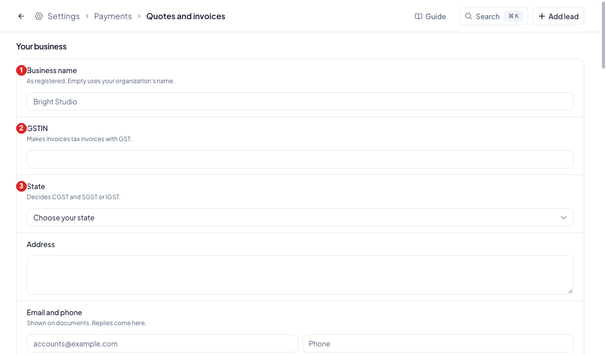

import { Flow } from "/snippets/flow.jsx";

Make quotes and invoices, send them, get paid and track the money, all from **Finance**. They are set up in **Settings → Payments → Quotes and invoices**; the items you sell are in [Products and prices](/guides/products-and-prices).

<Flow steps={["Quote", "Sent", "Accepted", "Invoice", "Paid"]} />

## Set it up

An administrator opens **Settings → Payments → Quotes and invoices**.

| Fill in | Notes |
| --- | --- |
| Business name, GSTIN, state, address, email, phone | Without a GSTIN, documents carry no GST. Outside India, tax follows your [regional settings](/guides/regional-settings) and you enter your registration number (ABN, VAT) |
| **Letter of Undertaking (LUT)** | India only. Its ARN and last day, so exports go without IGST. See [Customers abroad](#customers-abroad) |
| Payment, number prefixes, quote validity, due dates, terms | Also whether a paid invoice marks the lead converted, and reminders |
| **Products and prices** | Kept in their own list: see [Products and prices](/guides/products-and-prices) |
| **Document appearance** | **Modern**, **Classic** or **Compact**, a font, an accent colour and the logo from **Settings → Branding** |

<Frame>
  
</Frame>

1. **Business name**, as registered.
2. **GSTIN**: with it, invoices are tax invoices.
3. **State**: decides CGST and SGST, or IGST.

<Frame>
  
</Frame>

1. **Preview document**: a quotation or an invoice.
2. **Fit width** or **Actual size**.
3. The preview, as customers and the PDF show it.

## Make a quote or invoice

Open **Finance → Quotes → New quote** or **Finance → Invoices → New invoice**. A lead's **Finance** tab also has **Quote** and **Invoice**. A quote for a lead needs nothing else first: the lead is the customer.

<Steps>
  <Step title="Add items">Choose **Add products and services**, search by name or SKU, tick items, then **Add selected**. **New item** adds one that is not in your list. **Add blank line** types one from scratch.</Step>
  <Step title="Edit the lines">Change quantity, price and tax. **More details** on a line has the description, discount (*10%* or an amount), HSN/SAC and unit.</Step>
  <Step title="Preview">Switch between **Edit** and **Preview**. The PDF uses the same A4 layout.</Step>
  <Step title="Save or send">**Save draft** or **Save and send** (Ctrl or ⌘ + S, Ctrl or ⌘ + Enter). The footer shows the live total.</Step>
</Steps>

- Under India GST, tax is CGST and SGST inside your state, or IGST for another state. Under one tax rate (Australia's GST), each line is taxed or tax-free.
- Numbers are given on sending: quotes *QT-0001*, invoices *INV/2026-27/0001*, a new series each April.
- **Finance → Quotes** lists every quote. Search by number or customer and filter by **All**, **Drafts**, **Accepted** or **Void**.

## Customers abroad

Set the customer's **Country** and the document's **Currency** in the editor. A customer in another country makes it an export.

| Your business | What the export gets |
| --- | --- |
| India, with an LUT in force on the document's date | No IGST, any currency. It prints *"Supply meant for export under LUT without payment of IGST"* with your ARN |
| India, without an LUT | IGST at each line's rate, in rupees only |
| One-rate tax (Australia's GST, VAT) | No tax: a GST-free export |

The place of supply reads **Outside India** and the customer's country is printed under their address.

<Note>Your products' prices are in your own currency. On a document in another currency, enter each price yourself.</Note>

<Warning>An LUT lasts one financial year. Add the new one each April in **Settings → Payments → Quotes and invoices**, or exports carry IGST again.</Warning>

## After it is sent

| You can | Your customer's link can |
| --- | --- |
| **Send on WhatsApp** or email, **Copy link**, **Copy pay link** | **Accept** or **Decline** |
| **Record payment**, **Mark accepted** or **declined** | **Pay now** |
| **Make invoice**, **Duplicate**, **Void**, **Download PDF** | Download the PDF |

A document is *draft*, *sent*, *accepted*, *declined*, *partly paid*, *paid*, *void*, *expired* or *overdue*.

## Getting paid

<Steps>
  <Step title="Pay link">Uses the payment account you connected ([Payments](/guides/payments)).</Step>
  <Step title="Record by hand">Cash, UPI, bank transfer, card, cheque or other.</Step>
  <Step title="Paid in full">The lead is marked converted, to the stage set for "When a lead pays" or your first converted stage.</Step>
</Steps>

Reminders go before and after the due date by email, and on WhatsApp once your reminder template is approved.

## On the lead, in reports and automations

| Where | What |
| --- | --- |
| Lead's **Finance** tab | Quoted, invoiced, paid and due |
| **Finance → Revenue** | Revenue by month, source and person, and what is outstanding |
| [Automations](/guides/automations) | Triggers: quote sent, opened, accepted, declined, expires; invoice sent, paid, overdue, due soon. Actions: create and send a quote or invoice, send a payment link |

## Permissions

| Permission (Users → Roles) | Lets people |
| --- | --- |
| **Quotes and invoices** | Create, send and record payments |
| **Create leads** | Quote the leads assigned to them. Invoices, payments and others' leads need **Quotes and invoices** |

## Ask Marro

<Card title="Try asking" icon="message-circle">
  *"Quote Neha 10 hours of design at 2,000 an hour"*

  *"Record a 5,000 UPI payment on invoice 12"*

  *"Invoice Acme in the US 2,500 dollars for brand design"*

  Marro drafts the document, asks your approval and then offers to send it. Voiding stays on the page.
</Card>
