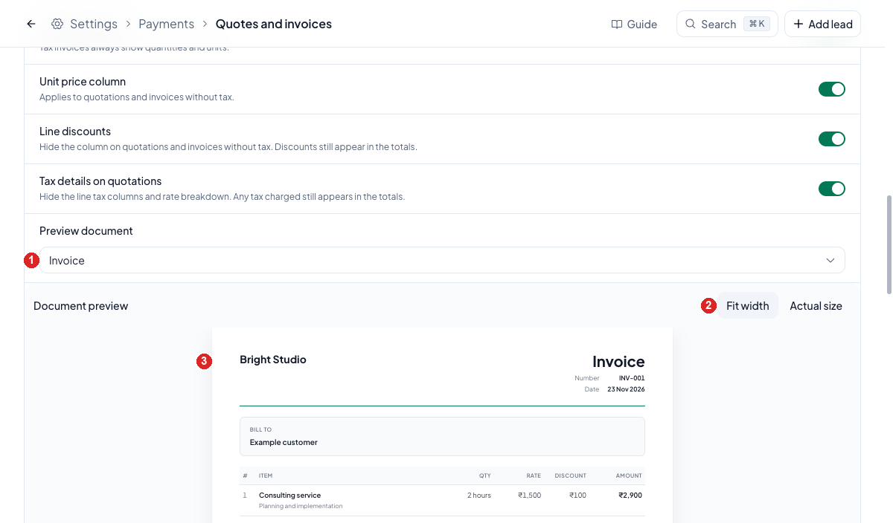
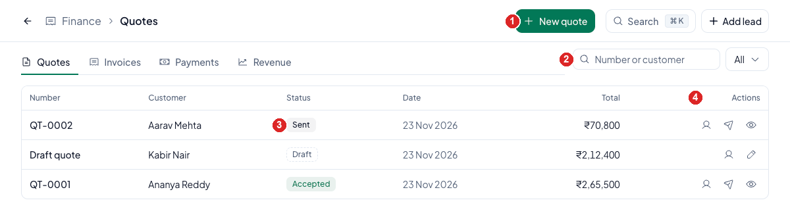
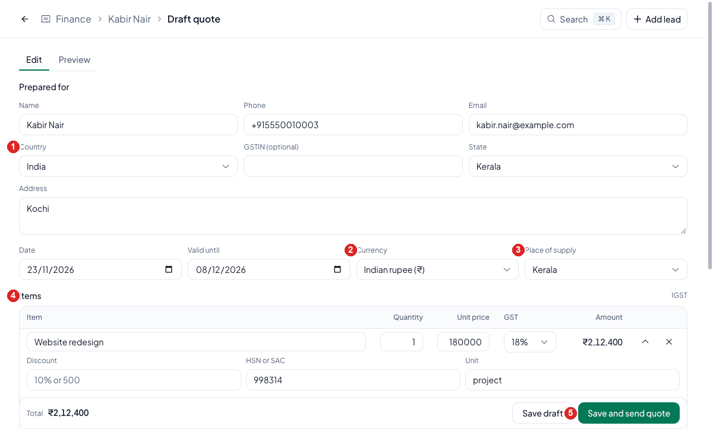
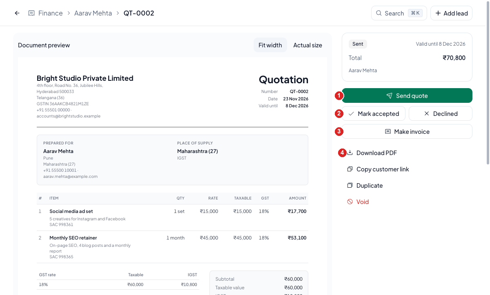
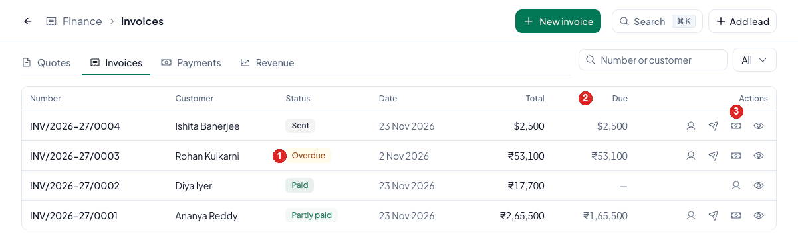
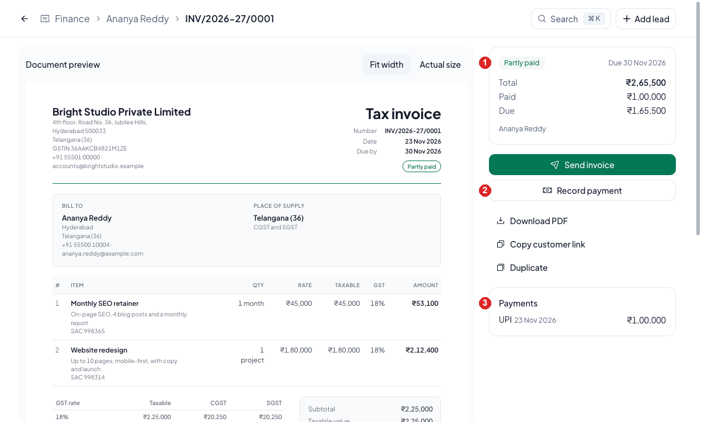
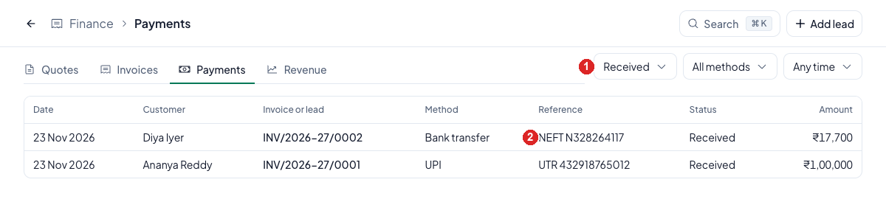
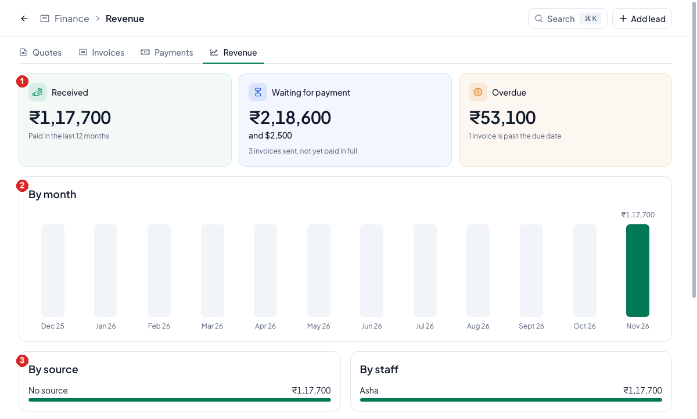
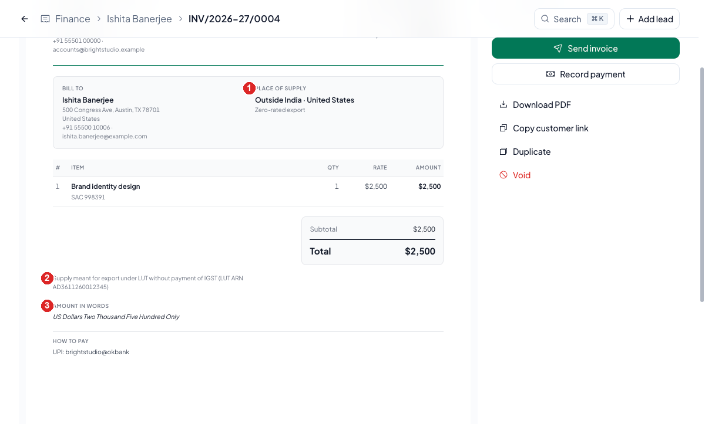

import { Flow } from "/snippets/flow.jsx";

Make quotes and invoices, send them, get paid and track the money, all from **Finance**. The items you sell are in [Products and prices](/guides/products-and-prices).

<Flow steps={["Quote", "Sent", "Accepted", "Invoice", "Paid"]} />

## Set it up

An administrator opens **Settings → Payments → Quotes and invoices**.

<Frame>
  
</Frame>

1. **GSTIN**: with it, invoices are tax invoices. Your state comes from it and decides CGST and SGST, or IGST.
2. **Letter of Undertaking (LUT)**: its ARN and last day, for [customers abroad](#customers-abroad). India only.

Below them: address, email and phone, how to pay, number prefixes, validity and due days, terms, reminders, and **Document appearance** (layout, font, colour, logo). Outside India, tax follows your [regional settings](/guides/regional-settings).

<Frame>
  
</Frame>

1. **Preview document**: a quotation or an invoice.
2. **Fit width** or **Actual size**.
3. The preview, as customers and the PDF show it.

## Quotes

<Frame>
  
</Frame>

1. **New quote**. A lead's **Finance** tab also has **Quote**.
2. Search by number or customer, and filter: **All**, **Drafts**, **Accepted**, **Void**.
3. Status: *draft*, *sent*, *accepted*, *declined*, *void*.
4. **Actions**: open the lead, send, view (edit for a draft).

## Make one

<Frame>
  
</Frame>

1. **Country**: the customer's. Another country makes it an export.
2. **Currency**: your own unless you choose another.
3. **Place of supply**: from the customer's state; **Outside India** for an export.
4. **Items**: **Add products and services** picks from your list; **Add blank line** types one. **More details** on a line has the discount, HSN/SAC, unit and description.
5. **Save draft** or **Save and send quote** (Ctrl or ⌘ + S, Ctrl or ⌘ + Enter).

Started from **Finance**, pick the customer from **Lead** above the fields: they fill in from the lead. Numbers are given on sending: *QT-0001*, *INV/2026-27/0001*, a new series each April.

## Send it and win it

<Frame>
  
</Frame>

1. **Send quote** on WhatsApp or by email, or copy the link.
2. **Mark accepted** or **Declined**. The customer can also accept or decline on their link.
3. **Make invoice**: once accepted, this is the next step.
4. **Download PDF**, **Copy customer link**, **Duplicate**, **Void**.

## Invoices and getting paid

<Frame>
  
</Frame>

1. *Overdue* once the due day passes; *partly paid* and *paid* follow payments.
2. **Due**: what is still to be paid.
3. **Record payment** straight from the list.

<Frame>
  
</Frame>

1. Total, paid and due.
2. **Record payment**: cash, UPI, bank transfer, card, cheque or other, with its reference. A pay link uses the account you connected in [Payments](/guides/payments).
3. **Payments** made against it.

Paid in full, the lead is marked converted, to the stage set for "When a lead pays". Reminders go before and after the due date by email, and on WhatsApp once your reminder template is approved.

## Payments and revenue

<Frame>
  
</Frame>

1. Filter by status, method and period.
2. The reference you recorded (UTR, cheque number).

<Frame>
  
</Frame>

1. **Received**, **Waiting for payment** and **Overdue**. Other currencies are shown apart, never added.
2. **By month**: the last twelve months.
3. **By source** and **By staff**, then every invoice still owed.

## Customers abroad

Set the customer's **Country** and the document's **Currency**. A customer in another country makes it an export.

| Your business | What the export gets |
| --- | --- |
| India, with an LUT in force on the document's date | No IGST, any currency |
| India, without an LUT | IGST at each line's rate, in rupees only |
| One-rate tax (Australia's GST, VAT) | No tax: a GST-free export |

<Frame>
  
</Frame>

1. **Outside India** and the country, *Zero-rated export*.
2. The declaration, with your LUT's ARN.
3. The amount in words, in the document's currency.

<Note>Your products' prices are in your own currency. On a document in another currency, enter each price yourself.</Note>

<Warning>An LUT lasts one financial year. Add the new one each April, or exports carry IGST again.</Warning>

## Permissions

| Permission (Users → Roles) | Lets people |
| --- | --- |
| **Quotes and invoices** | Create, send and record payments |
| **Create leads** | Quote the leads assigned to them. Invoices, payments and others' leads need **Quotes and invoices** |

## Ask Marro

<Card title="Try asking" icon="message-circle">
  *"Quote Neha 10 hours of design at 2,000 an hour"*

  *"Record a 5,000 UPI payment on invoice 12"*

  *"Invoice Acme in the US 2,500 dollars for brand design"*

  Marro drafts the document, asks your approval and then offers to send it. Voiding stays on the page.
</Card>
