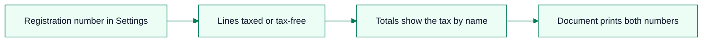

The country you chose at sign-up gives your organization its regional settings.

## Where it comes from

| Country | Currency | Dates and numbers | Dialling code | Week starts | Tax |
| --- | --- | --- | --- | --- | --- |
| India | Indian rupee | 13/11/2026, 1,25,000 | +91 | Monday | India GST (CGST, SGST, IGST) with GSTIN |
| Australia | Australian dollar | 13/11/2026, 125,000 | +61 | Monday | GST 10% with ABN |
| United Kingdom | British pound | 13/11/2026, 125,000 | +44 | Monday | VAT 20% with VAT number |
| United Arab Emirates | UAE dirham | 13/11/2026, 125,000 | +971 | Monday | VAT 5% with TRN |
| Singapore | Singapore dollar | 13/11/2026, 125,000 | +65 | Monday | GST 9% with GST registration number |
| Canada | Canadian dollar | 2026-11-13, 125,000 | +1 | Sunday | GST/HST 5% with business number |
| United States | US dollar | 11/13/2026, 125,000 | +1 | Sunday | No tax |
| Vietnam | US dollar | 13/11/2026, 125,000 | +84 | Monday | VAT 10% with tax code |

Your country and time zone stay as set at sign-up. The rest can be changed.

## Change it

An administrator opens **Settings → Business** and finds **Region**.

| Setting | What it does |
| --- | --- |
| **Currency** | New quotes, invoices, products and payments start in it. |
| **Dates and numbers** | How dates and amounts are written everywhere, including documents and the mobile app. |
| **Dialling code** | Added to numbers typed without one. A number typed with a country code (+44…) is kept. |
| **Week starts on** | Monday or Sunday. |
| **Tax** | *India GST*, *One tax rate* (name, rate, registration number label, prices include it or not) or *No tax*. |

**Save** keeps only what you changed. **Use country defaults** goes back to your country's settings.

## Tax on quotes and invoices

- With one tax rate, add your registration number (your ABN, for example) in **Settings → Quotes and invoices**.
- Without one, documents carry no tax and an invoice is not a tax invoice.
- Rupee totals round to the whole rupee. Other currencies keep their cents.
- A tax change affects new documents only. Each quote and invoice keeps the tax it was issued under.

## Getting paid

A pay link is offered when your connected payment account takes the invoice's currency. If not, the invoice says so and you record payments by hand.

## Ask Marro

<Card title="Try asking" icon="message-circle">
  *"What are our regional settings?"*

  *"Switch our currency to Australian dollars"*

  *"Our prices include GST"*

  Marro shows the exact change and asks before saving. Only an administrator can change them.
</Card>
