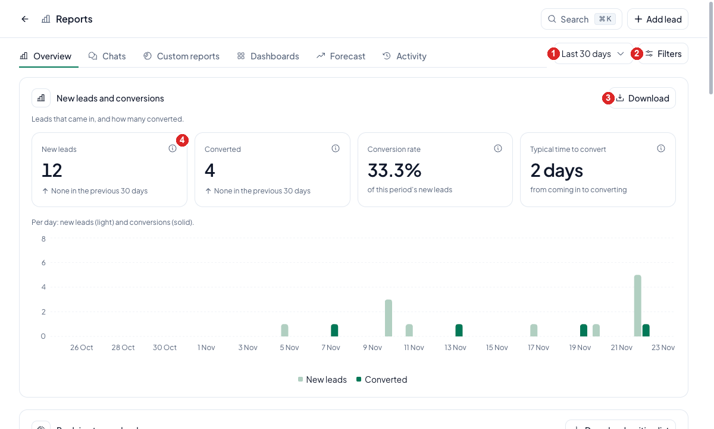
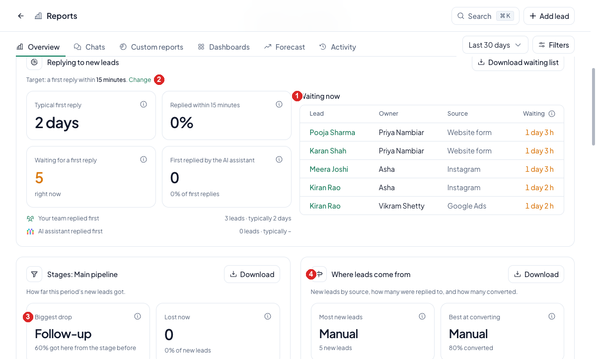
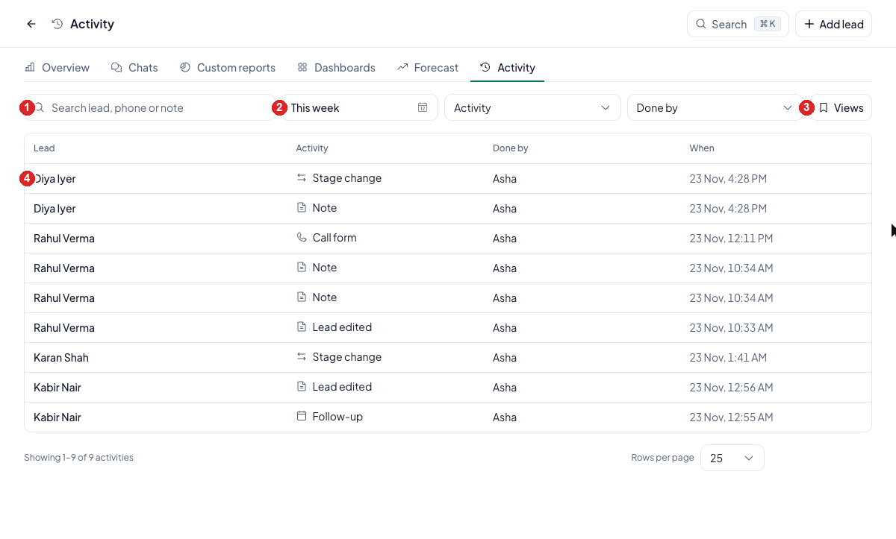

Open **Reports**. The tabs across the top are **Overview**, **Chats**, **Custom reports**, **Dashboards**, **Forecast** and **Activity**. Each tab's filters sit at the right of the tabs. Someone who sees only their own leads sees only their own figures.

## Overview

<Frame>
  
</Frame>

1. **Period**: today, the last 7, 30 or 90 days, this month, or **Choose dates**.
2. **Filters**: source, owner, pipeline and the stage leads are in now. The button shows how many filters are on.
3. **Download** saves a section as a spreadsheet (CSV).
4. **(i)** says exactly what a number counts. The line under a number compares it with the period before.

<Frame>
  
</Frame>

1. **Waiting now**: new leads nobody has replied to yet, longest wait first. Select one to open it.
2. **Change** sets the first-reply target.
3. **Stages**: how far this period's new leads got, and the **Biggest drop** between stages.
4. **Where leads come from**: new leads and conversions by source.

Further down: **Campaigns**, **How each person is doing** (calls, WhatsApp, follow-ups and conversions per person) and **Leads going quiet** (open leads by time since anyone last contacted them).

## Activity

<Frame>
  
</Frame>

1. Search by lead, phone or note.
2. The period. This week is the default.
3. **Views** saves a filtered list to come back to.
4. Select a row to see the activity in full, with **Open lead**.

Activity is for roles that may see everyone's activity.

## More reports

<CardGroup cols={2}>
  <Card title="Chats" icon="messages-square" href="/guides/chat-reports">How fast WhatsApp chats are answered and closed.</Card>
  <Card title="Custom reports and dashboards" icon="chart-bar" href="/guides/custom-reports">Your own reports, side by side.</Card>
  <Card title="Forecast" icon="trending-up" href="/guides/sales-forecasting">Expected sales and targets.</Card>
  <Card title="Campaigns" icon="megaphone" href="/guides/campaigns">What each campaign cost and brought back.</Card>
</CardGroup>

## Ask Marro

<Card title="Try asking" icon="message-circle">
  *"How many leads came in this month, and how many converted?"*

  *"Which source converts best?"*

  *"Who has the most overdue follow-ups?"*
</Card>
