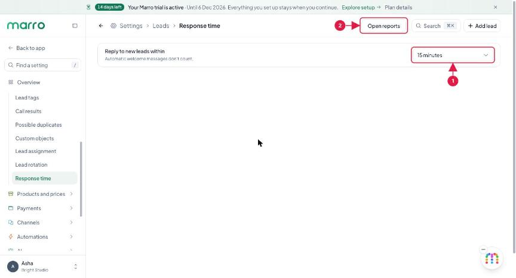

This sets the goal for a lead's first reply. Open **Settings → Leads → Response time**.

<Frame>
  
</Frame>

## Set the goal

<Steps>
  <Step title="Open Response time">In **Settings → Leads**.</Step>
  <Step title="Set how fast">Choose how fast every new lead should get its first reply.</Step>
</Steps>

## What counts

| Counts as a reply | Does not count |
| --- | --- |
| A message or call from your team | Automatic welcome messages |

## See how you are doing

| Where | Shows |
| --- | --- |
| **Open reports** | How your team is doing against the goal |

To pass on leads nobody has touched, see [Lead rotation](/guides/lead-rotation).

## Ask Marro

<Card title="Try asking" icon="message-circle">
  *"How fast does my team reply to new leads?"*

  Marro answers from your reports.
</Card>
