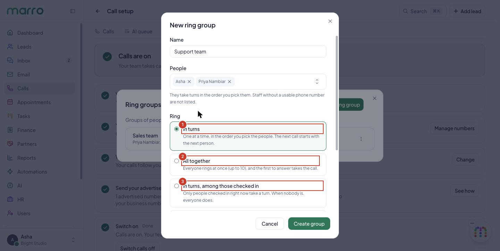
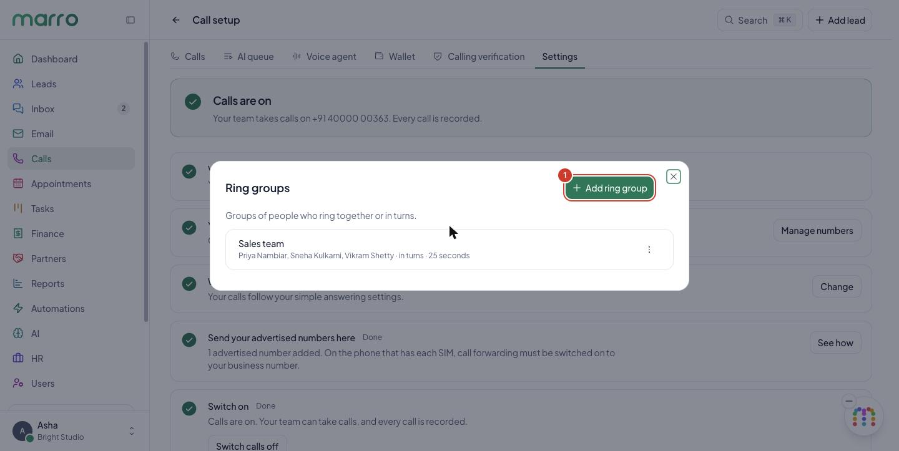

import { Flow } from "/snippets/flow.jsx";

A ring group is a named list of staff, such as *Shop A*. Open **Calls → Settings → More options → Ring groups**. To use a team you already have, choose the team instead.

## Add a ring group

<Frame>
  
</Frame>

<Steps>
  <Step title="Add ring group">Choose **Add ring group** in **More options → Ring groups**.</Step>
  <Step title="Fill it in">Add a **Name**, pick the **People** and **Ring for**.</Step>
  <Step title="Use it">In [Who answers](/guides/who-answers), choose **A ring group**.</Step>
</Steps>

## The five ring styles

<Frame>
  
</Frame>

| Ring style | How it rings |
| --- | --- |
| **In turns** | One person at a time. |
| **All together** | Everyone, up to 10. |
| **In turns, among those checked in** | Only people checked in. |
| **Fewest calls today** | Whoever has answered the fewest. |
| **The lead's owner first** | The owner, then the rest in turns. |

## Delete a group

A group still in use cannot be deleted. Change the rules or flows that use it first.

<Flow steps={["Group in use", "Switch rules to another group", "Delete the group"]} />

## Ask Marro

<Card title="Try asking" icon="message-circle">
  *"Who is in the Shop A ring group?"*

  Marro lists the people and how the group rings.
</Card>
