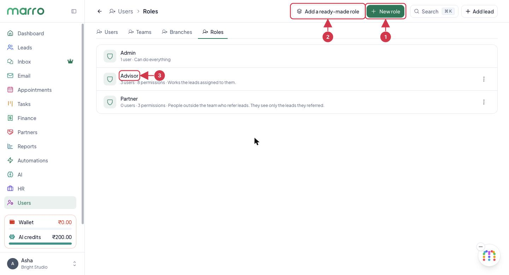
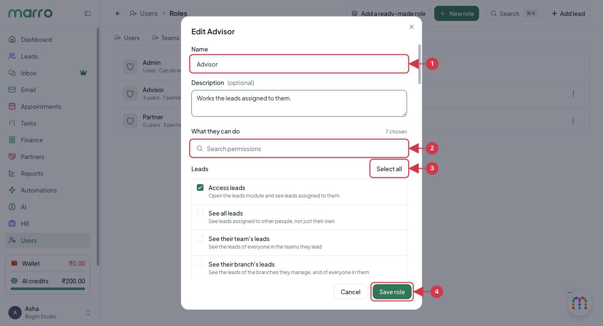

Open **Users → Roles**. A role is a named set of permissions you give to people.

## Ready-made roles

A new organization has **Admin**, **Advisor** (works leads) and **Partner** (refers leads). More ready-made roles are under **Add a ready-made role**.

<Frame>
  
</Frame>

| Ready-made role | Good to know |
| --- | --- |
| **Manager** | Has **Manage reports** |
| **Operations Head** | Add it from the list |
| **Editor** | Add it from the list |
| **Social Media Manager** | Has **Send email campaigns** |

## Edit a role

<Frame>
  
</Frame>

<Steps>
  <Step title="Open the role">Choose **New role**, or open one to edit it.</Step>
  <Step title="Name it and search">Change the **name**; **Search permissions** to find one.</Step>
  <Step title="Tick permissions">**Select all** ticks an area.</Step>
  <Step title="Save">Choose **Save role**.</Step>
</Steps>

Only permissions your subscription includes are counted.

## Permissions worth knowing

| Permission | Lets people |
| --- | --- |
| **Create leads** | Also quote the leads assigned to them |
| **Manage reports** | Share reports and dashboards, set a role's home dashboard, email reports. Admin and Manager have it |
| **Send email campaigns** | Write, test, send and schedule [email campaigns](/guides/email-campaigns). Admin and Social Media Manager have it |

## Ask Marro

<Card title="Try asking" icon="message-circle">
  *"Add a Manager role"*

  Marro shows the change and asks before saving.
</Card>
