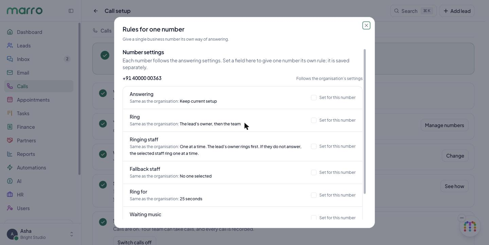

By default every number follows your organization’s settings. When one number needs its own handling, open **Calls → Settings → More options → Rules for one number**.

<Frame>
  
</Frame>

## Set a rule for a number

<Steps>
  <Step title="Open the rules">Go to **More options → Rules for one number** and find the number.</Step>
  <Step title="Choose what is different">Each row shows **Same as the organization**. Tick **Set for this number** on the row you want to change, such as **Answering**, **Ring**, **Ring for** or **Waiting music**.</Step>
  <Step title="Save">Rows you leave alone keep following the organization.</Step>
</Steps>

## What you can change

| Row | What it does |
| --- | --- |
| **Answering** | Keep your current setup, AI answers, staff answer, or staff in working hours and AI outside them. |
| **Ring** | The lead’s owner then the team, selected staff, one designated person, or a [ring group](/guides/ring-groups). |
| **Ringing staff** | One at a time, or all together. |
| **Ring for** | Seconds a phone rings before the call moves on. |
| **Waiting music** | What callers hear for this number. |

For rules that cover many numbers, use [Who answers](/guides/who-answers).

## Ask Marro

<Card title="Try asking" icon="message-circle">
  *"Make our Vizag number ring the sales team all together."*

  Marro prepares the change for you to approve.
</Card>
