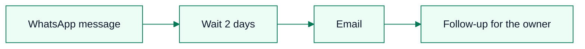

A sequence is a list of steps for one lead. Marro carries each lead through it and shows, on the lead, where they are and when the next step goes.

For something that starts from an event (a stage change, a form, a missed call) use an [automation](/guides/automations). For emails with your own sending windows see [email sequences](/guides/email-sequences).

## Steps

| Step | What it does |
| --- | --- |
| **WhatsApp message** | Sends a template outside WhatsApp's 24-hour window. Inside it, your own words go as a normal message. |
| **Email** | A subject and message from the owner's connected mailbox or the organization's sending address. |
| **Follow-up** | A follow-up for the lead's owner, due in a number of days. |
| **Wait** | Minutes, hours or days (up to 90 days), or until a time of day, optionally on a working day. |

Use details such as `{{lead.first_name}}` in the words. They are filled in for each lead.

## What stops a lead

Before each step Marro checks the lead and ends their place, saying why, if:

- they replied on WhatsApp or by email (a switch lets you keep going);
- they reached a won or lost stage (also a switch);
- the lead or the sequence was archived.

A lead who opted out of WhatsApp or unsubscribed from email is skipped for those steps. Follow-ups still go to your team.

## Quiet hours and limits

| Setting | Default |
| --- | --- |
| **Quiet hours** | 21:00 to 09:00 in your time zone. Steps wait until they end. |
| **Daily limit** | 200 messages a day. The rest go later. |

If WhatsApp refuses a message, Marro tries again an hour later, three times, then pauses that lead and says why. Meta bills WhatsApp conversations directly to your business.

## Where a lead is

Ask Marro, or have it **pause**, **resume** or **stop** one lead, or pause a whole sequence. Resume carries on at the step they were at. Editing a sequence changes it for leads who join later.

If Marro cannot confirm a step went out, it never resends on its own. The lead is paused with a note so you can check the chat.

Sequences are set up and run through Marro for now.

## Ask Marro

<Card title="Try asking" icon="message-circle">
  *"List my sequences"*

  *"Where is Asha in sequences?"*

  *"Create a sequence: WhatsApp the welcome template now, wait 2 days, then a follow-up for the owner"*

  *"Start it for these 20 leads"*

  Anything that sends or stops messages is shown to you for approval first.
</Card>
