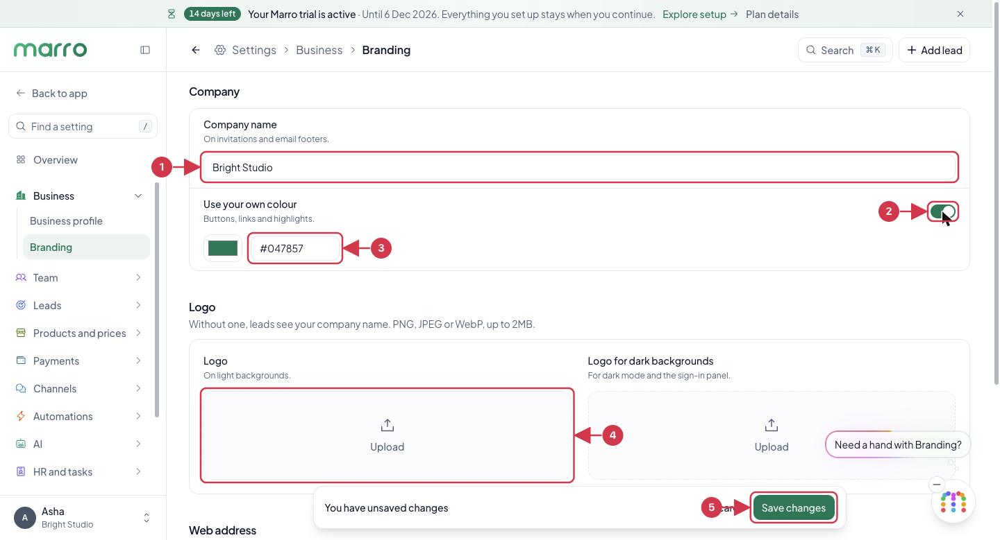
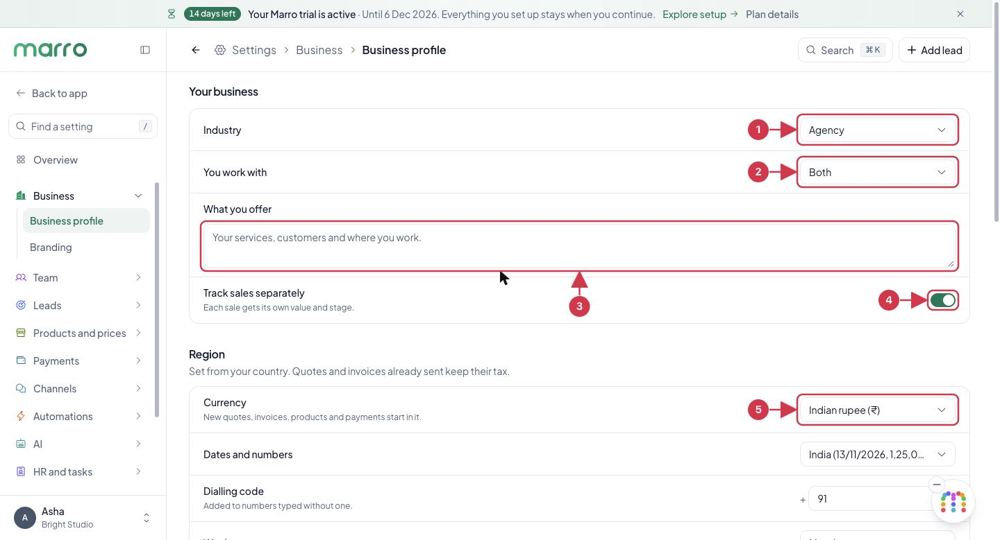
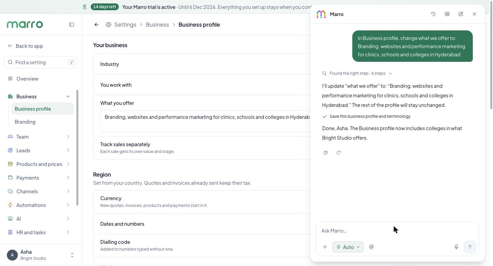

Open **Settings** from the main navigation. Only pages your role and enabled modules allow are listed, and organization settings are for the administrator.

## The areas

| Area | For |
| --- | --- |
| **Business** | Branding, business profile |
| **Team**, **Leads** | Users and leads, including custom objects |
| **Products and prices**, **Payments** | What you sell and how you get paid |
| **Channels**, **Calls**, **AI**, **Automations** | How you talk to customers |
| **HR and tasks**, **Integrations**, **Logs** | Everything else |
| **Plan and modules** | Subscription and **Modules** |

**Back to app** returns you to the page you left, with its filters.

## Find a setting

<Steps>
  <Step title="Search">Type a page name or a word such as billing, email or fields. Press **/** to focus the search.</Step>
  <Step title="Open">Press **Enter** for the first match, or **Escape** to clear.</Step>
  <Step title="Move around">On a computer the navigation stays beside the page; on a phone use the picker above it. **On this page** links jump to a section.</Step>
</Steps>

## Save changes

| Control | What it does |
| --- | --- |
| **Save changes** | Saves a page with a save bar |
| **Discard** | Restores saved values |
| Switches and choices | May save at once and confirm |

Every page has **Need a hand with …?** at the bottom right: it opens Ask Marro on that setting.

## Branding

Open **Settings → Business → Branding**. Your name, colour and logo appear on forms, booking pages, the customer portal and emails.

<Frame>
  
</Frame>

1. **Company name**.
2. The **Use your own colour** switch.
3. The colour: type or pick it.
4. **Upload logo**. You can add one for dark backgrounds too.
5. **Save changes**.

## Business profile

Open **Settings → Business → Business profile**. The assistant and AI agents read it.

<Frame>
  
</Frame>

1. **Industry**.
2. **You work with**.
3. **What you offer**.
4. **Track sales separately**.
5. **Currency**.

<Frame>
  
</Frame>

## Subscription and usage

**Plan and modules → Subscription** shows your plan and renewal.

| Good to know | |
| --- | --- |
| Cancelling | Two confirmation steps, no refund of fees paid, access until the period ends |
| Usage | Active users, automations and organizations you created; extra users show their charge |

See [Billing](/guides/billing) and [AI usage](/guides/ai-usage). Closing the organization is a separate action at the end of settings.

## Ask Marro

<Card title="Try asking" icon="message-circle">
  *"In Business profile, change what we offer to: Branding and websites for clinics in Hyderabad"*

  Marro fills the field on the page and says Done.
</Card>
