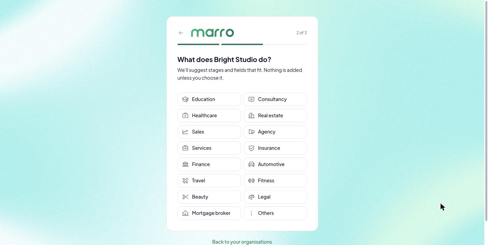
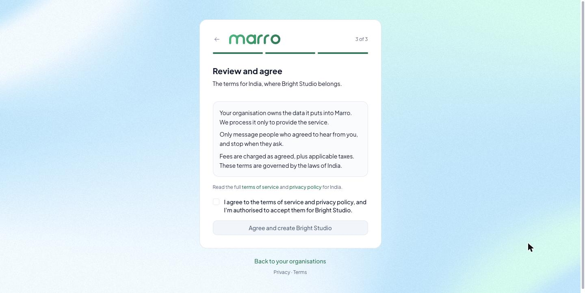
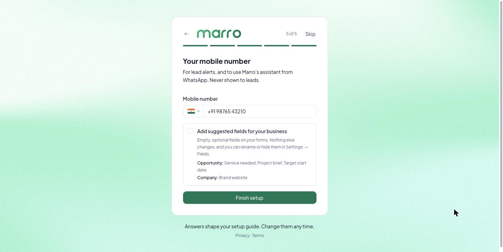
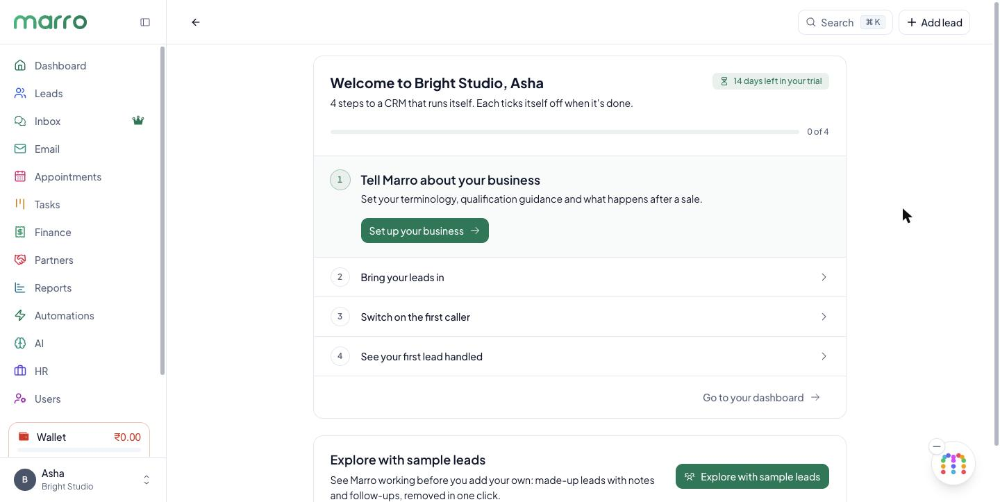

Sign up at [app.marro.si/signup](https://app.marro.si/signup). The trial is free for 14 days and needs no card.

<Note>
**Continue with Microsoft** works only with an address Microsoft has confirmed for your company's domain, or a personal Microsoft account. If it says the address isn't verified, use Google or your work email.
</Note>

<Steps>
  <Step title="Your email and account">
    Choose **Continue with Google** or **Continue with Microsoft**, or enter your work email. With Google or Microsoft there is no password or emailed code. Otherwise enter your name and a password of at least 8 characters.
  </Step>
  <Step title="Your company">
    Its name becomes your workspace. Choose its **country** and **time zone**. They can't be changed later: they decide your terms, currency and how dates are counted. Enter your phone number here too.

    <Frame>
      
    </Frame>
  </Step>
  <Step title="Verify your phone">
    Press **Send WhatsApp code**, enter the six-digit code and press **Verify phone number**. It is required before a workspace is created, and email cannot replace it. The code lasts five minutes; resend after 60 seconds. Five wrong tries need a new code.
  </Step>
  <Step title="What your business does">
    Pick the closest industry, or **Others**. It decides your agent templates and suggestions. Every workspace starts with the same general lead stages, fields and call outcomes; industry ones are offered later and added only if you choose.

    <Frame>
      
    </Frame>
  </Step>
  <Step title="Review and agree">
    Read the summary, terms of service and privacy policy for your country, then tick the box to agree. You can't continue without it. Marro records what was accepted, when, and from which IP address and browser.

    <Frame>
      
    </Frame>
  </Step>
  <Step title="Confirm your email">
    Enter the 6-digit code from the email, or open its link and press **Confirm**. Nothing is created until your phone and email are both confirmed.
  </Step>
</Steps>

## Setup questions

Five short questions follow. You can skip any.

<Frame>
  
</Frame>

| Question | What it changes |
| --- | --- |
| Your role | Kept for your workspace |
| How many people sell or follow up | **Just me** removes "Invite your team" from the setup guide |
| Where your leads come from | Lists those connections first, such as Meta lead ads or [webhook lead sources](/guides/webhooks) |
| What Marro should do first | Suggests a first agent: AI calls, chat receptionist or lead qualifier |
| Your mobile number | Used for lead alerts and the [assistant](/guides/assistant) on WhatsApp. Leads never see it |
| Add suggested fields | Unticked. Tick it to add your industry's empty, optional fields |

## Welcome

The setup guide opens on **Welcome**. To change your answers later, open `/setup` or ask the assistant.

<Frame>
  
</Frame>

**Request a demo or callback** on **Welcome** contacts the Marro team. Signing up alone does not request a call. Next: [Set up your organization](/guides/organization-onboarding).

## When the terms change

Each country has its own terms and privacy policy, for example [Australia's terms](https://app.marro.si/legal/terms/au). Read yours at `app.marro.si/legal/terms/<country>` and `app.marro.si/legal/privacy/<country>`.

| When | Who is asked |
| --- | --- |
| Terms or privacy policy change | Each administrator, next time they open Marro |
| Other users | Not asked: administrators accept for the organization |

## Protect your sign-in

<Card title="Sign-in security" icon="shield-check" href="/guides/two-step-sign-in">
  Open **Sign-in security** in your account menu to add an authenticator or passkey and save backup codes. If your organization requires it, finish before its seven-day deadline.
</Card>
