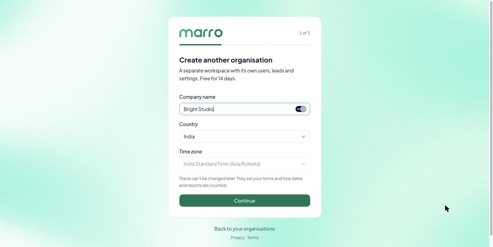

Sign up at [app.marro.si/signup](https://app.marro.si/signup). The trial is free for 14 days and needs no card.

<Note>
**Continue with Microsoft** works only with an address Microsoft has confirmed belongs to your company's domain (or to a personal Microsoft account). If it says the address isn't verified, use Google or your work email instead.
</Note>

<Steps>
  <Step title="Your email">
    Choose **Continue with Google** or **Continue with Microsoft**, or enter your work email. With either, Marro skips the password and the emailed code.
  </Step>
  <Step title="Your account">
    Enter your name and a password of at least 8 characters.
  </Step>
  <Step title="Your company">
    Its name becomes your workspace. Choose its **country** and **time zone**; both start from your device. They can't be changed later: they decide which terms apply, your currency, and how dates and reports are counted.

    <Frame>
      
    </Frame>
  </Step>
  <Step title="Verify your phone">
    Enter your phone number on the company step. The next step is **Verify your phone number**: press **Send WhatsApp code**, enter the six-digit code from WhatsApp and press **Verify phone number**. Verification is required for email, Google and Microsoft signup before you choose your business type or create a workspace. The code expires after five minutes; resend is available after 60 seconds. Five incorrect attempts require a new code. Changing your phone number or email requires verification again. Email cannot substitute for the phone code.
  </Step>
  <Step title="What your business does">
    Pick the closest industry, or **Others** if none fits. Your choice decides which agent templates and suggestions you see. It doesn't add anything to your workspace: every new workspace starts with the same general lead stages, fields and call outcomes. Industry stages and fields are offered later, listed in full, and added only if you choose them.

    <Frame>
      
    </Frame>
  </Step>
  <Step title="Review and agree">
    Read the short summary and the full terms of service and privacy policy for your country. Then tick the box to confirm that you agree and that you may accept them for your organisation. You can't continue without agreeing. Marro keeps a record of what was accepted, when, from which IP address and in which browser.

    <Frame>
      
    </Frame>
  </Step>
  <Step title="Confirm your email">
    Enter the 6-digit code from the email, or open its link and press **Confirm**. Nothing is created until your phone is verified and your email is confirmed.
  </Step>
</Steps>

## Setup questions

Next come five short questions. You can skip any of them.

<Frame>
  
</Frame>

| Question | What it changes |
| --- | --- |
| Your role | Kept for your workspace. |
| How many people sell or follow up | **Just me** removes "Invite your team" from the setup guide. |
| Where your leads come from | Lists the ways to connect those sources first, such as Meta lead ads or [webhook lead sources](/guides/webhooks). |
| What Marro should do first | Suggests the first agent: the first caller for AI calls, the chat receptionist for WhatsApp and other chats, or the lead qualifier for fast replies. |
| Your mobile number | Starts with the number verified during signup and is saved on your account, for lead alerts and for using the [assistant](/guides/assistant) from WhatsApp. Leads never see it. |
| Add suggested fields for your business | Shown with your mobile number when your industry has suggested fields. Unticked; tick it to add those empty, optional fields to your forms. Nothing else is added. |

Phone verification proves access to the number at signup. It does not request a demo, a callback or marketing messages. If a WhatsApp code cannot be sent, check that your number has WhatsApp and retry after a minute. You cannot create a new self-serve workspace without completing phone verification. Existing users keep their current sign-in.

After the questions, the setup guide opens on **Welcome**. To change your answers later, open `/setup` again, or ask the assistant.

<Frame>
  
</Frame>

If **Request a demo or callback** appears on **Welcome**, use it to contact the Marro team. You can ask a question by email, or share a phone number when you request a demo or callback. Completing signup by itself does not request a call.

Next: [Set up your organization](/guides/organization-onboarding) and take your first enquiry through to a follow-up.

## When the terms change

Each country has its own terms of service and privacy policy: the governing law, the taxes added to fees, the consumer rights nothing in them takes away, and the privacy law that applies are your country's. An Australian organisation's terms, for example, are governed by the laws of New South Wales and keep its rights under the Australian Consumer Law. Read your country's at `app.marro.si/legal/terms/<country>` and `app.marro.si/legal/privacy/<country>`, such as [Australia's terms](https://app.marro.si/legal/terms/au); the plain `/legal/terms` page shows India's.

When the terms or privacy policy for your country change, Marro asks each administrator to review and accept them the next time they open Marro. Other users aren't asked: the organisation accepts through its administrators.

## Protect your sign-in

After setup, open **Sign-in security** in your account menu to add an authenticator or passkey and save backup codes. See [Two-step sign-in](/guides/two-step-sign-in). If your organization requires it, complete setup before its seven-day deadline.
