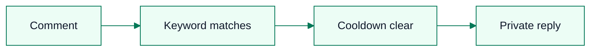

Administrators manage comment rules in **Inbox → Comments**. A rule watches a connected Instagram account or Facebook Page for a keyword and sends a private reply.

<Note>
Facebook comment sending is not available. Comment screens are awaiting release validation.
</Note>

## Make a rule

<Steps>
  <Step title="Choose an account">
    A connected Instagram account or Facebook Page.
  </Step>
  <Step title="Add keywords">
    At least one. Matching ignores capital letters and finds the keyword inside the comment. Post IDs are optional.
  </Step>
  <Step title="Write the reply">
    Set a **cooldown** from one minute to seven days.
  </Step>
  <Step title="Test it">
    Preview tests a sample. It sends nothing.
  </Step>
</Steps>

Lower priority numbers run first, and only one rule matches each comment. The cooldown applies to the same person on the same account, across rules.

## Turn sending on

| Step | Detail |
| --- | --- |
| Save the rule | Does not start sending |
| Activate the account | An administrator does this for each account |
| Grant comment permission | Reconnect Instagram and allow comments. Do it again after 24 hours or a token change |
| Turn a rule off | Stops its waiting replies |

Comments that arrive while sending is off are recorded but never replied to later.

## Instagram limits

| Limit | Detail |
| --- | --- |
| One private reply | Per comment, within seven days |
| Further replies | The person must respond first |
| Not included | Follow-up sequences, automatic leads |

## Statuses

| Status | Meaning |
| --- | --- |
| Pending | Waiting to be sent |
| Sending | Being sent now |
| Sent | Accepted by Meta, not necessarily read |
| Refused | Meta rejected it |
| Uncertain | May have gone; not retried automatically |
| Blocked | Verification or activation stopped it |
