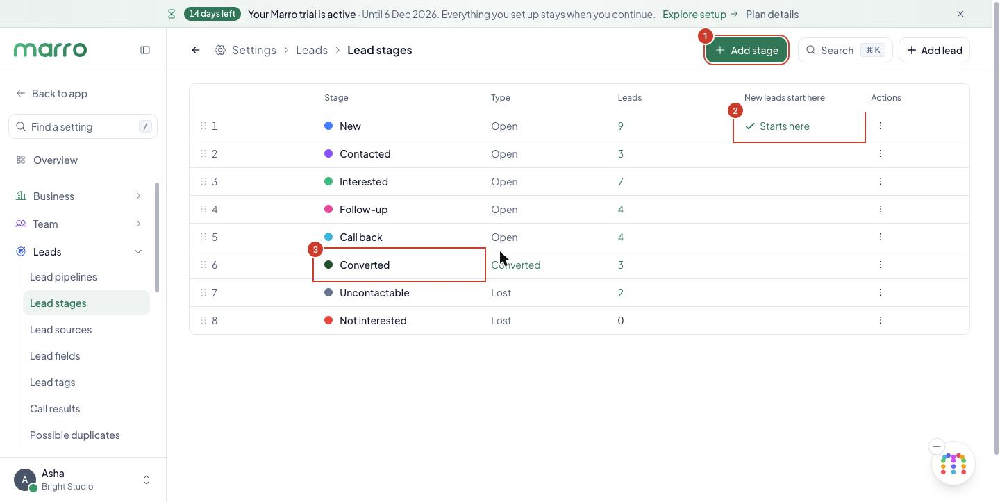
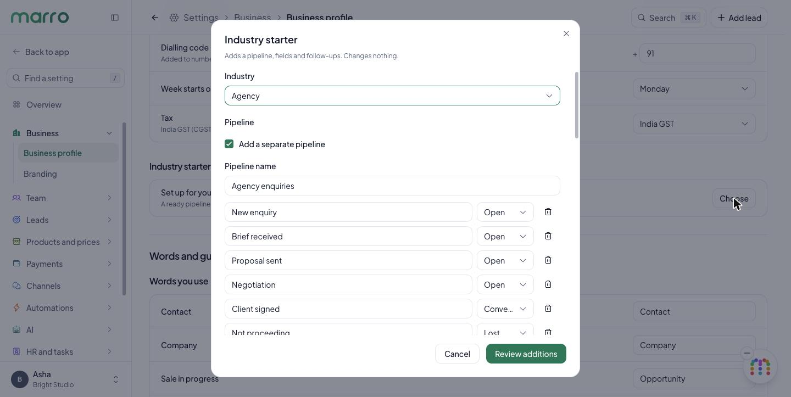

Stages are the steps a lead moves through, from new to won or lost. Open **Settings → Leads → Lead stages**.

<Frame>
  
</Frame>

1. **Add stage** adds a new one.
2. **Starts here** marks the stage new leads go into.
3. **Converted** is the type of a stage that counts a lead as won.

Use the arrows to reorder. The **…** menu edits a stage, starts new leads there, archives or deletes it.

## What a stage means

| Type | Meaning |
| --- | --- |
| **Open** | Still being worked |
| **Converted** | The lead became a customer |
| **Lost** | The lead will not go ahead |

When a lead moves into a converted stage from one that is not, Marro tells the owner and the organization's admins by email, WhatsApp and the app, once per conversion. The person who moved it is not told.

## Add or change a stage

<Steps>
  <Step title="Add stage">Choose **Add stage** and name it.</Step>
  <Step title="Pick its meaning and colour">Under **Meaning**, choose **Open** (still being worked), **Converted** (reached the goal) or **Lost** (closed without it), then a **Colour**.</Step>
  <Step title="Start new leads here">Optional: in the **…** menu, start new leads at this stage.</Step>
</Steps>

## Archive, restore or delete

| You want to | Do this |
| --- | --- |
| Stop using a stage | **Archive** it |
| Bring it back | **Restore** |
| Remove it for good | **Delete** |

## Stages for your industry

**Stages for your industry** suggests a set for the industry you chose. Choose which to add; they go after your own, and a set you already have is not added again.

<Frame>
  
</Frame>

Each pipeline has its own stages: see [Pipelines](/guides/pipelines).

## Ask Marro

<Card title="Try asking" icon="message-circle">
  *"Add a Site visit stage after Contacted"*

  Marro shows the change and asks before saving.
</Card>
